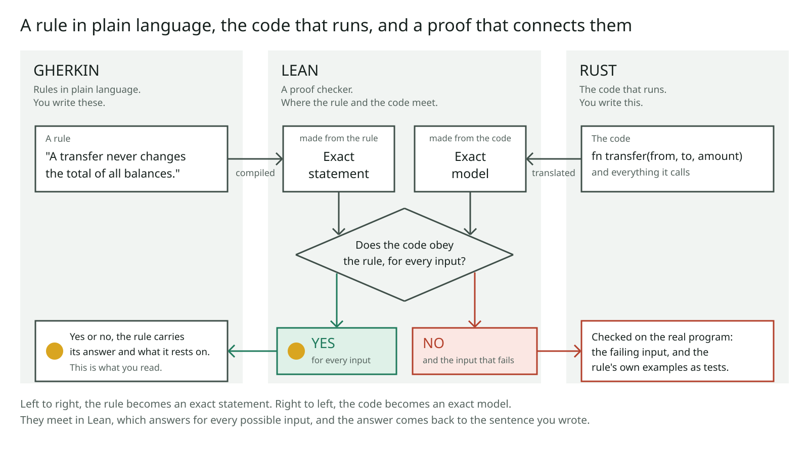
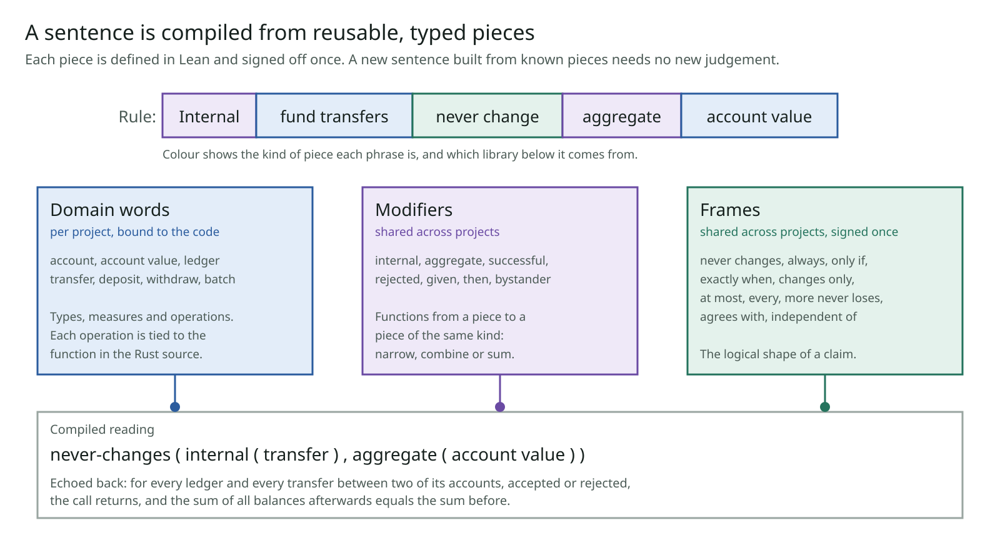

# lean-rosette

**Plain-language rules about your software, each one proved against the code that runs.**

Imagine every sentence in your requirements came with an answer: *yes, for every possible input*, or *no, and here is the case that breaks it*. Not a test that happened to pass. An answer for all cases, attached to a sentence anyone on the team can read.

This project connects three things that already exist to make that possible: **Gherkin** for the sentences, **Rust** for the code, and **Lean** to prove one against the other.



Research prototype, November 2026, Apache-2.0. [Architecture](docs/ARCHITECTURE.md) · [Results](docs/RESULTS.md) · [Plan](docs/PLAN.md)

## What you end up with

A list of sentences about your system, each tied to what the code provably does. These are real, from the two small example programs in this repository:

| The rule, as written | The answer |
|---|---|
| A transfer never changes the total of all balances. | **Yes**, for every input |
| A batch never changes the total of all balances of the ledger. | **Yes**, for every input |
| For a lookup, the result is the balance of the account in the ledger. | **Yes**, for every input |
| A transfer for which the amount is not more than the sender's balance is always accepted. | **No.** It fails when the receiver's balance is already at the maximum |
| A computation of the total is always accepted. | **No.** It fails when the balances add up to more than the maximum |
| A deposit earns interest. | **Not understood.** "Earns interest" is not in the vocabulary |

Three things to notice:

- **"Yes" means every case,** not the cases someone thought to test.
- **The fourth rule sounds right and its tests passed.** It is still false, and the answer says exactly where. Here the code was correct and the sentence had forgotten a case.
- **A sentence the system cannot read is refused.** It never guesses.

Over time the list becomes the description of the system that people trust, because every line in it has been checked against the code.

## Why it matters

Formal verification has been possible for decades and rare in practice, for three reasons:

1. **Proofs were expensive to write.** Language models are changing that fast.
2. **Nobody who owns the requirement can read the formal statement.** A proof of the wrong statement is worthless, and it looks exactly like a proof of the right one.
3. **Every project starts from zero.** Nothing accumulates.

As proofs get cheap, the scarce things become *knowing what was actually proved* and *not starting over each time*. Those two are what this project works on.

The aim is for formally modelled software to be the default, not the exception.

## Why it can scale: reusable pieces



A sentence is not interpreted as a whole. It is compiled from pieces, each defined once and reviewed once:

- **Frames** are the logical shapes of claims: *never changes*, *always*, *only if*, *exactly when*. There are a couple of dozen, shared by every project.
- **Modifiers** narrow or combine: *internal*, *aggregate*, *successful*.
- **Domain words** are the nouns and verbs of one system, tied to its actual code.

A new sentence built from known pieces needs no new definitions. Trust grows with the size of the vocabulary, not with the number of sentences, so the hundredth rule is far cheaper than the first.

The same principle applies at every layer: shared proofs for common patterns in code, a written profile of Rust that translates cleanly, generated tests. Libraries are what turn a research exercise into something routine.

## Built from tools that already work

Nothing here is a new prover, translator or test runner. The work is in connecting them end to end and making the answer legible.

| Asset | What it is | What it does here |
|---|---|---|
| **Gherkin** | The plain-language format many teams already use for behaviour tests | Holds the rules. The same file still runs as ordinary tests |
| **Rust** | A language whose ownership rules make code analysable | The implementation being checked |
| **Lean** | A proof checker with a small trusted core, and the largest library of formal mathematics | Where the rule and the code meet, and where the proof is checked |
| **Aeneas** | A translator from Rust to Lean | Turns the code into an exact model |
| Property tests, bounded checking | Fast ways to hunt for a failing case | Find most mistakes before a proof is attempted |

What this project adds is the vocabulary that gives a sentence one exact meaning, the checks that keep a "yes" honest, and a report that says what each answer rests on.

## Where it stands

It works end to end on small examples and has been tried on one real system. It is not yet something you can install and point at your own code.

- **Working:** a few dozen rules about two small example programs, each with an answer; a vocabulary of 23 frames; checks that the tool is not fooling itself.
- **On real code:** a model of the access-decision logic in a production system matched the real implementation on about 400,000 generated cases, and testing its plain-language guarantees surfaced six known edge cases and fifteen more.
- **Not yet:** installation and use on a project you bring; trials with people instead of language models as readers; sign-off of the vocabulary by a person.
- **Honest limits:** the first step, from a sentence to its exact meaning, can never be proved, only kept small enough to review. Proof today reaches code written in a restricted style of Rust. Compiler and hardware are taken on trust.

Every question tested so far, including the ones that came back negative, is in [docs/RESULTS.md](docs/RESULTS.md).

## Go deeper

| If you want | Read |
|---|---|
| How it works in detail, and what each answer rests on | [docs/ARCHITECTURE.md](docs/ARCHITECTURE.md) |
| A full report for real rules | [slice/out/report.md](slice/out/report.md) |
| How sentences are built from pieces | [docs/VOCABULARY.md](docs/VOCABULARY.md) |
| Results, experiments and the plan | [docs/RESULTS.md](docs/RESULTS.md), [docs/EXPERIMENTS.md](docs/EXPERIMENTS.md), [docs/PLAN.md](docs/PLAN.md) |
| Where this could go | [brainstorm/SUMMARY.md](brainstorm/SUMMARY.md) |
| The related work on making large proofs navigable | [out/FINDINGS.md](out/FINDINGS.md), [out/corpus/FINDINGS.md](out/corpus/FINDINGS.md) |
| Setup, decisions and the task list | [docs/SETUP.md](docs/SETUP.md), [DECISIONS.md](DECISIONS.md), [TODO.md](TODO.md) |

```sh
export PATH="$HOME/.elan/bin:$HOME/.cargo/bin:$PATH"
cd slice && ./run.sh      # runs the examples; report in slice/out/report.md
```
