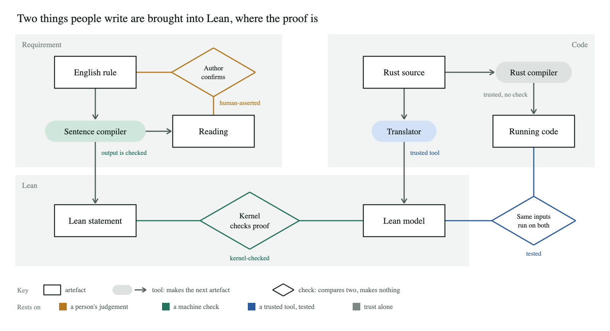

> **This page is a target, not the current state.** It is the README this project would have at a credible first public release, written before the release exists. The real README is [`../README.md`](../README.md); what is true today is in [`SCOPE.md`](SCOPE.md).
>
> A statement followed by a small number is **not true today**; the number links to [the gap table in SCOPE.md](SCOPE.md#appendix-what-the-target-readme-claims-that-is-not-true-today). Statements with no number are true today on the two example crates, by the repository's own reports of 2026-11-10. Nothing was re-run for this page or reproduced outside the project. Blocks of output are trimmed from today's real report unless marked.

# Readback

*Working name <sup>[1](SCOPE.md#c1)</sup>*

**Write a rule about your Rust decision logic as one sentence. Readback prints back exactly what it took the sentence to mean, in English the owner of the policy can check. It then tests your code against that meaning and, where a function is small and pure enough, proves it for every input of a model of the code. The report says which of those you got and what each rests on.**

```text
Rule: A transfer for which the amount is not more than the sender's balance is always accepted
  Verdict   REFUTED (false at a concrete input, kernel-checked)
            counterexample   sender = 1, receiver = 18446744073709551615, amount = 1
  Examples  2 of 2 pass on the compiled Rust; 2 of 2 pass on the Lean model
```

The rule reads like policy, and both of its example tests pass. At this input the sender holds 1 and the receiver holds the largest balance a wallet can have, so the code rejects the transfer to avoid overflow. **The code is right and the sentence is wrong.** That gap, between what a policy says and what the code does, is what Readback is for.

- **One fixed meaning, printed back.** A sentence is assembled from a small catalogue of reviewed phrases, never guessed by a language model. A sentence the catalogue cannot express is refused.
- **Checks generated from the sentence.** Example rows, a property test and a bounded check come from the same reading <sup>[3](SCOPE.md#c3)</sup> <sup>[4](SCOPE.md#c4)</sup>, so a rule and its tests cannot drift apart.
- **A proof where the code fits, and never one green tick.** Each link from sentence to compiled code is listed with its kind of evidence: checked by a proof kernel, tested, trusted to a tool, or asserted by a person.
- **The second rule costs less than the first.** A new sentence built from phrases already reviewed needs no new definitions and one human act: reading its readback <sup>[22](SCOPE.md#c22)</sup>.

**Status: early release (0.1).** Readbacks, tests and bounded checks run on a crate you bring <sup>[3](SCOPE.md#c3)</sup>. Proofs run on crates written to the [supported profile](#scope) <sup>[5](SCOPE.md#c5)</sup>. The phrase catalogue is edition 0, signed provisionally <sup>[8](SCOPE.md#c8)</sup>. It covers one pure call at a time: no I/O, concurrency, time or protocol state machines.

Two things this page depends on have no result yet. If people do not catch a wrong readback <sup>[9](SCOPE.md#c9)</sup>, the English is an index for experts and not a way to trust a rule. If no crate outside our examples gets through the proof route <sup>[13](SCOPE.md#c13)</sup>, this is a generator of tests with a fixed reading, and the page should say so.

## What it is

A command-line tool, a catalogue of a few dozen phrases, and a set of checkers. You write a rule as one sentence of restricted English. The tool compiles it into one formal statement, built from catalogue phrases such as *never changes* and *is accepted only if* and from words you bind to your own code, and prints that statement back in English with every assumption it added. It then gathers evidence that your code obeys the statement and reports what the evidence rests on.

## What it is not

- **Not free English.** A sentence outside the vocabulary is refused, with the nearest forms it knows. Expect to reword: 13 of the 14 rule lines in our own examples had to change before they compiled.
- **Not a reason to learn Lean.** Readbacks, example rows, property tests and bounded checks need cargo and Kani. A proof needs someone, or an agent, to write Lean: a few lines for straight-line code, about six per line of Rust for a loop.
- **Not a proof tool for most crates.** Proofs need code in the supported profile. On ten real crates, 35% of functions translated with patches we carry: 82% of nine crates and none of the tenth. Translating is not proving, and no proof has been done on code we did not write <sup>[13](SCOPE.md#c13)</sup>.
- **Not a proof about your running system.** "Proved" means Lean's kernel accepted a proof that the printed reading holds for every input of a model of one pure call, generated from your source by Aeneas, a research translator. The translator, its hand-written models of standard-library functions, the compiler and the hardware are trusted and named in the report.
- **Not a prover, a translator or a test runner.** It drives Lean, Aeneas, Kani and proptest. Where we changed one, the change is [listed](#scope).

## If you already run proptest, a fuzzer or Kani

Keep them. Readback drives proptest and Kani, and it will not find many bugs a good property test misses. On our two example crates (45 and 85 lines, written for this project), generated mutants made a rule false in 212 rule-and-mutant pairs. Boundary-weighted property tests found all 212, the bounded check 209 and the example rows 144. The harnesses were written by hand <sup>[3](SCOPE.md#c3)</sup>. **No injected bug needed a proof to be caught.**

What it adds is what a test suite leaves implicit:

- **The property is stated once, where someone who does not read Rust can check it.** The readback shows the exact reading and everything it assumed, so the owner of the policy can say "that is not what I meant" before anything runs.
- **A rule that is itself wrong gets caught,** as in the example above. A test written from the same misunderstanding passes.
- **Where the code fits, the answer stops depending on a sample or a size bound.**

It writes no fuzz targets. Keep fuzzing parsers and anything that does I/O.

## What you get, by kind of code

| Evidence | Works on | What it tells you |
|---|---|---|
| The sentence compiles and is read back | Any project, once your words are bound | The rule has one meaning, and you have seen it |
| Example rows on the compiled code | Rust the bindings can call | The stated cases hold |
| Generated property test, weighted toward boundary values <sup>[3](SCOPE.md#c3)</sup> | Rust the bindings can call; you supply generators for types with invariants | No failing input in a large sample |
| Generated bounded check <sup>[4](SCOPE.md#c4)</sup> | Rust that Kani accepts | No failing input up to a stated size |
| Proof, checked by Lean's kernel | Pure, single-call Rust in the supported profile <sup>[5](SCOPE.md#c5)</sup>; loops need hand-written invariants | No failing input of the model, at any size |

**For** an engineering lead who owns decision logic others rely on (authorisation and policy engines, ledgers and settlement, eligibility and pricing rules, validators), where the logic can be isolated as pure functions and someone who does not read code must agree to the rule.

**Not for** code that is mostly I/O, databases or async. Not for properties that compare two runs (noninterference, constant time) or span an open-ended sequence of calls. And if the person who owns your requirement reads Rust, write a Kani or Verus contract and skip the English.

## A walk through

### 1. Install

```sh
cargo install cargo-readback
cargo readback init          # rules/, a vocabulary skeleton, a bindings module
```
<sup>[2](SCOPE.md#c2)</sup>

That is enough for readbacks and tests. The bounded check needs [Kani](https://github.com/model-checking/kani). Proofs need the proof image <sup>[6](SCOPE.md#c6)</sup>: one container with the pinned Lean, Aeneas, Charon and Rust nightly. It is tens of gigabytes, and you do not need it on the first day.

### 2. Bind your words, write a rule

Your domain words are bound once, in your repository. These are two of the wallet's, as they exist today on the Lean side:

```lean
/-- "balance": the balance of one wallet, as a number. -/
@[reducible] def balance (w : Wallet) : Nat := w.balance.val
/-- "transfer": state = (sender, receiver), input = the amount. -/
@[reducible] def transfer : Frames.Op (Wallet × Wallet) U64 Answer := Bdd.opMut2 wallet.transfer accepted
```

A function can be bound if it has one of four shapes: `&mut self` plus an argument, two `&mut` plus an argument, `&self` plus an argument, or `&self` alone. The matching Rust-side binding, which the tests and the bounded check run on, is one short function per word <sup>[3](SCOPE.md#c3)</sup>. Then a rule is one line in a `.feature` file, with example rows beneath it if you want them:

```gherkin
Rule: A transfer never changes the total of all balances
```

*Transfer* and *balance* are yours. *Never changes* and *the total of all* come from the catalogue.

### 3. Run it, and read what comes back before you read the verdict

```sh
cargo readback check     # the reading, or a refusal; needs no proof tools
cargo readback test      # example rows, then a generated property test per rule
cargo readback bound     # a generated bounded check per rule (needs Kani)
cargo readback prove     # a proof about a model of the code (needs the proof image)
```
<sup>[2](SCOPE.md#c2)</sup> <sup>[3](SCOPE.md#c3)</sup> <sup>[4](SCOPE.md#c4)</sup> <sup>[5](SCOPE.md#c5)</sup>

```text
Rule: A transfer never changes the total of all balances
  Reading   applies to  a transfer: every sender, every receiver, every amount (a u64: 0 to 2^64 - 1)
                        every such call, accepted or rejected [default D2]
            assuming    nothing: every state and every input
            then        the call gives an answer [default D1]
                        the sum of the balances of every wallet named (the sender, the receiver) after the call
                        equals the sum of the balances of every wallet named (the sender, the receiver) before it
                        [narrowed N1: this call is given no other wallets]                                  (a)
            confirmed by <requirement owner>, <date>                             [human-asserted]            (a)
  Verdict   PROVED for every input of the model of wallet::transfer                                         (b)
  Examples  7 of 7 pass on the compiled Rust; 7 of 7 pass on the Lean model
  Rests on
    meaning      5 vocabulary pieces, 5 signed by 2 reviewers                  [human-asserted]             (c)
    proof        checked by Lean's kernel; axioms: the standard three only    [kernel-checked]
                 the rule's theorem is derived from 3 scenario theorems, each proved for all inputs
    translation  Lean model wallet.transfer generated from wallet/src/lib.rs  [tool-trusted]
                 same result on the compiled Rust and on the model, <n> generated inputs   [tested]       (d)
    compilation  rustc 1.94.0                                                  [trusted, not checked]
```
<sup>[7](SCOPE.md#c7)</sup>

Four lines differ from today's output. (a) Today a narrowing is printed in the reading but not tagged, and nobody confirms a readback <sup>[28](SCOPE.md#c28)</sup>. (b) Today's label is `PROVED FOR ALL INPUTS (from its scenarios)`. (c) Today: `0 of 5 vocabulary pieces signed off by anyone` <sup>[8](SCOPE.md#c8)</sup>. (d) Today: `cross-checked on 7 example rows` <sup>[11](SCOPE.md#c11)</sup>.

The reading shows three things you did not write. Rejected transfers are covered [D2]. The call must return [D1]. And *all balances* was read as the two wallets this `transfer` is given [N1], so the rule says nothing about a third account. If your code can reach state the call does not name, the rule as read is weaker than the sentence. A verdict is never printed without the reading it is about, and `--strict` fails a rule until its owner has confirmed the readback <sup>[28](SCOPE.md#c28)</sup>.

<details><summary>If you read Lean: the statement behind that readback, and the phrase it uses</summary>

```lean
def Rule.wallet.transfer_total.reading : Prop :=
  Frames.NeverChanges W.transfer (fun st inp => Frames.aggregate ([W.balance st.1, W.balance st.2]))

def NeverChanges (op : Op σ α ρ) (m : Measure σ α μ) : Prop := ∀ s a, NeverChanges.at op m s a
@[reducible] def NeverChanges.at (op : Op σ α ρ) (m : Measure σ α μ) (s : σ) (a : α) : Prop :=
  op.HoldsAt (fun s a _ s' => m s' a = m s a) s a
-- HoldsAt, default case:  op.scope s a → ∃ r s', op.run s a = some (r, s') ∧ Q s a r s'
```

The Lean governs; the English is a rendering of it <sup>[23](SCOPE.md#c23)</sup>. `run` gives `some` only when the model returns `ok`: a panic, an arithmetic overflow or a divergence is no answer. *Every state* means every value of the state type, reachable or not. If a rule holds only on states your constructors can build, say so with a *for which* clause, or it will be refuted at a state your system never reaches.
</details>

### 4. When a rule is false, lost or refused

A false rule comes back as at the top of this page: a concrete input, checked in the kernel and replayed on the compiled code, so it is not an artefact of the model. A failing input found by a property test or the bounded check comes back the same way <sup>[4](SCOPE.md#c4)</sup>.

A proof that stops compiling after a change is reported as **not shown**, never as false. In our mutation runs, 92 of the 295 proofs lost to an injected bug belonged to rules that nothing showed false. Whether a lost proof should fail your build is your policy, set per rule <sup>[27](SCOPE.md#c27)</sup>.

A sentence the vocabulary cannot express is refused: *A deposit earns interest* comes back as `Reading NONE: UNBOUND`, with the reason. A sentence with two readings is refused with an input on which they differ <sup>[12](SCOPE.md#c12)</sup>.

### 5. The next rule, and the catalogue

| Kind | In edition 0 | Shared across | Signed by |
|---|---|---|---|
| Phrase | always answers; never changes; changes only; always; never; if … then; only if; exactly when; is rejected and changes nothing; increases by, decreases by, becomes; at most, at least; every … of, no … of | Projects | Two reviewers who read Lean, once <sup>[8](SCOPE.md#c8)</sup> |
| Modifier | successful, rejected, internal, the total of, for which, and about twenty more | Projects | The same |
| Domain word | transfer, balance, account, accepted | One system | That system's owner |

```gherkin
Rule: An internal transfer never changes the total of all balances of the ledger
```

This compiled from five pieces that already existed. It gets its readback, tests and bounded check with no new code <sup>[22](SCOPE.md#c22)</sup>. A proof is still written per rule. The catalogue was built from one ledger; a phrase stays provisional until a second, unrelated system has used it <sup>[10](SCOPE.md#c10)</sup>.

`cargo readback status` lists what is unsigned or stale, and `cargo readback sign` records a reviewer's identity, the piece's digest and the date <sup>[2](SCOPE.md#c2)</sup>. A signature says the reviewer read the definition and agrees the English summarises it. It never says any code is correct. It is void the moment the piece changes <sup>[21](SCOPE.md#c21)</sup>, and until a rule's pieces are signed its verdict is recorded as *review*, not *pass*.

## What a verdict lets you say

| Verdict | Printed only when | You may conclude |
|---|---|---|
| PROVED for every input of the model | A kernel-checked theorem whose type is exactly the generated statement; standard axioms only; the rule's conditions shown satisfiable | The printed reading holds of the model. Nothing about the binary beyond the tests of model against code |
| REFUTED | A concrete input, checked in the kernel and replayed on the compiled Rust | The reading is false of the code at that input. The code or the sentence is wrong |
| TESTED, BOUNDED | Generated checks pass <sup>[3](SCOPE.md#c3)</sup> <sup>[4](SCOPE.md#c4)</sup> | No failing input in the sample, or up to the stated size |
| NOT SHOWN | A proof is absent or does not check | Nothing. It is not evidence the rule is false |
| REFUSED | Unbound, ill-typed or ambiguous sentence | The rule has no reading yet |

Any of these is marked *review* while the vocabulary or the readback is unsigned.

## What it rests on

 <sup>[24](SCOPE.md#c24)</sup>

| Trusted | Nature | How it is bounded |
|---|---|---|
| The phrase catalogue and your domain words | A few dozen shared definitions (643 lines of Lean); a few lines per word of yours | Printed in every report; a second executable reading of each, compared on generated inputs; signatures that go stale |
| The sentence parser and the English printer | About 7,000 lines of Python, not proved | A wrong parse or a wrong rendering is caught only by a person reading the readback, or by comparing it with the Lean statement printed beside it <sup>[9](SCOPE.md#c9)</sup> |
| The statement form, bridge and audit | 388 and 180 lines of Lean | Kernel-checked; negative controls that must fail |
| Loop specifications | Per-crate lemmas | Kernel-checked as lemmas; what they say a loop does is unsigned <sup>[23](SCOPE.md#c23)</sup> |
| Lean's kernel | Small, widely used | Proofs replayed by `leanchecker` <sup>[18](SCOPE.md#c18)</sup>. That is the same kernel: it guards against tampering during elaboration, not against a kernel bug |
| Aeneas, Charon and Aeneas's models of standard-library functions | A research translator; hand-written models | Model run against the compiled code on generated inputs <sup>[11](SCOPE.md#c11)</sup>; pinned versions. Tested, never proved |
| Harness generators, proptest, Kani | For tested and bounded verdicts only | The Rust reading of each phrase compared with the Lean one on generated inputs <sup>[3](SCOPE.md#c3)</sup> |
| The build, rustc and the hardware | The model comes from Charon's nightly compiler, the binary from yours | Commit, lock file, features, target, profile and overflow setting recorded in the report <sup>[30](SCOPE.md#c30)</sup>; otherwise assumed |

Not trusted: proof text, and any agent that wrote it. The kernel and the audit check both. The sentence compiler is not trusted for the statement that is proved, because Lean type-checks what it writes and the reading is proved equivalent to that statement. It **is** trusted for what a person signs: it chooses the pieces and prints the English.

The checks on the proof link are the strongest part of the project. The checks on the translation link are the weakest. The first link, from an English sentence to a formal reading, can never be proved; it is made small enough to audit, and whether people catch a wrong readback is a question for a trial, not an assumption <sup>[9](SCOPE.md#c9)</sup>.

## For agents

Every command writes JSON, and the exit code names the verdict class <sup>[29](SCOPE.md#c29)</sup>: 0 held at the stated strength (read `rests_on`), 1 refuted with an input, 2 refused with `nearest_forms` to retry from, 3 not shown. A refusal and a counterexample are both things a code-writing agent can act on. An agent that can write the Lean statement itself does not need the English; it may still want the audit, which exists to stop a proof-writing agent from proving a weaker statement than the one asked for.

## Scope

The full inventory, with paths and the state of each item, is [`SCOPE.md`](SCOPE.md).

| Part | What is in it |
|---|---|
| **Tooling** | `cargo readback` <sup>[2](SCOPE.md#c2)</sup>; the sentence compiler; generators for property tests, bounded checks and a test of model against code <sup>[3](SCOPE.md#c3)</sup> <sup>[4](SCOPE.md#c4)</sup> <sup>[11](SCOPE.md#c11)</sup>; the proof pipeline; the report as text, JSON and an evidence graph with computed staleness |
| **Libraries** | The phrase catalogue, edition 0 <sup>[10](SCOPE.md#c10)</sup>: per phrase, a Lean definition, an English form, two executable readings and a signing record. The bridge and audit support for Aeneas models. The supported Rust profile: 16 rules for Rust that translates, and a lint <sup>[20](SCOPE.md#c20)</sup>. Worked examples with their mutant sets, one of them a crate we did not write <sup>[13](SCOPE.md#c13)</sup> |
| **Checkers** | Exact statement type (a theorem of type `True` was once counted as a proof); axioms; non-vacuity; reading proved equivalent to the proved statement; second readings; counterexample replay on compiled code; suite adequacy against trivial implementations; a mutation run that counts "shown false" apart from "proof lost"; negative controls as `selftest` <sup>[19](SCOPE.md#c19)</sup>. Each exists because a review pass, usually by a second language model, found the failure it prevents |
| **Documented method** | What each verdict requires; who may sign what; readings and rulings for an ambiguous requirement; writing Rust that translates; writing proofs with an agent; red-build policy; experiment rules <sup>[23](SCOPE.md#c23)</sup> |
| **Other tools we changed** | Aeneas: five patches, about 300 lines, submitted upstream <sup>[15](SCOPE.md#c15)</sup> and shipped in the proof image <sup>[5](SCOPE.md#c5)</sup>; two of them do all the measured work. One lemma added to Aeneas's Lean library. Lean, Kani, proptest, cucumber-rs and cargo-mutants are used as shipped. hax was evaluated and set aside |
| **Not ours** | Your vocabulary lives in your repository. Loop and collection lemmas go to the Aeneas ecosystem <sup>[25](SCOPE.md#c25)</sup> |

### Its neighbours

| | Requirement written as | Strongest evidence | About |
|---|---|---|---|
| What you run now | Rust test code, read by engineers | Property tests; a bounded check with hand-written harnesses | Your code |
| Verus, Creusot, Kani contracts | Specifications in Rust syntax, read by engineers | SMT proof, or a bounded check | Rust code |
| Kiro | Structured English, property extracted by a language model | Property tests | Your code |
| NASA FRET | Restricted English with fixed semantics | Model checking; generated runtime monitors | A design |
| Cedar's method | Lean, read by experts | Kernel proof of a model; code tested against it | One engine |
| Readback | Restricted English with one fixed reading | Tests, bounded check, kernel proof where the code fits | Rust code |

Each neighbour does its own part better than we do. What we add is narrow: one fixed reading of an English rule, the same reading carried to tests, a bounded check and a proof, and a report that names the kind of evidence behind each link. FRET is closest and reaches further on requirements about time.

## Roadmap

**Not yet**

- I/O around a pure core, as a documented pattern. The one real defect found on a production target was on a path the model did not describe.
- Sentence forms for claims that compare two runs (*more never loses*, *is independent of*). The definitions exist.
- A CI action that reports counts by kind of evidence <sup>[16](SCOPE.md#c16)</sup>; a guard on changes that touch rules and proofs together <sup>[26](SCOPE.md#c26)</sup>; a second, independent verifier <sup>[17](SCOPE.md#c17)</sup>.
- Decision logic that is not Rust, through a hand-written model tested against the real code and labelled as such <sup>[14](SCOPE.md#c14)</sup>.
- Replaying real commit history to learn what proofs cost under change.

**Not by this approach:** concurrency; time (*eventually*, *until*); protocol state machines; the compiler and the hardware.

## Contributing

- **A sentence we refused** is the most useful report we can get.
- **A phrase** needs a Lean definition, an English form, an independent executable reading, a Rust reading, examples that separate it from its neighbours, and two unrelated systems that need it. Phrases are never edited in place: a new meaning is a new phrase <sup>[21](SCOPE.md#c21)</sup>.
- **Lemmas and library models** go to the Aeneas ecosystem; we will help <sup>[25](SCOPE.md#c25)</sup>. That layer can grow the way Mathlib has, because a kernel checks every addition. The catalogue cannot: a phrase is adequate only because people say its definition matches its English, so it stays small and changes by new editions.
- **A reader.** Take the ten-minute reader trial, or run it with your policy owners <sup>[9](SCOPE.md#c9)</sup>.

Maintained by *[maintainers, support policy and security contact]*. Built largely by language-model agents under review, and proofs written with one are welcome and must be labelled: only the kernel's verdict counts. Apache-2.0.
