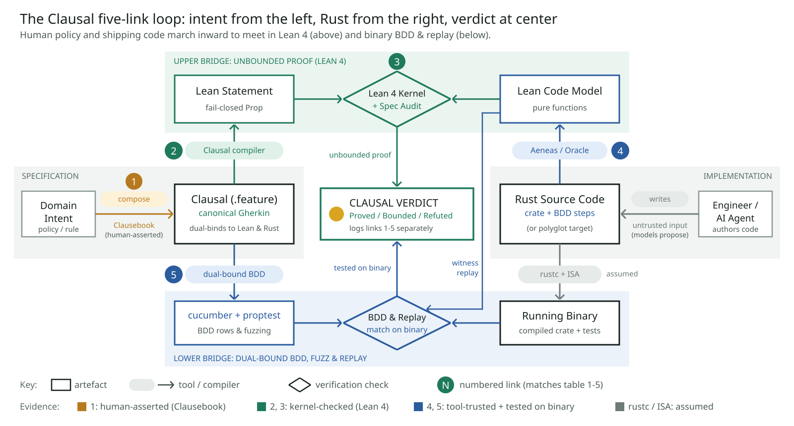
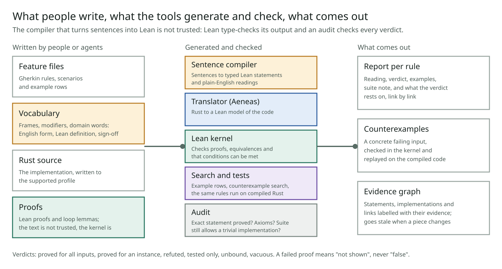
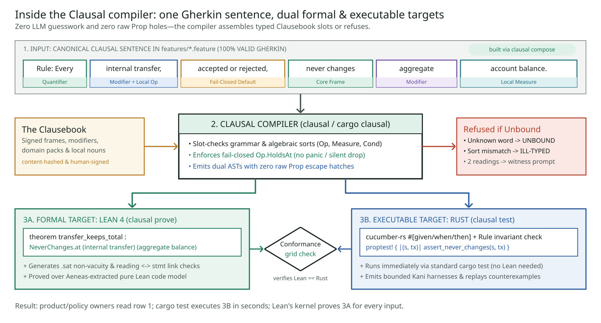
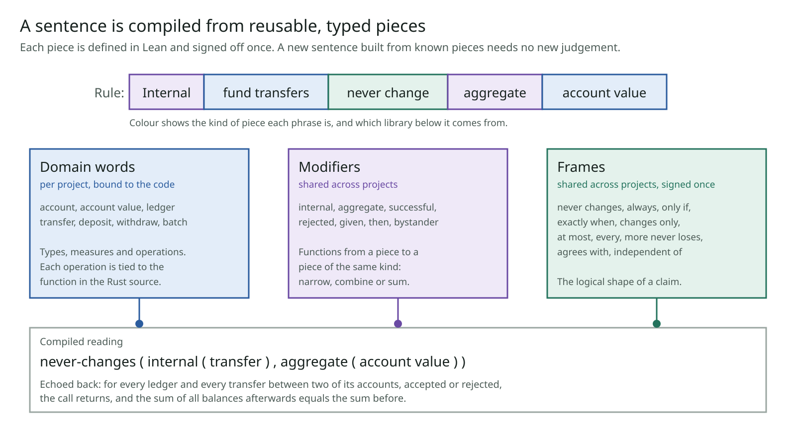
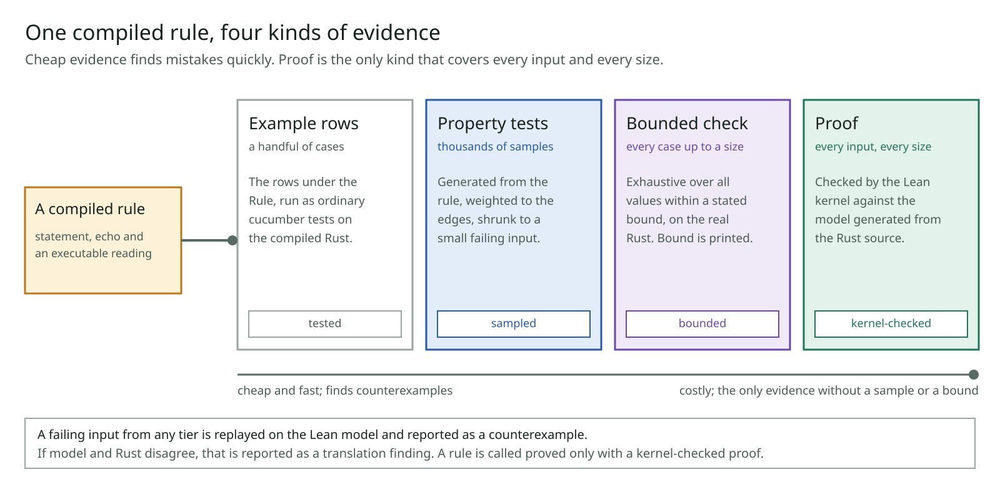

# Architecture

How Clausal is put together, why each part is the way it is, and where it is weak. Written 2026-11-10; names and framing updated 2026-11-11 when the project identity was settled (`DECISIONS.md`). `clausal/DESIGN.md` is the working design record and wins where the two differ.

**Names.** The project was called lean-rosette during phase 1, and the code and directories were renamed to `clausal` on 2026-11-11 (the repository and its checkout are still `lean-rosette`).

| Name | What it is | Where it lives today |
|---|---|---|
| **Clausal** | The language: a strict dialect of Gherkin in which every sentence has one fail-closed meaning. The canonical sentence is the one in the `.feature` file; there is no separate echo to drift from it | `clausal/features/*.feature` |
| **The Clausebook** | The library of typed pieces sentences are built from: frames and modifiers shared by every project (`clausebook/core`), domain packs (`clausebook/ledger`, `clausebook/abac`), and per-project bindings of local nouns to Lean and Rust | `clausal/clausebook.yaml`, `clausal/lean/Frames/`, `clausal/lean/*/Pieces.lean` (one flat namespace; the split is plan node C1) |
| **The Clausal compiler** (`clausal`, `cargo clausal`) | `clausal compose` (authoring: rough English in, canonical sentence out, asking with a separating input when readings differ), `clausal test` (scenarios, property tests, bounded checks on the compiled code), `clausal prove` (Lean statement, kernel proof, audit) | `clausal/clausal/`, `clausal/run.sh`. `compose` is not built (plan node L1) |

Where this document says "vocabulary" it means the Clausebook as it exists today.

Read the [README](../README.md) first for what the project is for.

## Contents

1. [The problem, stated precisely](#1-the-problem-stated-precisely)
2. [The chain of assurance](#2-the-chain-of-assurance)
3. [The pipeline](#3-the-pipeline)
4. [The vocabulary](#4-the-vocabulary)
5. [Verdicts](#5-verdicts)
6. [Evidence in layers](#6-evidence-in-layers)
7. [How the tool checks itself](#7-how-the-tool-checks-itself)
8. [The trusted base](#8-the-trusted-base)
9. [The evidence graph](#9-the-evidence-graph)
10. [Proofs and who writes them](#10-proofs-and-who-writes-them)
11. [The translator and the Rust profile](#11-the-translator-and-the-rust-profile)
12. [Code that is not Rust](#12-code-that-is-not-rust)
13. [The mathematics tooling](#13-the-mathematics-tooling)
14. [Repository and toolchains](#14-repository-and-toolchains)
15. [Open design questions](#15-open-design-questions)

## 1. The problem, stated precisely

A requirement lives in someone's head and in prose. An implementation lives in code. Three gaps separate them:

- **The meaning gap.** Does a formal statement say what the requirement's owner meant? This cannot be proved, because one side of it is not formal.
- **The proof gap.** Is the formal statement true of a model of the code? This can be proved.
- **The model gap.** Does the model behave as the running code does? This can be proved in principle and is tested in practice.

Most verification projects spend their effort on the proof gap, which is the one a machine can close, and leave the meaning gap to a few experts reading formal text. As proofs get cheaper, the meaning gap becomes the binding constraint. The architecture is organised around making that gap small, explicit and auditable, and around never letting evidence about one gap be mistaken for evidence about another.

Two design rules follow and recur throughout:

1. **Fail closed.** An unknown word, an ambiguous sentence, a failed proof or a missing check yields no claim. It never yields a guess.
2. **Say what it rests on.** Every verdict is reported with the evidence behind each link, by kind.

## 2. The chain of assurance

The figure draws the same chain as a loop: intent enters from the left as a Clausal sentence, the Rust source enters from the right, and the two meet at the Lean statement and code model above and at the running binary below. The figure numbers five links (composition, statement compilation, proof and audit, model extraction, run and replay on the binary); the table below lists the same gaps by what could go wrong, and keeps compilation by rustc as its own row because it is an assumption and not a check.

| Link | From → to | What could go wrong | Evidence, and its kind | What limits the risk |
|---|---|---|---|---|
| Meaning | Intent → Clausal sentence | The sentence does not say what the author meant | Signed Clausebook pieces; the author chooses the canonical sentence at authoring time, shown a separating input when readings differ. *Human-asserted* | Few pieces, each one line; a second independent reading of each piece compared on generated inputs; sign-off voided when a definition changes |
| Composition | Clausal sentence → Lean statement | Pieces assembled wrongly | Generated, then type-checked by Lean. *Machine-checked* | Typed holes; one way to parse or the sentence is refused |
| Proof | Statement → model | The statement is false, or the proof proves something else | Lean's kernel; the audit requires the proof's type to be exactly the statement. *Kernel-checked* | Standard axioms only; conditions shown satisfiable; suite checked against trivial implementations |
| Translation | Model → Rust source | The model does not behave as the code | Aeneas, with hand-written models of some standard-library functions. *Tool-trusted*, plus *tested* | The same examples and counterexamples run on both model and compiled Rust; versions and hashes recorded |
| Compilation | Rust source → running code | Miscompilation, hardware faults | rustc. *Trusted* | Not addressed |

The four evidence kinds are deliberately not ordered into a single scale. "Tested on a thousand inputs" and "trusted tool" are not comparable, so the report lists them side by side.

## 3. The pipeline

One command, `clausal/run.sh`, does the following. Paths are under `clausal/`. The figure predates the Clausal names; the steps are unchanged.

| Step | What happens | Where |
|---|---|---|
| Translate | Rust crates go through Charon and Aeneas into Lean models; a provenance file records hashes and tool versions | `translate.sh`, `lean/Generated/` |
| Compile sentences | Each scenario and each `Rule:` line is assembled from vocabulary pieces into one reading: frames applied to an operation | `clausal/vocab.py`, `clausebook.yaml`, `lean/*/Pieces.lean`, `lean/*/Readings.lean` |
| Build | Lean checks the models, the statements, the lemma libraries and the proofs. One module per scenario, so one broken proof costs one scenario | `lean/` |
| Search | Example rows are evaluated on the model; a search looks for an input that satisfies the conditions and for one that breaks the claim | `lean/Run/Search.lean`, `ReadingSearch.lean` |
| Link | For every scenario, the compiled reading is proved equivalent to the flat statement the proofs are about; for every rule, its statement is derived from its scenarios | `lean/Run/Links.lean` |
| Audit | Theorems derived from the search are kernel-checked (satisfiable conditions, refutation at a counterexample); axioms are collected; every proof's type is compared with its statement | `lean/Run/Audit.lean` |
| Run on Rust | cucumber-rs runs the same feature files on the compiled code, replays each counterexample, and evaluates the Rust reading of each phrase on the same inputs as the Lean one | `wallet-bdd/` |
| Suite note | Each operation's rules are re-stated against trivial implementations and searched | `lean/Run/Adequacy.lean` |
| Report | A block per rule and per scenario, and the evidence graph | `clausal/report.py`, `out/report.md`, `out/graph.json` |

Inside the sentence compiler, one sentence is checked slot by slot against the Clausebook's sorts, refused if a word is unbound or the pieces do not fit, and otherwise emitted twice: as a Lean statement and as Rust test harnesses, with the two readings compared on a grid of inputs.

Two components are explicitly **not trusted**:

- **The sentence compiler.** It is a small program that finds the one way a sentence is built from known forms and writes out the Lean term the pieces spell. Lean type-checks the result, the report prints the reading beside the sentence, and the link step proves the reading equivalent to the statement that was proved.
- **Proof text.** Whoever or whatever wrote it, only kernel acceptance of a theorem with exactly the right type counts.

## 4. The Clausebook (the vocabulary)

### Three kinds of piece

| Kind | Examples | In Lean | Reused across | Signed |
|---|---|---|---|---|
| Frame | never changes, always, only if, exactly when, changes only, is rejected and changes nothing, increases by exactly, at most, every … of, more never loses, agrees with, is independent of | A definition over an abstract operation with typed holes | Every project (`clausebook/core`) | Once |
| Modifier | given, successful, rejected, internal, aggregate, then, bystander, the first … of | A function from a piece to a piece of the same kind | Every project (`clausebook/core`) | Once |
| Domain word | account, balance, transfer, batch, accepted | A type, a measure, a condition, or an operation bound to a function of the generated model | A domain pack (`clausebook/ledger`, `clausebook/abac`) where the notion is general; one system where it is a local noun | Per pack, or per project |

Today the 96 entries sit in one flat file: 25 frames and 28 modifiers that are shared, and 43 entries bound to the two fixtures (32 domain words, 8 operations, 3 idioms). Splitting them into `clausebook/core`, a ledger pack and local bindings comes before the first sign-off (plan node C1), so that the owner signs the shared pieces without the toy nouns.

### The abstract operation

Every frame is stated about one thing: an operation that takes a state and an input and either returns an answer and a new state, or fails to return. The operation also says which answers count as acceptance and which calls a claim covers. Frames therefore mean the same thing whether the operation is a wallet withdrawal or an access decision.

Holes are typed: a measure is a function from state to a value, a condition is a predicate on state and input, a collection is a list drawn from state, input and answer. There is no frame that takes an arbitrary relation between before and after, so a sentence cannot smuggle in an unreviewed claim through a catch-all.

### Defaults are strict and printed

- "Never" and "always" cover every call, accepted or rejected.
- Every frame includes "the call returns": no panic, no hang.
- "If" is one direction. The converse has its own frame ("only if") and both together have a third ("exactly when"). The converse is never inferred.
- "Successful" and "rejected" narrow a claim to some calls. They are the non-default reading and must be written.

The canonical sentence states each of these in its own words ("accepted or rejected"), so the text a person signs and a test runner executes is the text that is proved. Phase 1 instead printed a separate echo beside a looser sentence, listing the defaults applied; that second artefact could drift from the `.feature` file and is being retired.

### One canonical surface, and a composer in front of it

Phase 1 measured that none of 48 rules written without the vocabulary compiled as written. The response is not to make the static grammar accept many phrasings of one meaning: that makes `.feature` files differ between projects and adds ambiguity. Each Clausebook composition has one canonical sentence, and `clausal compose` sits in front of it. It takes rough English and synonyms, proposes canonical sentences (a language model may rank candidates, restricted to compositions the Clausebook already permits, and is trusted for nothing), shows a concrete input when two candidate readings differ, and writes the chosen sentence into the `.feature` file. Disambiguation happens once, at authoring time. `compose` is plan node L1 and is not built.

### Granularity

Split a phrase where a part would be reused with a different partner. "Aggregate" is its own piece because "aggregate fees" will follow; "account value" stays whole until something forces a split. Start coarse, split on the second use.

### Composition and refusal

A sentence compiles only if there is exactly one way to build it from known forms. Otherwise it is refused, with a location and the nearest forms:

- **Unbound:** a word or form is not in the vocabulary.
- **Ill-typed:** the pieces exist but do not fit, and the two types are named.
- **Ambiguous:** more than one reading. The compiler refuses; `clausal compose` shows an input on which the readings differ and asks (plan node L3).

An example of each, from the fixtures:

| Sentence | Outcome | Why |
|---|---|---|
| `A deposit earns interest` | **Refused, unbound** | "earns interest" has no entry in the Clausebook or in the project's own bindings. The compiler does not guess at a meaning; the author adds a piece, with a definition someone signs, or rewords |
| `For a transfer, it is accepted` (with no scenario beneath it) | **Refused, ambiguous** | "transfer" names an operation in both the wallet and the ledger. The refusal names the two systems and says how to state which |
| `An accepted fund transfer never loses acceptance when the amount is the same or larger` | **Refused, says nothing** (vacuous by narrowing) | Narrowed to accepted calls, the claim holds of any code at all, so it would say nothing |

A refusal is a verdict like any other: the sentence yields no claim, and the report says why.

### Rules and their scenarios

A `Rule:` line compiles to one statement. The universally quantified scenarios beneath it are its parts: a generated, kernel-checked theorem derives the rule from them, usually by cases on their conditions. Only that direction is claimed. Example rows are the tested instances of the same claim.

### The second reading

Each frame has, beside its Lean definition, an independent executable checker. The two are compared on generated inputs on every run. Each domain word likewise has a Rust reading compared with its Lean definition. This catches a definition that is wrong in one place; it does not catch one that is wrong the same way in both.

### What a sentence still needs

At the end of phase 1 a new sentence built from existing pieces gets a statement, its reading in English, example rows on compiled Rust, a generated property test, a generated bounded check, and a proof slot (`clausal/FINDINGS.md`). It does not get a "proved" verdict without a proof being supplied, and it does not compile at all unless the author already knows the Clausebook, which is what phase 2's track L addresses.

Design history and decisions: `docs/VOCABULARY.md`. Prior art: `out/prior_art_vocabulary.md`.

## 5. Verdicts

| Verdict | Meaning |
|---|---|
| Proved for all inputs | A kernel-checked theorem whose type is exactly the generated statement, standard axioms only, with conditions shown satisfiable |
| Proved for an instance | The same, for a scenario with literal values |
| Refuted | A concrete input on which the statement is false, checked in the kernel and replayed on the compiled code |
| Counterexample | A failing input found by testing, without a kernel-checked refutation |
| Tested only | Example rows pass; no proof, or a proof that does not check |
| Unbound / ill-typed / ambiguous | The sentence did not compile |
| Vacuous | The conditions cannot be met, so the claim says nothing |
| Unlinked | A proof exists but its statement was not shown equivalent to the compiled reading |

Two rules about verdicts matter more than the list:

- **A failed proof means "not shown", never "false".** In experiments, most lost proofs under an injected bug belonged to rules that were really false, but a large minority belonged to rules that were still true.
- **A verdict is recorded as "review", not "pass", while it rests on unsigned vocabulary.** A strict mode turns that into a failure.

## 6. Evidence in layers

Measured on the fixtures against tool-generated bugs (`clausal/compare/TRADES.md`):

- Example rows caught most injected bugs but only about two thirds of the individual rule violations.
- Property-based tests with generators weighted toward boundary values found every violation.
- Bounded model checking found nearly all, on the real Rust with no translation step, and was the only technique to find bugs that occur at a single magic value. It could show a rule *holds* only up to small sizes.
- No bug needed a proof to be caught. The proofs' distinct contribution was a result independent of any sample or size bound.

The design consequence: because every frame already has an executable reading, a compiled rule generates its own property test and bounded-checking harness as well as its Lean statement (`clausal/compare/e1/E1_TRADES.md`: the generated ones find everything the hand-written ones found). A failing input from any layer is replayed on the Lean model. If it fails there too it becomes a refutation; if model and Rust disagree, that is a finding about the translation link. A false rule can still pass every tested layer if its failing case is larger than every size tried; flagging that is plan node E2.

The tiers map onto the commands: scenarios, property tests and bounded checks are `clausal test` and need no Lean; the kernel proof and audit are `clausal prove`.

## 7. How the tool checks itself

Each check exists because a reviewer found the failure it prevents.

| Check | The failure it prevents |
|---|---|
| A proof's type must be exactly the generated statement, from that scenario's own module | A theorem of type `True` was once counted as a proof |
| Only the three standard axioms; no `sorry`; no native evaluation | A proof resting on something unchecked |
| A kernel-checked witness that the conditions can be met | A claim that is true because its conditions never hold |
| Suite adequacy note: rules restated against "rejects everything", "does nothing", identity and constant implementations | A safety rule that a do-nothing implementation also satisfies; reported for the suite, as information |
| A second reading of every piece, compared on generated inputs | A subtly weakened definition passing silently |
| Counterexamples replayed on compiled code | A refutation that is an artefact of the model |
| Mutation runs: bugs injected into the Rust must be shown false by some rule | A rule set that leaves real behaviour unconstrained |
| "Shown false" counted separately from "proof lost" | An agent re-proving around a bug and getting a green run |
| Negative controls that must fail | A check that cannot fail |
| Reading proved equivalent to the proved statement | A recompiled sentence quietly weakened |

## 8. The trusted base

What a "proved" verdict rests on, in full:

| Trusted | Size or nature | How it is bounded |
|---|---|---|
| The vocabulary | A few dozen pieces, one line each | Printed in every report; second readings; sign-off with staleness |
| Lean's kernel | Small, widely used | Standard |
| The audit code | About a hundred lines of Lean | Negative controls |
| Aeneas and Charon | A research translator | Cross-checking by execution; pinned versions; this project carries small patches |
| Aeneas's models of standard-library functions | Hand-written | Listed per report; not yet separately tested |
| The Gherkin parser and test glue | Small | The same files run under an independent runner |
| rustc and the hardware | Large | Assumption |

Not trusted: the sentence compiler, proof text, and any agent that wrote either.

## 9. The evidence graph

Every run writes a graph (`out/graph.json`; format in `docs/SCHEMA.md`):

- **Nodes** have an interface (a statement, a signature) and zero or more implementations (a proof, a function body). Kinds include rule group, scenario, vocabulary piece, theorem, model function, source function.
- **Edges** carry a list of evidence entries, each with a kind, the tool or person behind it, and digests of what it was computed from.
- **Staleness is computed, never stored.** If a vocabulary piece changes, every statement built from it, every proof of those statements and every sign-off is marked stale.

The "rests on" block of a report is generated from the graph. The same format is meant to describe mathematics (a theorem decomposed into lemmas, statements shared across proofs), so navigation and audit tools can be shared.

## 10. Proofs and who writes them

- **Straight-line code** proves almost automatically: a few lines per rule using Aeneas's step tactic and arithmetic automation.
- **Loops do not.** Each needs an invariant, usually a small pure description of what the loop computes, and a proof connecting the two. Measured cost is about six lines of hand-written Lean per line of Rust, stable across two experiments and two models. Once a loop's lemma exists, further rules about it are cheap.
- **Agents can write these proofs.** On a crate neither had seen, with rules by a separate author, two models each proved all seven loop functions in under fifteen minutes. The loops were textbook patterns; unfamiliar invariants are untested.
- **The hazard is an agent proving around a bug.** If no rule forbids a wrong behaviour, an agent asked to make the build green will re-prove the lemmas to fit. The defences are the mutation runs, the suite note and the rule that agents may not edit rules or vocabulary to get a proof through.
- **Exact results need a reference.** "The loop computes X" cannot be stated without saying what X is. Today that is a small pure definition in the vocabulary, signed like any other piece.

## 11. The translator and the Rust profile

A census of ten real crates (`census/CENSUS.md`) found that tool robustness, more than Rust idiom, decides how much translates: one error aborted whole crates. Five small patches (`census/fork/`) raise the share of functions ending as compiling Lean from 1% to 35%, and to 82% outside one crate that fails earlier in the toolchain.

`census/PROFILE.md` is a written profile of Rust that translates: how to write loops, which library functions are modelled, what to avoid. Code meant to be verified should be written to it, in the way code meant to be fast is written with the optimiser in mind.

## 12. Code that is not Rust

Much code worth verifying is not Rust. Extraction from Rust by Charon and Aeneas is **Route A**. **Route B** is the pattern used on TDFLite's Go decision logic: a proved Lean reference model, with the production binary tested against it. It is a separate chain with a weaker model link, and it is a named evidence class in its own right, to be written into `docs/SCHEMA.md` (plan node X4):

1. Write a Lean model from the source by hand (or by agent), keeping a line-by-line trace to the code.
2. Check the model against the real implementation by differential testing on generated inputs, and keep that as a one-command check for any later commit.
3. Write down every reasonable formal reading of each English guarantee. Where readings differ, find an input that separates them and ask the owner. Search for counterexamples to each reading and replay them on the real code.
4. Turn the owner's rulings into parameters of the model, prove the guarantees under them, and emit test vectors in the project's own format.

Here the model link is *tested*, not *tool-trusted*, and the report must say so. The method found real behaviour on real code, and its one mistake was instructive: a proposed change touched a path the model did not describe, and only a reviewer caught the regression. Anything outside the model needs its own evidence.

## 13. The mathematics tooling

A separate strand asks whether large formal developments can be made navigable. It shares the evidence graph and the habit of measuring against ground truth.

| Tool | What it does | Where |
|---|---|---|
| Candidate enumeration and lifting | Lists every proof-valued piece of a proof term; turns chosen pieces into real lemmas with the kernel re-checking the result | `Rosette/` |
| Corpus exporters | Declaration graphs, statements and proof sizes from built Lean projects, across Lean versions | `corpora/tools/`, `corpora/ns_export/` |
| Outline and validation | Dominator-based and definition-centred outlines; scoring against human blueprints and against the papers | `bench/outline*.py`, `bench/paper_truth.py` |
| Dead code | What a reader need not read, confirmed by deleting and rebuilding | `bench/deadcode.py`, `tools/deadcode/` |
| Friction census | Where proof bulk sits, by kind of side-condition | `bench/friction_*.py` |

What has been learned is mostly negative and is recorded in `out/FINDINGS.md` and `out/corpus/FINDINGS.md`: size and graph position do not identify what people find meaningful; the content of a large machine proof sits in its definitions.

## 14. Repository and toolchains

The repository holds several independent projects with different pinned toolchains, because the tools they depend on pin different versions.

| Project | Path | Lean |
|---|---|---|
| Restructuring tools | repo root (`Rosette/`) | 4.36.0-rc2, with Mathlib |
| The pipeline | `clausal/lean` | 4.35.0 (Aeneas's pin) |
| Machine-generated corpus | `corpora/ns` | 4.34.0-rc2 |
| Human corpora | `corpora/pfr`, `corpora/carleson` | 4.36 |

Charon needs one exact Rust nightly; ordinary builds and tests use stable. Setup, disk use and rebuild steps: `docs/SETUP.md`.

## 15. Open design questions

- **Do people read canonical Clausal correctly?** Model readers caught about 92% of seeded wrong echoes when comparing two English sentences. Nobody has yet tested people, on either the canonical sentences or the separating inputs `clausal compose` shows, and that decides how much weight the meaning link can carry (plan node H2).
- **Does one core serve unrelated domains?** The claim that `clausebook/core` is reused unchanged across ledgers, an outside crate and access control is untested until R2 and TDFLite's `tdf-core` run against the same package.
- **How should a loop be fully specified?** A signed reference definition, or rules that compare two runs ("applying a batch equals applying its first transfer then the rest").
- **Effects, input/output and concurrency.** Frames describe one pure call. A shell around a pure core is not covered, and real defects live there.
- **Two-run claims.** "More never loses" and "is independent of" compare two calls. They have definitions and tests; their sentence forms are new.
- **Who may sign what.** Domain words need a domain owner; the Lean behind them needs a different reviewer; shared frames need more than one signer.
- **Versioning the shared frame library.** A change to one frame voids signatures across every project that uses it, unless the change is proved meaning-preserving.
- **Time.** No current target needs "eventually" or "until". Step-by-step invariants cover the cases in hand.
- **The compilation link.** Verified compilation for Rust is an open problem in the field and is left as a stated assumption.
- **Presenting evidence to an auditor.** The graph has the content; the form an evaluator wants has not been designed.

The plan that sequences these is `docs/PLAN.md`.
