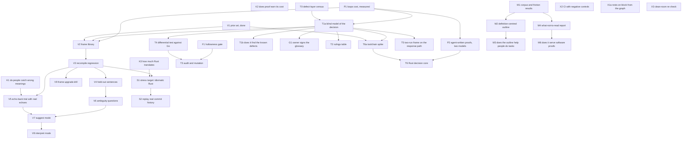

# Plan: hypotheses, tests and order of work

Draft 4, 2026-11-10 (status and changes after the first night added below the Stance).

Draft 3, 2026-11-10 (owner's steer applied; see the end).

Draft 2, 2026-11-10. Draft 1 was reviewed by two critics on a different model (method and strategy) and checked against a prior-art survey (`out/prior_art_vocabulary.md`). Their main findings are folded in; "What changed from draft 1" at the end lists them.

Each node is a hypothesis with a test and a target, so a result can be read without arguing afterwards.

## Stance (owner, 2026-11-10)

- **The destination is fixed.** English descriptions and working code will have proofs between them. The question is never "is it worth it"; it is "how good can we make it, and what are the trades".
- **Report, don't gate.** The "Pass / fail" columns below are targets and signals. A miss changes what is built next and is reported plainly; it does not stop a track.
- **Do not overfit to the wallet.** The wallet and ledger are fixtures for building infrastructure, not sources of conclusions about real systems.
- **Rules come in suites.** A single rule is not expected to pin behaviour by itself; adequacy is judged for the suite.
- **A restricted Rust profile is acceptable**, and forking a tool to improve it is an option when a limitation is in the way.
- **People tests are deferred.** For now they run on naive subagent proxies, on infrastructure built so real people can take the same trial later without change.

## Status and changes after the first night (2026-11-10)

This section is the current state. The tables further down are the original node definitions.

### Where each node stands

| Node | State | Result in one line |
|---|---|---|
| K1 meaning trial | Done, proxy readers | 93% of wrong readings caught; harness ready for people |
| K2 trade map | Done, reviewed | Sampling and bounded checking find nearly every injected bug; proofs add the all-inputs result |
| K3 translation census | Done | 1% of real functions translate as shipped, 34% with aborts worked around; three small tool defects dominate |
| F1 suite note, `Rule:` | Done | In the slice report; 7 of 8 fixture operations fully constrained |
| T0, T1a, T1b TDFLite pilot | Done | Model matches the Go on 400k cases; all six known cases surfaced (search was guided); 15 more reproduced |
| T2 rulings | Done; owner has ruled | Rulings recorded privately |
| T3r ruled specification, T4 repeatable check | Done, reviewed | Guarantees 1–5 proved, 8 given named facts; 75 vectors; ten proposed changes, none applied |
| V1 prior art | Done | 14-frame catalogue |
| V2, V3 frame library | Running | Draft library exists |
| P2 agent-written loop proofs | Running | Two model arms |
| Aeneas fork spike (new, A1) | Running | Patching the three census defects |
| M2 definition-centred outline | Done, proxy readers | More followable, no more milestones; model readers split |
| M4 dead code | Done | A quarter of the machine corpus deleted, headline theorems still check |
| Paper ground truth (new) | Done | 117 paper items mapped to Lean |
| Constant threading (new) | Done | Small prize; the corpus re-invented big-O three times |

### What the results change

1. **Evidence comes in layers, and the tool should produce all of them from one compiled rule.** K2 showed property tests and bounded model checking are the best finders of counterexamples and proofs are the only unbounded evidence. Each frame already has an executable reading, so a rule can generate its own property test and bounded-checking harness as well as its Lean statement. New node **E1**.
2. **Tool robustness is on the critical path.** K3 showed the translator, not Rust idiom, limits coverage. New track **A**: carry patches in a fork, offer them upstream, add missing standard-library models.
3. **The TDFLite track moves from finding to specifying.** With rulings in hand: fix them in the model, prove the guarantees, and hand the owner test vectors and a proposed change list. New nodes **T3r** and **T7**.
4. **The stress target changes.** Cedar does not get through the translator today. Use one of the crates that mostly does (76% across the other nine) as S1 now, and return to Cedar after track A.
5. **Maths: build on what worked.** The dead-code report is cheap and real, so make it a tool for any Lean project (**M8**). The most interesting observation was a machine re-inventing a library abstraction; look for that directly (**M7**). Outline work continues only with a person to rate it.
6. **Model readers are instruments, not judges.** They are kept for mechanical checks and proxy trials, and not used as evidence of mathematical or semantic quality.

### New and changed nodes

| Node | What | Target or output | Needs |
|---|---|---|---|
| E1 | From one compiled rule, generate a property test and a bounded-checking harness alongside the Lean statement; feed any falsifying input back as an example row and a kernel-checked refutation | On the fixtures: every bug the K2 arms found is found by the generated harnesses, with no hand-written test code | V3 |
| A1 | Fork spike: patch the three translator defects, re-measure the census | Functions unlocked per patch; test suite unchanged | Running |
| A2 | Decide fork versus upstream; prepared reports are sent only by the owner | Decision | A1, owner |
| A3 | Models for the most-used unmodelled library items; drop the slice's warnings-as-errors flag | Share of functions that translate with no unmodelled dependency | A1 |
| T3r | The ruled specification: rulings fixed in the model, guarantees proved under them, test vectors for each ruling, and a proposed change list for the Go, all private and none applied | Guarantees 1–5 proved; 8 proved or its missing facts named; vectors run against today's Go and fail exactly where a ruling changes behaviour | T2 |
| T4 | Now: make the model-versus-Go differential check a repeatable command the owner can run at any commit | One command, minutes | T3r |
| T7 | Obligations in depth: proof of capability versus declaration, trigger scoping, parity | Roadmapped, not started | Owner |
| S1 | Stress target: start with a crate that translates today; Cedar after track A | As before | V3, A1 |
| V4–V6 | Unchanged, run with proxy authors and readers for now | As before | V3 |
| M7 | Find project definitions that are equivalent to an existing library notion (re-invented abstractions) | Candidates with a kernel-checked equivalence each | — |
| M8 | Dead-code report as a tool for any Lean project, with the elaboration-time dependencies it must not delete | Runs on a second and third project; deletions confirmed by build | — |
| X1 | Update `docs/SCHEMA.md` for rule groups, suite verdicts and layered evidence | Schema validates the slice graph | V3 |

### How the work is run

- **One owner per directory.** Agents write only in their own tree; anything that runs a pipeline does it in a scratch copy.
- **Build, review, fix.** Every substantial node is built by one agent, checked by a second on a different model, and the corrections are applied and rerun before results are written up. The fix step is now part of the node, not an afterthought.
- **Two heavy workflows at most at once**, about eight build-running agents. The first night ran more, pushed the machine to several times its capacity, and made every timing unreliable.
- **Timings are measured in a quiet window**, alone, after the heavy work finishes.
- **No broad process kills, no public posts, no changes to the owner's other repositories.**
- **Top-level findings are assembled by the orchestrator**; agents return them as text.

## Rules for every node

Each rule answers a mistake already made in this project (`docs/EXPERIMENTS.md`, `slice/FINDINGS.md`).

1. **Frozen before data.** Thresholds, the item set (scenarios, sentences, mutants, samples) and the budget are committed before the measured run starts, and the report names that commit. Anything changed afterwards makes the node exploratory.
2. **Items are not chosen by the builder.** They come from a tool, a fixed rule, random sampling with a recorded seed, or a different author. The builder's ledger mutants were 21 of 22 caught; the reviewer's five were 1 of 5.
3. **Pass and fail are separated by a gap, and the interval is reported.** A cutoff placed at the target rate on 20 items passes a system that is exactly on target only about 60% of the time. Sample sizes below are sized so the pass and fail bands do not overlap; results in between are "unclear" and say so.
4. **People decide judgement calls.** A model reader is a proxy and is labelled as one. Two models are independent of each other's context, not of each other's blind spots.
5. **A lost proof is not a detection.** Only "a rule is shown false by a concrete input" counts. A proof that stops compiling means "not shown".
6. **Every rule suite gets an adequacy note** (node F1): what trivial implementations the suite as a whole would still allow, and what it leaves unconstrained. This is information for the author, not a mark against any one rule.
7. **Agents may not edit rules, vocabulary or axioms to make a proof go through** without the change being reported as such.

## Strategy in brief

- **Centre of gravity: the software chain.** English rule → Lean statement → proof about a model of the Rust → stated trust at each link.
- **Map the trades early.** Three questions shape how good the chain can be made, and none needs new tooling to start on: do readers catch wrong meanings, where does proof add over testing and at what cost, and which Rust translates today.
- **Forcing function: the TDFLite pilot, run blind.** It is the right first customer but an easy case (a small pure function, and AWS has done the same for Cedar). So it is paired with a harder second target.
- **Maths stays as a long-term bet with checkpoints**, in this repo.
- **Not yet:** compiler and hardware links, temporal frames, further graph-scoring ideas, free-form English with no signed vocabulary.

## Dependency graph

## Track K: map the trades (first)

These use only what exists today.

| Node | Hypothesis | Test | Pass / fail | Model |
|---|---|---|---|---|
| K1 | Readers catch a wrong meaning | Paper prototype, no frame code. (a) Seed 8 wrong definitions into the existing glossary (strict versus non-strict bound, dropped condition, rejected inputs excluded, wrong scope). (b) 30 rules with hand-written echoes; 10 wrong, 5 of those wrong only through composition. Seeds written by a different author from the reviewer. Run now with naive subagent readers of several models as a proxy; the trial harness records answers per reader so people can take the identical trial later | Target: ≥ 90% of wrong items caught, ≤ 10% false alarms. Reports state the measured catch rate beside the meaning link, labelled proxy until people have taken it | Subagent proxies now; people later |
| K2 | Where proof adds over testing, and at what cost | Discharge the same rules four ways on wallet and ledger: example rows; property-based tests (10,000 cases with shrinking); bounded model checking on the Rust (Kani); Lean proofs. Mutants from a tool (cargo-mutants) plus bugs transplanted from real fix commits; nobody who wrote a rule picks a mutant. Record cost per rule | Output: a trade map per kind of rule (what each method catches, what it costs), used to decide which evidence each rule gets by default. Not a go/no-go | Fable build; smaller model for runs |
| K3 | Which Rust translates, and what would widen it | Run current Charon/Aeneas and hax over 10 crates (5 business-logic, 5 sampled from popular crates). Per function: extracts or not, the generated Lean builds or not, which standard-library models it relies on | Output: a coverage figure, a written "supported Rust profile" that authors can code to, and a ranked list of tool improvements (candidates for a fork or upstream patch) by how much code each would unlock | Smaller model for runs; Fable to classify |

Current evidence bearing on K2: example rows alone catch 17 of 18 wallet mutants and nearly all ledger mutants; the proofs add one each.

## Cross-cutting

| Node | What | Pass | Model |
|---|---|---|---|
| F1 | **Suite adequacy note.** The rule suite for an operation is checked as a whole against trivial implementations (rejects everything, does nothing, always denies, identity) and tool-generated mutants; what the suite still allows is listed. Authors may record a few expected examples per rule before seeing the formal reading | Each report carries one adequacy note per operation. Informational | Fable |
| X1a | The "rests on" block of the target report is generated from the refinement graph | Report matches the graph on every run | Fable |
| X1b | The maths tooling writes the same graph format | Deferred until M2 needs it | — |
| X2 | CI runs `./run.sh` and the negative controls on every push | Controls fail when they should | Smaller model |
| X3 | **Clean-room re-check.** A fresh machine, given only a released evidence bundle, re-derives every verdict | Everything matches, one command, within 60 minutes | Smaller model |

F1 exists because a safety rule such as "internal transfers never change aggregate account value" is also true of a ledger that rejects every transfer. That is expected of a single rule; the note tells the author whether the suite includes the progress rule that rules it out.

## Track P: does proof cost stay manageable?

The cost track. Its results set how proofs get written (how much agent effort, which Rust profile, which tool improvements), not whether.

| Node | Hypothesis | Test | Pass / fail | Needs | Model |
|---|---|---|---|---|---|
| P1 | — | Measured, not a test. Ledger: 6.0 hand-written Lean lines per Rust line (wallet 1.6); two invariants; a 227-line lemma library; about 21 failed builds. Nothing about a loop was automatic | Recorded | — | — |
| P2 | An agent can write loop proofs unaided, at bounded cost | A new crate with at least 6 functions containing loops and no lemma library. Rules written by a different author. The agent must find the invariants and helper lemmas itself, within a fixed budget per rule (tokens and wall-clock). Two arms, Fable and Opus 5.5, same tasks | Per arm, counted per function, not per rule. Pass: ≥ 5 of 6 functions fully proved within budget. Fail: ≤ 2. Report Lean lines per Rust line and failed builds. The comparison between arms is descriptive | P1 | Both |

## Track V: does the vocabulary compose?

| Node | Hypothesis | Test | Pass / fail | Needs | Model |
|---|---|---|---|---|---|
| V1 | — | Done. Report in `out/prior_art_vocabulary.md`; summary below | — | — | — |
| V2 | A small typed frame library covers real rules | Build the shared library from the 14-frame catalogue below. Holes are typed, so one catch-all frame cannot pass. First check: a Scenario Outline under `Rule:` actually runs through cucumber-rs | Pass: every wallet, ledger **and TDFLite** guarantee is expressible with no one-off frame, and each frame has an independent executable reading that agrees with its Lean definition on generated inputs | V1, T1a, P1 | Fable; a person signs the frames |
| V3 | Composition loses nothing | Recompile every existing scenario through frames | Pass: each recompiled statement is proved equivalent to the old one by the kernel, not merely given the same verdict. Deliberate changes from fail-closed defaults are listed one by one | V2 | Fable |
| V4 | New sentences compile from existing pieces | 40 new rules, at least 20 written by people who know the domain but not the vocabulary. Each author records what they meant (five examples) before seeing the compiled reading | Pass: ≥ 75% compile with no new piece. Fail: < 50%. Any reading that contradicts its author's examples without being flagged is a fail regardless | V3 | People and a separate model author |
| V5 | Echo-back works with real, generated echoes | K1 repeated on the tool's own output | Same thresholds as K1 | K1, V3 | People |
| V6 | The tool notices ambiguity and asks the right question | Run on V4's naturally written rules, not seeded ones. Count ambiguities found, missed (judged by people) and false alarms | Pass: for each ambiguity found, an input that separates the readings, shown on compiled code | V4 | Fable |
| V7 | Suggest mode strengthens weak sentences | 30 loosely worded claims with the author's intent recorded first | Pass: a candidate matching the recorded intent in the top three for ≥ 80% | V5, V6 | Fable; people as authors |
| V8 | Interpret mode on a fixed document | A case study, labelled as one: one real document; every clause given a traced reading or listed as uninterpreted; a second person checks the uninterpreted list is complete | Descriptive | V7 | Fable; two people |
| V9 | A shared frame can change safely | In two projects on different Lean versions, change one frame without changing its meaning and one with | Pass: the first voids no signature (equivalence checked by the kernel); the second lists every affected rule with a separating input | V3 | Fable |

### What the prior-art check found (V1)

- **Frames with a fixed formal reading echoed back in English already exist**: NASA's FRET does this for timed requirements on signals. It has no typed domain vocabulary and no quantifiers, and it targets model checkers, not source code. Copy its echo format and its practice of giving each frame a second, executable reading.
- **First catalogue, 14 frames**: always answers; never changes; changes only; always / never; if-then; only if; exactly when; rejected and unchanged when; changes by exactly; at most / at least; counting over a named collection; monotone (more never loses); agrees with a reference; independent of (two runs). Five of these were missing from draft 1 and are needed by targets already in the plan.
- **Gherkin `Rule:`** may contain Scenario Outlines with Examples and tags, and all four main runners parse it. No runner gives the rule line any meaning, and no convention for a universally quantified rule was found, so that reading is this project's addition. Not yet executed here.
- **The whole chain was not found anywhere.** Pieces overlap with existing work: agent prove-and-audit loops for Aeneas-translated Rust (including a 16.7k-line cryptographic library), requirement-to-property tools that stop at property-based tests, and ambiguity scenarios over SMT in a cloud product.
- **hax's Lean backend is now built on Charon and Aeneas** (since late September 2026), adding contracts and its own library. Use plain Aeneas unless T6a shows otherwise.
- **The Cedar claim in the TDFLite plan is correct**: a Lean model, proofs about it, and differential random testing against the production Rust.

## Track T: TDFLite

Material about TDFLite's unresolved edge cases stays out of the public repository.

| Node | Hypothesis | Test | Pass / fail | Needs | Model |
|---|---|---|---|---|---|
| T0 | The proof must cover where the defects are | Classify every guarantee and D1–D6 by layer: integer core, string intake, rewrap shell, bundle acceptance. Four of the six sit in intake and one in the shell; only D4 is in the integer core that stage 2 would prove | Output: one "rests on" line per layer that is not proved | — | Fable |
| T1a | — | An agent that has not seen `tdflite-ideas/` or `docs/TDFLITE.md` writes the Lean model from the public Go source, including intake over strings. Guarantees given in plain English only. Adds a "model target" mode to the generator | Model builds; search settings frozen | T0, P1, owner's OK | Fable, blind |
| T1b | The chain finds defects it was not told about | Score T1a's output against D1–D6 | Pass: ≥ 4 of 6 surface as refutations or ambiguity questions, D4 among them. Fail: ≤ 2 | T1a | Opus 5.5 scores |
| G1 | — | The owner reads and signs the TDFLite glossary | Until signed, every verdict is recorded as "review", not "pass" | T1a | Owner |
| T2 | Rulings can be explored | The six rulings as parameters; each option one at a time from the suggested baseline (12 variants), plus the interactions among D1–D3 | Output: the decision table | T1a | Fable |
| T4 | The model matches production | Differential test against the Go engines, following Cedar's recipe: structure-aware generators, a second generator aimed at error paths, coverage-guided fuzzing. Each difference classified with the owner as Go defect, model defect or a seventh ruling | Pass: no unclassified difference; report the share of generated inputs that reach a Permit | T1a, owner's go-ahead | Fable |
| T3 | The guarantee set is not hollow | Tool-generated mutants of the model; F1 applied. "Noticed" means shown false. Survivors are accepted or rejected by the owner, not the builder | Pass: no survivor the owner rejects. Note: guarantees 1, 2, 4, 5, 6 and 7 all hold of a decision that always denies, so guarantee 3 must be stated as an equivalence | T4, F1 | Fable build; owner judges |
| T5 | Secrecy can be stated | A two-run frame over a model of the response path (unwrap, binding check, decide, respond). On the bare decision function the claim is true by typing and proves nothing | Pass: guarantee 6 stated on the response path, reading confirmed by the owner, proved | T1a, V2 | Fable |
| T6a | — | Toolchain spike: plain Aeneas against hax on two TDFLite-shaped functions, each proved against T1a's model | Output: the choice, with reasons | V1, T1a | Fable |
| T6 | The decision core can be proved in Rust | Per the TDFLite plan's gates plus the audit checks. Intake and release become their own nodes after it | — | T6a, P2 | Fable |

## Track S: an honest stress target

TDFLite alone cannot show the approach generalises.

| Node | Hypothesis | Test | Pass / fail | Needs | Model |
|---|---|---|---|---|---|
| S1 | The chain works on idiomatic Rust it was not designed around | A real open-source crate with an independent expert specification. First choice: Cedar's authoriser and evaluator, whose headline properties already exist as expert Lean statements. State them as English rules through the vocabulary | Pass: ≥ 4 properties expressed with no one-off frame and proved equivalent to the expert statement. Report the share of the code that translated and Lean lines per Rust line | K3, V3 | Fable; Opus 5.5 review |
| S2 | Proofs survive real change | Starting from proofs at one commit, replay about 50 later real commits. The policy for a red build is fixed beforehand. One agent repair attempt per broken proof | Pass: ≥ 90% of commits end green with no human proof work. Fail: > 20% need a person, or > 30% of breaks are brittleness with no change in behaviour | S1 | Fable; smaller model for the replay |

## Track M: mathematics (long-term bet, with checkpoints)

Five structure-scoring ideas have now failed: the hiding ratio, small goal state, reuse in Mathlib, dominators predicting blueprint nodes, and reuse in the machine corpus. What survives is tooling (sound lifting, corpus exporters), some cheap observations (a third of the Navier–Stokes theorems are unused by any headline result; hundreds of copy-and-modify families), and one lead: the interface a reader cannot skip is the definitions.

The claim that this track serves software verification is untested, and is not used to justify it until M6 tests it. The owner wants to keep investing here for the long term; the checkpoints are for deciding how, not whether.

| Node | Hypothesis | Test | Pass / fail | Needs | Model |
|---|---|---|---|---|---|
| M1 | — | Collect and review the corpus, reuse and friction results. Criteria for what would count as "packets help" are written before the numbers are read | Running | — | Fable |
| M2 | An outline built around definitions is readable where a lemma-based one was not | The same readers rate both outlines blind, with a written rubric, on at least 30 entries each | Pass: the definition-centred outline has a clearly higher share of "recognisable milestone" (intervals do not overlap) | M1 | Fable builds; at least two readers, one human if available |
| M3 | The outline helps people do tasks | 12 fixed questions about the Navier–Stokes development; outline against the standard documentation and search | Pass: ≥ 25% less time or ≥ 20 points more correct | M2 | People |
| M4 | "What you need not read" is a cheap, real win | Report unused declarations, cloned modules and copy-and-modify families; confirm by deleting a sample and rebuilding; include a negative control (delete something used) | Pass: sample confirmed; control fails as it should | M1 | Smaller model |
| M6 | The tooling serves software proofs | Run the outline and the report on a real software proof development (Cedar's Lean, the S1 proofs) | Pass: an engineer new to it answers fixed questions faster with it | M4, S1 | People |

Checkpoint: review M2, M3 and M6 with the owner in spring 2027 and decide the next shape of the track.

## Order

1. **Now:** K1 (paper prototype), K2, K3, F1, T0, X2. Ask the owner for the OK to read the Go source. Finish M1.
2. **Next:** T1a blind, then T1b and T2. P2. V2 against wallet, ledger and TDFLite. M4.
3. **Then:** T4 (as soon as access allows), T3, T5, G1. V3, V4, V9. X1a. M2.
4. **Then:** S1. V5, V6. T6a. X3.
5. **Later:** S2, T6, V7, V8, M3, M6.

## Where people are needed

- **Owner:** (OK to read the TDFLite Go source: given 2026-11-10); sign the glossaries (G1 and the slice's 44 entries); confirm readings (T5); judge survivors and differences (T3, T4); rulings (T2).
- **Other engineers and a mathematician (deferred):** K1, V4, V5, M2, M3 run on subagent proxies for now, labelled as such, with the trial infrastructure kept ready for people.

## Use existing tools where they exist

| Need | Borrow |
|---|---|
| Counterexample search | Property-based testing with shrinking on both the Lean and Rust sides; bounded model checking on the Rust. Keep the hand-built grid as a regression baseline |
| Mutants | A mutation tool, with hand-written mutants only as targeted probes |
| Frame catalogue and echo format | Published property patterns; FRET's slot-structured echo |
| Ambiguity questions | A solver query for an input on which two readings differ |
| Differential testing | Cedar's recipe |
| Signing and provenance | A standard attestation format over content digests |

## Open programme questions (no node yet)

- **Code that is not Rust.** TDFLite's production is Go. "Differentially tested against a Lean model" should be a named evidence level with its own pass bars, not a stopgap.
- **Effects, I/O and concurrency.** No frame and no link covers the shell around a pure core, and one TDFLite defect lives there.
- **How a loop is fully specified.** Either a small signed reference model in the vocabulary, or two-run rules. Until decided, each loop's exact behaviour lives in unsigned lemmas.
- **Who may sign what.** Separate roles for domain words and for the Lean behind them; more than one signer for shared frames.
- **Red builds.** Blocking or advisory, and who owns them. Must be fixed before S2.
- **Presenting evidence to an auditor**, and a disclosure policy for evidence about unresolved defects.
- **An inventory of the trusted base** (standard-library models, audit code, parsers, pins) with versions and digests in every report.
- **Budget and stop rule** per track.

## Model allocation

No measurements yet; P2 supplies the first.

- **Fable** for design, proofs and fix-and-report passes.
- **Opus 5.5** for sceptical review, scoring and as a second author. This gives a reader who has not seen the builder's context. It does not give statistical independence, so it never replaces a person on a judgement node.
- **A smaller model** for bulk mechanical runs.

## Deliberately not yet

- **Compiler and hardware links.** Stated as assumptions in every report.
- **Temporal frames.** No current target needs them.
- **More graph or size scoring for proof structure.**
- **Free-form English with no signed vocabulary.** K1 includes it only as a comparison arm.

## What changed in draft 3 (owner's steer)

- Added the Stance section: destination fixed, report don't gate, do not overfit to the wallet, rules come in suites, a restricted Rust profile and tool forks are acceptable, people tests deferred to proxies.
- Track K renamed from "falsify" to "map the trades"; K2 and K3 produce maps and a supported profile, not verdicts.
- The hollowness gate became a suite-level adequacy note.
- The kill clause on the cost track was removed.

## What changed from draft 1

1. Added Track K: three cheap tests that could falsify the thesis, run first.
2. Added the hollowness gate (F1) after a critic showed the flagship rule is true of a ledger that rejects everything.
3. TDFLite pilot made blind and moved ahead of the frame library; it now feeds the frame library instead of waiting for it. Added the defect-layer census, the glossary sign-off and a toolchain spike; the differential test moved earlier.
4. Added Track S: a harder real target and a replay of real commit history.
5. Proof-cost track rebuilt so it can fail: a new crate, no lemma library, rules by a different author, counted per function.
6. Sample sizes and cutoffs changed so pass and fail are distinguishable; authorship of test items specified; people decide judgement nodes.
7. Maths reframed as a dated bet with a task-based test, counting five failures, not three.
8. Frame catalogue grown from about 8 to 14 from the prior-art check.
9. Added clean-room re-check, CI with negative controls, and a list of programme questions with no node yet.
