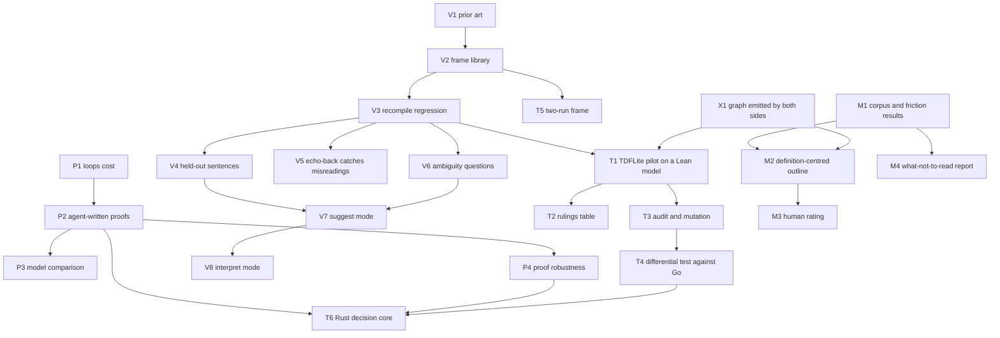

# Plan: hypotheses, tests and order of work

Draft 1, 2026-11-10. Each node is a hypothesis with a test and thresholds fixed in advance, so a result can be read as pass, fail or unclear without arguing afterwards. Thresholds are first guesses and are meant to be challenged before a node starts, not after it finishes.

## Strategy in brief

- **Centre of gravity: the software chain.** English rule → Lean statement → proof about a model of the Rust → stated trust at each link. It works on toys and has a first real target, the TDFLite decision core.
- **Forcing function: the TDFLite stage-1 pilot.** Work is prioritised by whether it gets that pilot to a trustworthy result.
- **Maths stays, as a long-term investment at lower intensity.** It serves the same goal at scale: large formal developments, including the proofs verified software generates and the shared vocabulary library itself, have to be navigable. It stays in this repo for now (see the end).
- **Not yet:** the bottom of the chain (compiler, hardware), temporal frames, and further graph-scoring ideas.

## Dependency graph

## Track P: does proof cost stay manageable?

The kill-or-continue track. If proofs about ordinary code need an expert each time, "formal by default" does not scale.

| Node | Hypothesis | Test | Pass / fail | Needs | Model |
|---|---|---|---|---|---|
| P1 | Loops raise proof cost by a bounded factor, not an order of magnitude | Ledger crate: proof lines, hand-written invariants and time per scenario, against the wallet | Running. Read the cost table; no threshold set in advance | — | Fable build, Fable review |
| P2 | An agent can write the proofs unaided | 20 new scenarios across the ledger and one new crate; agent gets the generated statement and the model, a fixed attempt and time budget, no human hints | Pass: ≥ 80% proved. Fail: < 50%. Between: study the failures | P1 | Fable |
| P3 | Model choice matters measurably for proof work | Same 20 tasks, Fable and Opus 5.5, same budget; success rate, time, tokens | Output is an allocation table, not pass/fail | P2 | Both |
| P4 | Proofs survive ordinary code change | 15 behaviour-preserving refactors of the Rust (renames, reordering, extracting a helper); count proofs that still pass or are repaired by an agent in one attempt | Pass: ≥ 80%. Fail: < 50% | P2 | Fable |

## Track V: does the vocabulary compose?

| Node | Hypothesis | Test | Pass / fail | Needs | Model |
|---|---|---|---|---|---|
| V1 | Existing work can supply the frame catalogue and tell us what to avoid | Web check: controlled languages, property-pattern catalogues, Gherkin-to-formal tools, `Rule:` support in runners, current state of hax and Aeneas | Output is a report | — | Fable |
| V2 | About a dozen frames cover the scenarios we have | Write the shared frame library with Lean definitions and English paraphrases, fail-closed defaults | Pass: every existing scenario is expressible. Fail: more than 20 frames needed, or any scenario needs a one-off | V1 | Fable design, Opus 5.5 review |
| V3 | Composition loses nothing | Recompile every wallet and ledger scenario through frames and modifiers | Pass: 100% of current verdicts reproduced, including refuted, unbound and vacuous; mutation results unchanged | V2 | Fable |
| V4 | New sentences compile from existing pieces | 30 new rules about the wallet and ledger, written by someone who has seen the domain but not the vocabulary | Pass: ≥ 70% compile with no new piece and ≥ 90% with at most one new domain word. Fail: < 40%. Any silently wrong reading is a fail regardless | V3 | Sentences: owner or a separate Opus 5.5 agent. Compile: tool |
| V5 | People catch a wrong reading when it is echoed back | Seed 20 rules, half with a subtly wrong reading; reviewers see rule and echo only | Pass: ≥ 90% of wrong readings caught, ≤ 10% false alarms. Needs humans; a model-reviewer run first is a proxy only and is labelled as one | V3 | Humans; Opus 5.5 as proxy |
| V6 | The tool can ask the right question | 15 seeded ambiguous rules; tool must produce an input on which the two readings differ | Pass: ≥ 80% | V3 | Fable |
| V7 | Suggest mode strengthens weak sentences | 20 loosely worded claims; tool proposes candidates; author accepts one | Pass: an acceptable candidate in the top three for ≥ 80% | V4, V6 | Fable |
| V8 | Interpret mode works on a fixed document | One real document chosen by the owner; every clause is either given a traced formal reading or listed as uninterpreted | Pass: no clause approximated silently; owner agrees with ≥ 90% of readings | V7 | Fable, owner review |

## Track T: TDFLite

No production code is touched before T4. T1 to T3 need only the plan document in `tdflite-ideas/`.

| Node | Hypothesis | Test | Pass / fail | Needs | Model |
|---|---|---|---|---|---|
| T1 | The tool finds the known problems unaided | Lean model of the decision as it behaves today; guarantees 1–5 and D1–D6 as rules | Pass: D1–D6 instance results reproduced; guarantee 4 refuted with a D4-style input; guarantee 2 refuted via D1 or D3; no hint given to the search | V3, X1 | Fable build, Opus 5.5 review |
| T2 | Rulings can be explored, not just decided | Six rulings as parameters; flip each; record which verdicts change | Output is the decision table for the owner | T1 | Fable |
| T3 | The guarantee set is not hollow | Audit checks from the slice (exact statement type, vacuity witnesses, two readings) plus mutation of the model | Pass: every mutant noticed, or each survivor explained as intended freedom | T1 | Fable build, Opus 5.5 review |
| T4 | The model matches production | Differential test against the Go engines on the corpus and on random inputs | Pass: zero unexplained differences. Needs the owner's go-ahead and repository access | T3 | Fable |
| T5 | Secrecy claims can be stated | A two-run frame for "a denied request learns nothing about the key" | Pass: guarantee 6 stated, reading confirmed by the owner, proved on the model | V2 | Fable |
| T6 | The decision core can be proved in Rust | Rust core over integer IDs, translated, proved equal to the model | Pass per the TDFLite plan's gates plus the audit checks. Decide hax or plain Aeneas using V1 | P2, P4, T4 | Fable |

## Track M: mathematics (long-term)

Lower intensity, kept alive deliberately. Three scoring ideas have failed; the track continues from the leads the data produced.

| Node | Hypothesis | Test | Pass / fail | Needs | Model |
|---|---|---|---|---|---|
| M1 | — | Collect and review the corpus, reuse and friction results | Running | — | Fable |
| M2 | An outline built around definitions is readable where one built from lemma statements was not | Outline of the Navier–Stokes proof with structures and definitions as chapters, fields shown, statements printed relative to their context | Pass: an independent reader rates ≥ 50% of the top 15 entries as recognisable milestones (lemma-based outline: 2 of 15) | M1, X1 | Fable build, Opus 5.5 as independent reader |
| M3 | Model ratings agree with a mathematician's | A human analyst rates the same entries blind | Pass: agreement on ≥ 70%. Needs a person | M2 | Human |
| M4 | "What you need not read" is a cheap, real win | Report unused declarations, cloned modules and copy-and-modify families in a corpus. Preliminary: a third of the Navier–Stokes theorems are unused by any headline result | Pass: findings confirmed by the kernel (delete and rebuild) on a sample | M1 | Opus 5.5 or smaller |
| M5 | Whatever the friction run supports | To be written when M1 lands | — | M1 | — |

## Cross-cutting

| Node | What | Needs | Model |
|---|---|---|---|
| X1 | Both sides write the refinement graph directly (`docs/SCHEMA.md`); the "rests on" block of the target report is generated from it | — | Fable |
| X2 | The slice runs in CI on every push | X1 | Smaller model |

## Order

1. Now: V1; finish P1 and M1.
2. Next, in parallel: P2 with P3; V2 then V3; X1.
3. Then: T1 to T3; V4 to V6; M2 and M4.
4. Then: T4 and T5; V7; P4.
5. Later: T6, V8, M3.

The owner is needed at V4 (optionally), V5, V8, T2, T4 and M3. Those are the points where a model cannot substitute for a person.

## Model allocation

There are no measurements yet comparing models on this work; P3 exists to supply them. Until then:

- **Fable** for design, proofs, and fix-and-report passes.
- **Opus 5.5** for sceptical review and for any role that must be independent of the builder (second reader, sentence author in V4).
- **A smaller model** for bulk mechanical work: exports, mutation runs, labelling.

## Deliberately not yet

- **Compiler and hardware links.** Stated as assumptions in every report. Revisit when the links above them are routine.
- **Temporal frames** ("eventually", "until"). No current target needs them; step-by-step invariants cover the cases in hand.
- **More graph or size scoring for proof structure.** Three failures are enough without a new idea.
- **Free-form English with no signed vocabulary.** It removes the one thing that bounds trust in the meaning link.

## Should the maths move to its own repository?

Not yet. The two sides share the graph schema, and navigation tooling is expected to serve the vocabulary library and large software proofs as well as mathematics. The projects are already separate Lake packages, so splitting later is cheap. Split when the maths strand has its own users, or when its corpora and toolchains start slowing down work on the software side.
