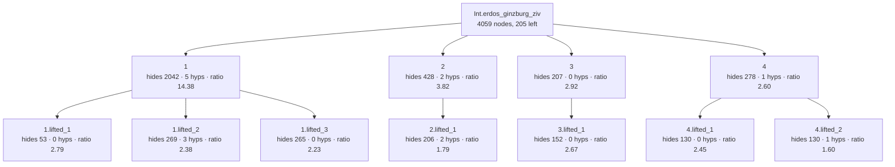
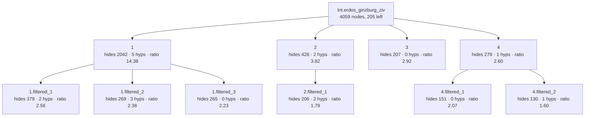
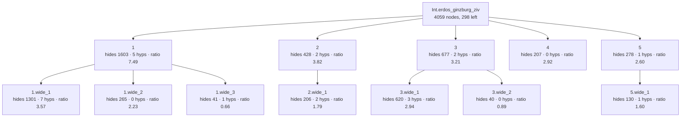

# Erdős–Ginzburg–Ziv over ℤ — recovered skeleton

Combinatorics. Source: `Mathlib/Combinatorics/Additive/ErdosGinzburgZiv.lean`, lines 109–177: one
tactic block of 69 lines. Induction on the prime factorisation of `n` (cases `0`, `1`, prime,
composite). The composite case `m * n` builds, by an inner induction on `k`, a family of
`2m − 1` disjoint `n`-subsets each with sum divisible by `n`, then applies the induction
hypothesis for `m` to the family.

Everything in fenced blocks and stat lines below is copied from `generated/`, which Lean wrote
(`Rosette/Demo.lean`). The tables and prose are my reading. Rating scale: **meaningful** (a step of
the argument a combinatorialist would state), **technical** (technical-but-sensible bookkeeping an
author could name with a `have`), **junk** (artefact: tactic internals, proposition equalities,
instances, renamed copies of the parent, closed trivialities).

## Original statement

```lean
Int.erdos_ginzburg_ziv.{u_1} {ι : Type u_1} {n : ℕ} {s : Finset ι} (a : ι → ℤ)
  (hs : 2 * n - 1 ≤ s.card) : ∃ t ⊆ s, t.card = n ∧ ↑n ∣ ∑ i ∈ t, a i
```

- proof term: **4059** nodes as a DAG (shared subterms once), **39563** as a tree
- candidate boundaries enumerated (Prop-typed subterms of DAG size ≥ 20): 252, of which 2 are typeclass-instance proofs and 3 are values of a `have`

## Skeleton A — `Rosette.Lift` as shipped (score = hidingRatio)

- config `lifted`: levels k = [6, 3], minProof 40, maxStmt 150, maxFraction 0.800000
- result: 11 lemmas in the tree (4 called directly by the main proof); main proof 4059 → **205** nodes
- kernel check: `Int.erdos_ginzburg_ziv.lifted` and all 11 lemmas were added with `addDecl` (synchronous kernel check) and are `theorem`s; `Int.erdos_ginzburg_ziv.lifted` has the identical statement; axioms of the lifted version: [propext, Classical.choice, Quot.sound] (no new axiom)



- **`1`** — hides 2042 proof nodes (tree 33698) · statement 142 nodes · hidingRatio 14.38 · binders: 5 hypotheses, 0 instances (10 supplied from the caller's context) · was `lamBody` in its parent proof, head `«(none)»` · own proof 3525 → 3142 nodes after lifting its children

  ```lean
  Int.erdos_ginzburg_ziv.lifted_1.{u_1} (m : ℕ) (hm : 2 ≤ m)
    (ihm :
      ∀ {ι : Type u_1} {s : Finset ι} (a : ι → ℤ),
        2 * m - 1 ≤ s.card → ∃ t ⊆ s, t.card = m ∧ ↑m ∣ ∑ i ∈ t, a i)
    (n : ℕ) (hn : 2 ≤ n)
    (ihn :
      ∀ {ι : Type u_1} {s : Finset ι} (a : ι → ℤ),
        2 * n - 1 ≤ s.card → ∃ t ⊆ s, t.card = n ∧ ↑n ∣ ∑ i ∈ t, a i)
    {ι : Type u_1} {s : Finset ι} (a : ι → ℤ) (hs : 2 * (m * n) - 1 ≤ s.card) :
    ∃ t ⊆ s, t.card = m * n ∧ ↑(m * n) ∣ ∑ i ∈ t, a i
  ```
  - **`1.lifted_1`** — hides 53 proof nodes (tree 75) · statement 19 nodes · hidingRatio 2.79 · binders: 0 hypotheses, 0 instances (0 supplied from the caller's context) · was `arg` in its parent proof, head `IsLeftCancelAdd.addLeftReflectLE_of_addLeftReflectLT` · statement is a typeclass

    ```lean
    Int.erdos_ginzburg_ziv.lifted_1.lifted_1 : AddLeftReflectLE ℕ
    ```
  - **`1.lifted_2`** — hides 269 proof nodes (tree 2293) · statement 113 nodes · hidingRatio 2.38 · binders: 3 hypotheses, 0 instances (7 supplied from the caller's context) · was `arg` in its parent proof, head `Eq.mpr`

    ```lean
    Int.erdos_ginzburg_ziv.lifted_1.lifted_2.{u_1} {ι : Type u_1} {s : Finset ι} (𝒜 : Finset (Finset ι))
      (h𝒜disj : (↑𝒜).Pairwise Disjoint) (t₀ : Finset ι) (ht₀ : t₀ ⊆ s \ 𝒜.biUnion id) (this : t₀ ∉ 𝒜) :
      (↑(Finset.cons t₀ 𝒜 this)).Pairwise Disjoint
    ```
  - **`1.lifted_3`** — hides 265 proof nodes (tree 2483) · statement 119 nodes · hidingRatio 2.23 · binders: 0 hypotheses, 0 instances (4 supplied from the caller's context) · was `lamBody` in its parent proof, head `Exists.intro`

    ```lean
    Int.erdos_ginzburg_ziv.lifted_1.lifted_3.{u_1} (n : ℕ) {ι : Type u_1} {s : Finset ι} (a : ι → ℤ) :
      ∃ 𝒜,
        𝒜.card = 0 ∧
          (↑𝒜).Pairwise Disjoint ∧ ∀ ⦃t : Finset ι⦄, t ∈ 𝒜 → t ⊆ s ∧ t.card = n ∧ ↑n ∣ ∑ i ∈ t, a i
    ```
- **`2`** — hides 428 proof nodes (tree 1682) · statement 112 nodes · hidingRatio 3.82 · binders: 2 hypotheses, 0 instances (0 supplied from the caller's context) · was `arg` in its parent proof, head `«(none)»` · own proof 428 → 77 nodes after lifting its children

  ```lean
  Int.erdos_ginzburg_ziv.lifted_2.{u_1} (p : ℕ) (hp : Nat.Prime p) {ι : Type u_1} {s : Finset ι}
    (a : ι → ℤ) (hs : 2 * p - 1 ≤ s.card) : ∃ t ⊆ s, t.card = p ∧ ↑p ∣ ∑ i ∈ t, a i
  ```
  - **`2.lifted_1`** — hides 206 proof nodes (tree 1591) · statement 115 nodes · hidingRatio 1.79 · binders: 2 hypotheses, 0 instances (6 supplied from the caller's context) · was `haveBody` in its parent proof, head `Exists.casesOn`

    ```lean
    Int.erdos_ginzburg_ziv.lifted_2.lifted_1.{u_1} (p : ℕ) {ι : Type u_1} {s : Finset ι} (a : ι → ℤ)
      (hs : 2 * p - 1 ≤ s.card) (this : Fact (Nat.Prime p)) : ∃ t ⊆ s, t.card = p ∧ ↑p ∣ ∑ i ∈ t, a i
    ```
- **`3`** — hides 207 proof nodes (tree 1131) · statement 71 nodes · hidingRatio 2.92 · binders: 0 hypotheses, 0 instances (3 supplied from the caller's context) · was `lamBody` in its parent proof, head `Exists.intro` · own proof 227 → 142 nodes after lifting its children

  ```lean
  Int.erdos_ginzburg_ziv.lifted_3.{u_1} {ι : Type u_1} {s : Finset ι} (a : ι → ℤ) :
    ∃ t ⊆ s, t.card = 0 ∧ ↑0 ∣ ∑ i ∈ t, a i
  ```
  - **`3.lifted_1`** — hides 152 proof nodes (tree 605) · statement 57 nodes · hidingRatio 2.67 · binders: 0 hypotheses, 0 instances (2 supplied from the caller's context) · was `arg` in its parent proof, head `Eq.trans`

    ```lean
    Int.erdos_ginzburg_ziv.lifted_3.lifted_1.{u_1} {ι : Type u_1} (a : ι → ℤ) :
      (∅.card = 0 ∧ ↑0 ∣ ∑ i ∈ ∅, a i) = True
    ```
- **`4`** — hides 278 proof nodes (tree 2291) · statement 107 nodes · hidingRatio 2.60 · binders: 1 hypotheses, 0 instances (0 supplied from the caller's context) · was `arg` in its parent proof, head `«(none)»` · own proof 278 → 153 nodes after lifting its children

  ```lean
  Int.erdos_ginzburg_ziv.lifted_4.{u_1} {ι : Type u_1} {s : Finset ι} (a : ι → ℤ)
    (hs : 2 * 1 - 1 ≤ s.card) : ∃ t ⊆ s, t.card = 1 ∧ ↑1 ∣ ∑ i ∈ t, a i
  ```
  - **`4.lifted_1`** — hides 130 proof nodes (tree 513) · statement 53 nodes · hidingRatio 2.45 · binders: 0 hypotheses, 0 instances (3 supplied from the caller's context) · was `arg` in its parent proof, head `Eq.trans`

    ```lean
    Int.erdos_ginzburg_ziv.lifted_4.lifted_1.{u_1} {ι : Type u_1} (a : ι → ℤ) (t : Finset ι) :
      (t.card = 1 ∧ ↑1 ∣ ∑ i ∈ t, a i) = (t.card = 1)
    ```
  - **`4.lifted_2`** — hides 130 proof nodes (tree 943) · statement 81 nodes · hidingRatio 1.60 · binders: 1 hypotheses, 0 instances (3 supplied from the caller's context) · was `arg` in its parent proof, head `Eq.mp`

    ```lean
    Int.erdos_ginzburg_ziv.lifted_4.lifted_2.{u_1} {ι : Type u_1} {s : Finset ι}
      (hs : 2 * 1 - 1 ≤ s.card) : ∃ t ⊆ s, t.card = 1
    ```

| lemma | what it says | rating | note |
|---|---|---|---|
| `1` | EGZ for `m` and EGZ for `n` (both `≥ 2`) imply EGZ for `m * n` | **meaningful** | The multiplicativity step, the heart of the proof. Not a `have`: it is the `composite` argument passed to `Nat.prime_composite_induction`. |
| `1.1` | `AddLeftReflectLE ℕ` | junk | Instance. |
| `1.2` | adding `t₀ ⊆ s \ ⋃𝒜` to a pairwise disjoint family keeps it pairwise disjoint | technical | First bullet of the final `refine`. The membership proof `this` appears as an argument of `Finset.cons` inside the statement. |
| `1.3` | a family of size 0 with the required properties exists | technical | Base case of the inner induction. |
| `2` | EGZ for a prime `p` | **meaningful** | The `prime` case; restates the file's private lemma with `≤` instead of `=`. |
| `2.1` | the same statement with `Fact (Nat.Prime p)` in place of `Nat.Prime p` | junk | The body after `have := Fact.mk hp`: a renamed copy of its parent. |
| `3` | EGZ for `n = 0` | technical | Printed with `↑0 ∣ …`. |
| `3.1` | `(∅.card = 0 ∧ ↑0 ∣ ∑ i ∈ ∅, a i) = True` | junk | `simp` output. |
| `4` | EGZ for `n = 1` | technical | Printed with the unreduced hypothesis `2 * 1 - 1 ≤ s.card`. |
| `4.1` | `(t.card = 1 ∧ ↑1 ∣ ∑ …) = (t.card = 1)` | junk | `simp` output. |
| `4.2` | `∃ t ⊆ s, t.card = 1` | technical | |

**Tally: 2 meaningful, 5 technical, 4 junk (of 11).** The four top-level lemmas are exactly the
four cases of the induction, and the main proof drops from 4059 to 205 nodes. That is a correct
and readable first level. The second level under `1` is poor: the proof's key intermediate
claim (the family of `2m − 1` sets) is missing.

## Skeleton B — `filtered`

- config `filtered`: levels k = [6, 3], minProof 40, maxStmt 150, maxFraction 0.800000
- result: 10 lemmas in the tree (4 called directly by the main proof); main proof 4059 → **205** nodes
- kernel check: `Int.erdos_ginzburg_ziv.filtered` and all 10 lemmas were added with `addDecl` (synchronous kernel check) and are `theorem`s; `Int.erdos_ginzburg_ziv.filtered` has the identical statement; axioms of the lifted version: [propext, Classical.choice, Quot.sound] (no new axiom)



- **`1`** — hides 2042 proof nodes (tree 33698) · statement 142 nodes · hidingRatio 14.38 · binders: 5 hypotheses, 0 instances (10 supplied from the caller's context) · was `lamBody` in its parent proof, head `«(none)»` · own proof 3525 → 2942 nodes after lifting its children

  ```lean
  Int.erdos_ginzburg_ziv.filtered_1.{u_1} (m : ℕ) (hm : 2 ≤ m)
    (ihm :
      ∀ {ι : Type u_1} {s : Finset ι} (a : ι → ℤ),
        2 * m - 1 ≤ s.card → ∃ t ⊆ s, t.card = m ∧ ↑m ∣ ∑ i ∈ t, a i)
    (n : ℕ) (hn : 2 ≤ n)
    (ihn :
      ∀ {ι : Type u_1} {s : Finset ι} (a : ι → ℤ),
        2 * n - 1 ≤ s.card → ∃ t ⊆ s, t.card = n ∧ ↑n ∣ ∑ i ∈ t, a i)
    {ι : Type u_1} {s : Finset ι} (a : ι → ℤ) (hs : 2 * (m * n) - 1 ≤ s.card) :
    ∃ t ⊆ s, t.card = m * n ∧ ↑(m * n) ∣ ∑ i ∈ t, a i
  ```
  - **`1.filtered_1`** — hides 379 proof nodes (tree 6335) · statement 148 nodes · hidingRatio 2.56 · binders: 2 hypotheses, 0 instances (9 supplied from the caller's context) · was `arg` in its parent proof, head `Eq.mpr`

    ```lean
    Int.erdos_ginzburg_ziv.filtered_1.filtered_1.{u_1} (m n : ℕ) {ι : Type u_1} {s : Finset ι}
      (a : ι → ℤ) (k : ℕ) (𝒜 : Finset (Finset ι)) (h𝒜card : 𝒜.card = k)
      (h𝒜 : ∀ ⦃t : Finset ι⦄, t ∈ 𝒜 → t ⊆ s ∧ t.card = n ∧ ↑n ∣ ∑ i ∈ t, a i) :
      (2 * m - k) * n - 1 = 2 * (m * n) - 1 - ∑ t ∈ 𝒜, t.card
    ```
  - **`1.filtered_2`** — hides 269 proof nodes (tree 2293) · statement 113 nodes · hidingRatio 2.38 · binders: 3 hypotheses, 0 instances (7 supplied from the caller's context) · was `arg` in its parent proof, head `Eq.mpr`

    ```lean
    Int.erdos_ginzburg_ziv.filtered_1.filtered_2.{u_1} {ι : Type u_1} {s : Finset ι}
      (𝒜 : Finset (Finset ι)) (h𝒜disj : (↑𝒜).Pairwise Disjoint) (t₀ : Finset ι)
      (ht₀ : t₀ ⊆ s \ 𝒜.biUnion id) (this : t₀ ∉ 𝒜) : (↑(Finset.cons t₀ 𝒜 this)).Pairwise Disjoint
    ```
  - **`1.filtered_3`** — hides 265 proof nodes (tree 2483) · statement 119 nodes · hidingRatio 2.23 · binders: 0 hypotheses, 0 instances (4 supplied from the caller's context) · was `lamBody` in its parent proof, head `Exists.intro`

    ```lean
    Int.erdos_ginzburg_ziv.filtered_1.filtered_3.{u_1} (n : ℕ) {ι : Type u_1} {s : Finset ι}
      (a : ι → ℤ) :
      ∃ 𝒜,
        𝒜.card = 0 ∧
          (↑𝒜).Pairwise Disjoint ∧ ∀ ⦃t : Finset ι⦄, t ∈ 𝒜 → t ⊆ s ∧ t.card = n ∧ ↑n ∣ ∑ i ∈ t, a i
    ```
- **`2`** — hides 428 proof nodes (tree 1682) · statement 112 nodes · hidingRatio 3.82 · binders: 2 hypotheses, 0 instances (0 supplied from the caller's context) · was `arg` in its parent proof, head `«(none)»` · own proof 428 → 77 nodes after lifting its children

  ```lean
  Int.erdos_ginzburg_ziv.filtered_2.{u_1} (p : ℕ) (hp : Nat.Prime p) {ι : Type u_1} {s : Finset ι}
    (a : ι → ℤ) (hs : 2 * p - 1 ≤ s.card) : ∃ t ⊆ s, t.card = p ∧ ↑p ∣ ∑ i ∈ t, a i
  ```
  - **`2.filtered_1`** — hides 206 proof nodes (tree 1591) · statement 115 nodes · hidingRatio 1.79 · binders: 2 hypotheses, 0 instances (6 supplied from the caller's context) · was `haveBody` in its parent proof, head `Exists.casesOn`

    ```lean
    Int.erdos_ginzburg_ziv.filtered_2.filtered_1.{u_1} (p : ℕ) {ι : Type u_1} {s : Finset ι} (a : ι → ℤ)
      (hs : 2 * p - 1 ≤ s.card) (this : Fact (Nat.Prime p)) : ∃ t ⊆ s, t.card = p ∧ ↑p ∣ ∑ i ∈ t, a i
    ```
- **`3`** — hides 207 proof nodes (tree 1131) · statement 71 nodes · hidingRatio 2.92 · binders: 0 hypotheses, 0 instances (3 supplied from the caller's context) · was `lamBody` in its parent proof, head `Exists.intro`

  ```lean
  Int.erdos_ginzburg_ziv.filtered_3.{u_1} {ι : Type u_1} {s : Finset ι} (a : ι → ℤ) :
    ∃ t ⊆ s, t.card = 0 ∧ ↑0 ∣ ∑ i ∈ t, a i
  ```
- **`4`** — hides 278 proof nodes (tree 2291) · statement 107 nodes · hidingRatio 2.60 · binders: 1 hypotheses, 0 instances (0 supplied from the caller's context) · was `arg` in its parent proof, head `«(none)»` · own proof 278 → 145 nodes after lifting its children

  ```lean
  Int.erdos_ginzburg_ziv.filtered_4.{u_1} {ι : Type u_1} {s : Finset ι} (a : ι → ℤ)
    (hs : 2 * 1 - 1 ≤ s.card) : ∃ t ⊆ s, t.card = 1 ∧ ↑1 ∣ ∑ i ∈ t, a i
  ```
  - **`4.filtered_1`** — hides 151 proof nodes (tree 631) · statement 73 nodes · hidingRatio 2.07 · binders: 0 hypotheses, 0 instances (3 supplied from the caller's context) · was `arg` in its parent proof, head `«(none)»`

    ```lean
    Int.erdos_ginzburg_ziv.filtered_4.filtered_1.{u_1} {ι : Type u_1} {s : Finset ι} (a : ι → ℤ)
      (t : Finset ι) : (t ⊆ s ∧ t.card = 1 ∧ ↑1 ∣ ∑ i ∈ t, a i) = (t ⊆ s ∧ t.card = 1)
    ```
  - **`4.filtered_2`** — hides 130 proof nodes (tree 943) · statement 81 nodes · hidingRatio 1.60 · binders: 1 hypotheses, 0 instances (3 supplied from the caller's context) · was `arg` in its parent proof, head `Eq.mp`

    ```lean
    Int.erdos_ginzburg_ziv.filtered_4.filtered_2.{u_1} {ι : Type u_1} {s : Finset ι}
      (hs : 2 * 1 - 1 ≤ s.card) : ∃ t ⊆ s, t.card = 1
    ```

| lemma | rating | note |
|---|---|---|
| `1`, `2` | **meaningful** | as in A |
| `1.1` | technical | `(2m − k)·n − 1 = 2(mn) − 1 − ∑ t ∈ 𝒜, #t`: the second line of the author's `calc`. A boundary the author did write, though as a `calc` step, not a `have`. |
| `1.2`, `1.3`, `3`, `4`, `4.2` | technical | as in A |
| `2.1` | junk | renamed copy of `2` |
| `4.1` | junk | proposition equality; its proof has no head constant, so the head filter missed it |

**Tally: 2 meaningful, 6 technical, 2 junk (of 10).**

## Skeleton C — `wide` (statements up to 500 nodes; each pick at most half its parent)

- config `wide`: levels k = [6, 3], minProof 40, maxStmt 500, maxFraction 0.500000
- result: 12 lemmas in the tree (5 called directly by the main proof); main proof 4059 → **298** nodes
- kernel check: `Int.erdos_ginzburg_ziv.wide` and all 12 lemmas were added with `addDecl` (synchronous kernel check) and are `theorem`s; `Int.erdos_ginzburg_ziv.wide` has the identical statement; axioms of the lifted version: [propext, Classical.choice, Quot.sound] (no new axiom)



- **`1`** — hides 1603 proof nodes (tree 24887) · statement 214 nodes · hidingRatio 7.49 · binders: 5 hypotheses, 0 instances (9 supplied from the caller's context) · was `haveValue` in its parent proof, head `«(none)»` · own proof 2746 → 421 nodes after lifting its children

  ```lean
  Int.erdos_ginzburg_ziv.wide_1.{u_1} (m : ℕ) (hm : 2 ≤ m) (n : ℕ) (hn : 2 ≤ n)
    (ihn :
      ∀ {ι : Type u_1} {s : Finset ι} (a : ι → ℤ),
        2 * n - 1 ≤ s.card → ∃ t ⊆ s, t.card = n ∧ ↑n ∣ ∑ i ∈ t, a i)
    {ι : Type u_1} {s : Finset ι} (a : ι → ℤ) (hs : 2 * (m * n) - 1 ≤ s.card) (k : ℕ)
    (hk : k ≤ 2 * m - 1) :
    ∃ 𝒜,
      𝒜.card = k ∧
        (↑𝒜).Pairwise Disjoint ∧ ∀ ⦃t : Finset ι⦄, t ∈ 𝒜 → t ⊆ s ∧ t.card = n ∧ ↑n ∣ ∑ i ∈ t, a i
  ```
  - **`1.wide_1`** — hides 1301 proof nodes (tree 20903) · statement 364 nodes · hidingRatio 3.57 · binders: 7 hypotheses, 0 instances (14 supplied from the caller's context) · was `lamBody` in its parent proof, head `And.casesOn`

    ```lean
    Int.erdos_ginzburg_ziv.wide_1.wide_1.{u_1} (m : ℕ) (hm : 2 ≤ m) (n : ℕ) (hn : 2 ≤ n)
      (ihn :
        ∀ {ι : Type u_1} {s : Finset ι} (a : ι → ℤ),
          2 * n - 1 ≤ s.card → ∃ t ⊆ s, t.card = n ∧ ↑n ∣ ∑ i ∈ t, a i)
      {ι : Type u_1} {s : Finset ι} (a : ι → ℤ) (hs : 2 * (m * n) - 1 ≤ s.card) (k : ℕ)
      (ih :
        k ≤ 2 * m - 1 →
          ∃ 𝒜,
            𝒜.card = k ∧
              (↑𝒜).Pairwise Disjoint ∧ ∀ ⦃t : Finset ι⦄, t ∈ 𝒜 → t ⊆ s ∧ t.card = n ∧ ↑n ∣ ∑ i ∈ t, a i)
      (hk : k + 1 ≤ 2 * m - 1) (𝒜 : Finset (Finset ι)) :
      (𝒜.card = k ∧
          (↑𝒜).Pairwise Disjoint ∧ ∀ ⦃t : Finset ι⦄, t ∈ 𝒜 → t ⊆ s ∧ t.card = n ∧ ↑n ∣ ∑ i ∈ t, a i) →
        ∃ 𝒜,
          𝒜.card = k + 1 ∧
            (↑𝒜).Pairwise Disjoint ∧ ∀ ⦃t : Finset ι⦄, t ∈ 𝒜 → t ⊆ s ∧ t.card = n ∧ ↑n ∣ ∑ i ∈ t, a i
    ```
  - **`1.wide_2`** — hides 265 proof nodes (tree 2483) · statement 119 nodes · hidingRatio 2.23 · binders: 0 hypotheses, 0 instances (4 supplied from the caller's context) · was `lamBody` in its parent proof, head `Exists.intro`

    ```lean
    Int.erdos_ginzburg_ziv.wide_1.wide_2.{u_1} (n : ℕ) {ι : Type u_1} {s : Finset ι} (a : ι → ℤ) :
      ∃ 𝒜,
        𝒜.card = 0 ∧
          (↑𝒜).Pairwise Disjoint ∧ ∀ ⦃t : Finset ι⦄, t ∈ 𝒜 → t ⊆ s ∧ t.card = n ∧ ↑n ∣ ∑ i ∈ t, a i
    ```
  - **`1.wide_3`** — hides 41 proof nodes (tree 55) · statement 62 nodes · hidingRatio 0.66 · binders: 1 hypotheses, 0 instances (3 supplied from the caller's context) · was `arg` in its parent proof, head `Nat.le_of_succ_le`

    ```lean
    Int.erdos_ginzburg_ziv.wide_1.wide_3 (m k : ℕ) (hk : k + 1 ≤ 2 * m - 1) : k ≤ 2 * m - 1
    ```
- **`2`** — hides 428 proof nodes (tree 1682) · statement 112 nodes · hidingRatio 3.82 · binders: 2 hypotheses, 0 instances (0 supplied from the caller's context) · was `arg` in its parent proof, head `«(none)»` · own proof 428 → 77 nodes after lifting its children

  ```lean
  Int.erdos_ginzburg_ziv.wide_2.{u_1} (p : ℕ) (hp : Nat.Prime p) {ι : Type u_1} {s : Finset ι}
    (a : ι → ℤ) (hs : 2 * p - 1 ≤ s.card) : ∃ t ⊆ s, t.card = p ∧ ↑p ∣ ∑ i ∈ t, a i
  ```
  - **`2.wide_1`** — hides 206 proof nodes (tree 1591) · statement 115 nodes · hidingRatio 1.79 · binders: 2 hypotheses, 0 instances (6 supplied from the caller's context) · was `haveBody` in its parent proof, head `Exists.casesOn`

    ```lean
    Int.erdos_ginzburg_ziv.wide_2.wide_1.{u_1} (p : ℕ) {ι : Type u_1} {s : Finset ι} (a : ι → ℤ)
      (hs : 2 * p - 1 ≤ s.card) (this : Fact (Nat.Prime p)) : ∃ t ⊆ s, t.card = p ∧ ↑p ∣ ∑ i ∈ t, a i
    ```
- **`3`** — hides 677 proof nodes (tree 8569) · statement 211 nodes · hidingRatio 3.21 · binders: 2 hypotheses, 0 instances (7 supplied from the caller's context) · was `haveBody` in its parent proof, head `Exists.casesOn` · own proof 1254 → 360 nodes after lifting its children

  ```lean
  Int.erdos_ginzburg_ziv.wide_3.{u_1} (m : ℕ)
    (ihm :
      ∀ {ι : Type u_1} {s : Finset ι} (a : ι → ℤ),
        2 * m - 1 ≤ s.card → ∃ t ⊆ s, t.card = m ∧ ↑m ∣ ∑ i ∈ t, a i)
    (n : ℕ) {ι : Type u_1} {s : Finset ι} (a : ι → ℤ)
    (this :
      ∀ k ≤ 2 * m - 1,
        ∃ 𝒜,
          𝒜.card = k ∧
            (↑𝒜).Pairwise Disjoint ∧
              ∀ ⦃t : Finset ι⦄, t ∈ 𝒜 → t ⊆ s ∧ t.card = n ∧ ↑n ∣ ∑ i ∈ t, a i) :
    ∃ t ⊆ s, t.card = m * n ∧ ↑(m * n) ∣ ∑ i ∈ t, a i
  ```
  - **`3.wide_1`** — hides 620 proof nodes (tree 7117) · statement 211 nodes · hidingRatio 2.94 · binders: 3 hypotheses, 0 instances (7 supplied from the caller's context) · was `arg` in its parent proof, head `«(none)»`

    ```lean
    Int.erdos_ginzburg_ziv.wide_3.wide_1.{u_1} (m : ℕ)
      (ihm :
        ∀ {ι : Type u_1} {s : Finset ι} (a : ι → ℤ),
          2 * m - 1 ≤ s.card → ∃ t ⊆ s, t.card = m ∧ ↑m ∣ ∑ i ∈ t, a i)
      (n : ℕ) {ι : Type u_1} {s : Finset ι} (a : ι → ℤ) (𝒜 : Finset (Finset ι))
      (h𝒜card : 𝒜.card = 2 * m - 1) :
      ((↑𝒜).Pairwise Disjoint ∧ ∀ ⦃t : Finset ι⦄, t ∈ 𝒜 → t ⊆ s ∧ t.card = n ∧ ↑n ∣ ∑ i ∈ t, a i) →
        ∃ t ⊆ s, t.card = m * n ∧ ↑(m * n) ∣ ∑ i ∈ t, a i
    ```
  - **`3.wide_2`** — hides 40 proof nodes (tree 55) · statement 45 nodes · hidingRatio 0.89 · binders: 0 hypotheses, 0 instances (1 supplied from the caller's context) · was `arg` in its parent proof, head `le_rfl`

    ```lean
    Int.erdos_ginzburg_ziv.wide_3.wide_2 (m : ℕ) : 2 * m - 1 ≤ 2 * m - 1
    ```
- **`4`** — hides 207 proof nodes (tree 1131) · statement 71 nodes · hidingRatio 2.92 · binders: 0 hypotheses, 0 instances (3 supplied from the caller's context) · was `lamBody` in its parent proof, head `Exists.intro`

  ```lean
  Int.erdos_ginzburg_ziv.wide_4.{u_1} {ι : Type u_1} {s : Finset ι} (a : ι → ℤ) :
    ∃ t ⊆ s, t.card = 0 ∧ ↑0 ∣ ∑ i ∈ t, a i
  ```
- **`5`** — hides 278 proof nodes (tree 2291) · statement 107 nodes · hidingRatio 2.60 · binders: 1 hypotheses, 0 instances (0 supplied from the caller's context) · was `arg` in its parent proof, head `«(none)»` · own proof 278 → 232 nodes after lifting its children

  ```lean
  Int.erdos_ginzburg_ziv.wide_5.{u_1} {ι : Type u_1} {s : Finset ι} (a : ι → ℤ)
    (hs : 2 * 1 - 1 ≤ s.card) : ∃ t ⊆ s, t.card = 1 ∧ ↑1 ∣ ∑ i ∈ t, a i
  ```
  - **`5.wide_1`** — hides 130 proof nodes (tree 943) · statement 81 nodes · hidingRatio 1.60 · binders: 1 hypotheses, 0 instances (3 supplied from the caller's context) · was `arg` in its parent proof, head `Eq.mp`

    ```lean
    Int.erdos_ginzburg_ziv.wide_5.wide_1.{u_1} {ι : Type u_1} {s : Finset ι} (hs : 2 * 1 - 1 ≤ s.card) :
      ∃ t ⊆ s, t.card = 1
    ```

| lemma | what it says | rating | note |
|---|---|---|---|
| `1` | for every `k ≤ 2m − 1` there is a family of `k` pairwise disjoint `n`-subsets of `s` with sums divisible by `n` | **meaningful** | Verbatim the claim of the author's `suffices`. |
| `1.1` | inductive step `k → k + 1` for that family | technical | Correct step, but 364 nodes and 7 hypotheses: the family property is written out three times, and the induction hypothesis `ih` is quantified although the conclusion already assumes a family of size `k`. |
| `1.2` | base case `k = 0` | technical | |
| `1.3` | `k + 1 ≤ 2m − 1 → k ≤ 2m − 1` | junk | One instance of `Nat.le_of_succ_le`. |
| `2` | EGZ for a prime | **meaningful** | |
| `2.1` | copy of `2` with `Fact` | junk | |
| `3` | EGZ for `m` plus such a family for every `k ≤ 2m − 1` imply the conclusion for `m * n` | **meaningful** | The other half of the `suffices`. |
| `3.1` | the same with the family of size `2m − 1` already chosen | junk | Body after `obtain`: a near copy of `3`. |
| `3.2` | `2m − 1 ≤ 2m − 1` | junk | |
| `4`, `5`, `5.1` | cases `0`, `1`, and `∃ t ⊆ s, #t = 1` | technical | |

**Tally: 3 meaningful, 5 technical, 4 junk (of 12).** `1` and `3` together are precisely the
author's `suffices … by …` split, recovered from the term. The price of the half-of-parent limit
is that the multiplicativity lemma (A `1`) is no longer a node of its own.

## Comparison with the `have` statements the author wrote

The term contains only 3 `have` values of at least 20 nodes: the `suffices` claim, the counting
bound `2n − 1 ≤ #(s \ 𝒜.biUnion id)`, and `t₀ ∉ 𝒜`.

- The `suffices` claim ranks 6th of 252 by hidingRatio, but its closed statement has 214 nodes,
  so the shipped bound of 150 rejects it. `wide` recovers it.
- The counting bound ranks 28th (190 nodes, 5 hypotheses) and is never selected; `filtered`
  instead picks one line of the `calc` inside it.
- `t₀ ∉ 𝒜` ranks 108th. The author's three-word statement becomes a closed statement of 311
  nodes with 9 hypotheses, because its proof touches most of the local context. This is the
  clearest example in the demo of a `have` that is short only *in context*.
- The first-level structure (four cases) and the two halves of `suffices` are recovered although
  none of them is a `have` in the term: they are arguments of the induction principle and a
  continuation.

Every value of a `have` (non-dependent `let`) in the elaborated term with proof DAG size ≥ 20, in source order (a value that occurs at several positions is listed once). `rank` is the position among all 252 distinct candidates sorted by hidingRatio (1 = best). The statement shown is the *closed* one: all hypotheses the proof of the `have` actually uses are quantified.

- rank 6/252 · ratio 7.49 · proof 1603 · statement 214 · 4 hyps

  ```lean
  ∀ (m : ℕ), 2 ≤ m → ∀ (n : ℕ), 2 ≤ n → (∀ {ι : Type u_1} {s : Finset ι} (a : ι → ℤ), 2 * n - 1 ≤ s.card → ∃ t ⊆ s, t.card = n ∧ ↑n ∣ ∑ i ∈ t, a i) → ∀ {ι : Type u_1} {s : Finset ι} (a : ι → ℤ), 2 * (m * n) - 1 ≤ s.card → ∀ k ≤ 2 * m - 1, ∃ 𝒜, 𝒜.card = k ∧ (↑𝒜).Pairwise Disjoint ∧ ∀ ⦃t : Finset ι⦄, t ∈ 𝒜 → t ⊆ s ∧ t.card = n ∧ ↑n ∣ ∑ i ∈ t, a i
  ```
- rank 28/252 · ratio 2.65 · proof 503 · statement 190 · 5 hyps

  ```lean
  ∀ (m : ℕ), 2 ≤ m → ∀ (n : ℕ) {ι : Type u_1} {s : Finset ι} (a : ι → ℤ), 2 * (m * n) - 1 ≤ s.card → ∀ (k : ℕ), k + 1 ≤ 2 * m - 1 → ∀ (𝒜 : Finset (Finset ι)), 𝒜.card = k → (∀ ⦃t : Finset ι⦄, t ∈ 𝒜 → t ⊆ s ∧ t.card = n ∧ ↑n ∣ ∑ i ∈ t, a i) → 2 * n - 1 ≤ (s \ 𝒜.biUnion id).card
  ```
- rank 108/252 · ratio 1.39 · proof 432 · statement 311 · 9 hyps

  ```lean
  ∀ (m n : ℕ), 2 ≤ n → (∀ {ι : Type u_1} {s : Finset ι} (a : ι → ℤ), 2 * n - 1 ≤ s.card → ∃ t ⊆ s, t.card = n ∧ ↑n ∣ ∑ i ∈ t, a i) → ∀ {ι : Type u_1} {s : Finset ι} (a : ι → ℤ), 2 * (m * n) - 1 ≤ s.card → ∀ (k : ℕ), (k ≤ 2 * m - 1 → ∃ 𝒜, 𝒜.card = k ∧ (↑𝒜).Pairwise Disjoint ∧ ∀ ⦃t : Finset ι⦄, t ∈ 𝒜 → t ⊆ s ∧ t.card = n ∧ ↑n ∣ ∑ i ∈ t, a i) → ∀ (𝒜 : Finset (Finset ι)), (∀ ⦃t : Finset ι⦄, t ∈ 𝒜 → t ⊆ s ∧ t.card = n ∧ ↑n ∣ ∑ i ∈ t, a i) → 2 * n - 1 ≤ (s \ 𝒜.biUnion id).card → ∀ t₀ ⊆ s \ 𝒜.biUnion id, t₀.card = n → ↑n ∣ ∑ i ∈ t₀, a i → t₀ ∈ 𝒜 → False
  ```

## Verdict for this proof

Readable at the first level in all three configurations, and `wide` reproduces the author's own
decomposition. The statements are long because each one repeats the family property
`∀ t ∈ 𝒜, t ⊆ s ∧ #t = n ∧ n ∣ ∑ …`; a human would introduce a local definition for it. The
term has no such definition to offer, so this needs a presentation step (common-subterm
abbreviation across the lemmas of one skeleton).
