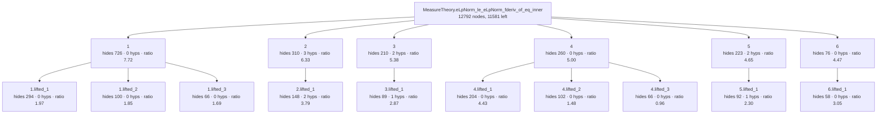
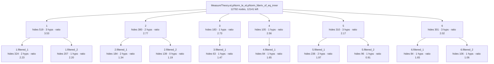

# Gagliardo–Nirenberg–Sobolev inequality — recovered skeleton

Analysis, PDE-adjacent. Source: `Mathlib/Analysis/FunctionalSpaces/SobolevInequality.lean`, lines
467–585: one tactic block of 119 lines. The argument: reduce `p > 1` to the `p = 1` inequality
applied to `v = ‖u‖^γ` with `γ = p(n−1)/(n−p)`; bound `‖Dv‖` by `γ ‖u‖^(γ−1) ‖Du‖`; apply
Hölder with exponents `p, q`; divide by `(∫‖u‖^p')^(1/q)`. About half of the source is exponent
arithmetic (`h2p … h4γ`), the other half is one long `calc`.

**This is the negative case of the demo.** No configuration recovers a single step of the
mathematical argument.

Everything in fenced blocks and stat lines below is copied from `generated/`, which Lean wrote
(`Rosette/Demo.lean`). The tables and prose are my reading. Rating scale: **meaningful** (a step of
the argument an analyst would state), **technical** (technical-but-sensible bookkeeping an author
could name with a `have`), **junk** (artefact: tactic internals, proposition equalities,
instances, renamed copies of the parent, closed trivialities).

## Original statement

```lean
MeasureTheory.eLpNorm_le_eLpNorm_fderiv_of_eq_inner.{u_4, u_5} {E : Type u_4} [NormedAddCommGroup E]
  [NormedSpace ℝ E] [MeasurableSpace E] [BorelSpace E] [FiniteDimensional ℝ E]
  (μ : MeasureTheory.Measure E) [μ.IsAddHaarMeasure] {F' : Type u_5} [NormedAddCommGroup F']
  [InnerProductSpace ℝ F'] {u : E → F'} (hu : ContDiff ℝ 1 u) (h2u : HasCompactSupport u)
  {p p' : NNReal} (hp : 1 ≤ p) (hn : 0 < Module.finrank ℝ E)
  (hp' : (↑p')⁻¹ = ↑p⁻¹ - (↑(Module.finrank ℝ E))⁻¹) :
  MeasureTheory.eLpNorm u (↑p') μ ≤
    ↑(MeasureTheory.eLpNormLESNormFDerivOfEqInnerConst μ ↑p) *
      MeasureTheory.eLpNorm (fderiv ℝ u) (↑p) μ
```

- proof term: **12792** nodes as a DAG (shared subterms once), **1189531** as a tree
- candidate boundaries enumerated (Prop-typed subterms of DAG size ≥ 20): 1152, of which 32 are typeclass-instance proofs and 26 are values of a `have`

## Skeleton A — `Rosette.Lift` as shipped (score = hidingRatio)

- config `lifted`: levels k = [6, 3], minProof 40, maxStmt 150, maxFraction 0.800000
- result: 16 lemmas in the tree (6 called directly by the main proof); main proof 12792 → **11581** nodes
- kernel check: `MeasureTheory.eLpNorm_le_eLpNorm_fderiv_of_eq_inner.lifted` and all 16 lemmas were added with `addDecl` (synchronous kernel check) and are `theorem`s; `MeasureTheory.eLpNorm_le_eLpNorm_fderiv_of_eq_inner.lifted` has the identical statement; axioms of the lifted version: [propext, Classical.choice, Quot.sound] (no new axiom)



- **`1`** — hides 726 proof nodes (tree 35955) · statement 94 nodes · hidingRatio 7.72 · binders: 0 hypotheses, 2 instances (4 supplied from the caller's context) · was `haveValue` in its parent proof, head `Mathlib.Tactic.Ring.of_eq` · own proof 778 → 714 nodes after lifting its children

  ```lean
  MeasureTheory.eLpNorm_le_eLpNorm_fderiv_of_eq_inner.lifted_1.{u_4} {E : Type u_4}
    [NormedAddCommGroup E] [NormedSpace ℝ E] {p : NNReal} :
    let n := Module.finrank ℝ E;
    ↑p * (↑n - 1) - (↑n - ↑p) = ↑n * (↑p - 1)
  ```
  - **`1.lifted_1`** — hides 294 proof nodes (tree 3499) · statement 149 nodes · hidingRatio 1.97 · binders: 0 hypotheses, 0 instances (1 supplied from the caller's context) · was `arg` in its parent proof, head `Mathlib.Tactic.Ring.Common.sub_congr`

    ```lean
    MeasureTheory.eLpNorm_le_eLpNorm_fderiv_of_eq_inner.lifted_1.lifted_1 {p : NNReal} :
      ↑p - 1 = (Int.negOfNat 1).rawCast + (↑p ^ Nat.rawCast 1 * Nat.rawCast 1 + 0)
    ```
  - **`1.lifted_2`** — hides 100 proof nodes (tree 335) · statement 54 nodes · hidingRatio 1.85 · binders: 0 hypotheses, 0 instances (0 supplied from the caller's context) · was `arg` in its parent proof, head `Mathlib.Meta.NormNum.IsInt.to_raw_eq`

    ```lean
    MeasureTheory.eLpNorm_le_eLpNorm_fderiv_of_eq_inner.lifted_1.lifted_2 :
      Nat.rawCast 1 * (Int.negOfNat 1).rawCast = (Int.negOfNat 1).rawCast
    ```
  - **`1.lifted_3`** — hides 66 proof nodes (tree 275) · statement 39 nodes · hidingRatio 1.69 · binders: 0 hypotheses, 0 instances (0 supplied from the caller's context) · was `arg` in its parent proof, head `Mathlib.Meta.NormNum.IsNat.to_raw_eq`

    ```lean
    MeasureTheory.eLpNorm_le_eLpNorm_fderiv_of_eq_inner.lifted_1.lifted_3 :
      Nat.rawCast 1 * Nat.rawCast 1 = Nat.rawCast 1
    ```
- **`2`** — hides 310 proof nodes (tree 751) · statement 49 nodes · hidingRatio 6.33 · binders: 3 hypotheses, 2 instances (0 supplied from the caller's context) · was `fn` in its parent proof, head `«(none)»` · own proof 310 → 146 nodes after lifting its children

  ```lean
  MeasureTheory.eLpNorm_le_eLpNorm_fderiv_of_eq_inner.lifted_2 (α : Type) (self self' : LE α)
    (e'_2 : self = self') (a✝ a'✝ : α) (e'_3 : a✝ = a'✝) (a✝¹ a'✝¹ : α) (e'_4 : a✝¹ = a'✝¹) :
    (a✝ ≤ a✝¹) ≍ (a'✝ ≤ a'✝¹)
  ```
  - **`2.lifted_1`** — hides 148 proof nodes (tree 449) · statement 39 nodes · hidingRatio 3.79 · binders: 2 hypotheses, 1 instances (8 supplied from the caller's context) · was `lamBody` in its parent proof, head `Eq.casesOn`

    ```lean
    MeasureTheory.eLpNorm_le_eLpNorm_fderiv_of_eq_inner.lifted_2.lifted_1 (α : Type) (self : LE α)
      (a✝ a'✝ : α) (e'_3 : a✝ = a'✝) (a✝¹ a'✝¹ : α) (e'_4 : a✝¹ = a'✝¹) : (a✝ ≤ a✝¹) ≍ (a'✝ ≤ a'✝¹)
    ```
- **`3`** — hides 210 proof nodes (tree 479) · statement 39 nodes · hidingRatio 5.38 · binders: 2 hypotheses, 1 instances (0 supplied from the caller's context) · was `fn` in its parent proof, head `«(none)»` · own proof 210 → 129 nodes after lifting its children

  ```lean
  MeasureTheory.eLpNorm_le_eLpNorm_fderiv_of_eq_inner.lifted_3 (α : Type) (self : LE α) (a✝ a'✝ : α)
    (e'_3 : a✝ = a'✝) (a✝¹ a'✝¹ : α) (e'_4 : a✝¹ = a'✝¹) : (a✝ ≤ a✝¹) ≍ (a'✝ ≤ a'✝¹)
  ```
  - **`3.lifted_1`** — hides 89 proof nodes (tree 231) · statement 31 nodes · hidingRatio 2.87 · binders: 1 hypotheses, 1 instances (6 supplied from the caller's context) · was `lamBody` in its parent proof, head `Eq.casesOn`

    ```lean
    MeasureTheory.eLpNorm_le_eLpNorm_fderiv_of_eq_inner.lifted_3.lifted_1 (α : Type) (self : LE α)
      (a✝ a✝¹ a'✝ : α) (e'_4 : a✝¹ = a'✝) : (a✝ ≤ a✝¹) ≍ (a✝ ≤ a'✝)
    ```
- **`4`** — hides 260 proof nodes (tree 2409) · statement 52 nodes · hidingRatio 5.00 · binders: 0 hypotheses, 0 instances (1 supplied from the caller's context) · was `arg` in its parent proof, head `Mathlib.Tactic.FieldSimp.eq_mul_of_eq_eq_eq_mul` · own proof 263 → 87 nodes after lifting its children

  ```lean
  MeasureTheory.eLpNorm_le_eLpNorm_fderiv_of_eq_inner.lifted_4 {p : NNReal} :
    ↑p = Mathlib.Tactic.FieldSimp.NF.eval [] * ↑p
  ```
  - **`4.lifted_1`** — hides 204 proof nodes (tree 1491) · statement 46 nodes · hidingRatio 4.43 · binders: 0 hypotheses, 0 instances (1 supplied from the caller's context) · was `arg` in its parent proof, head `Mathlib.Tactic.FieldSimp.eq_div_of_eq_one_of_subst`

    ```lean
    MeasureTheory.eLpNorm_le_eLpNorm_fderiv_of_eq_inner.lifted_4.lifted_1 {p : NNReal} :
      ((1, ↑p) ::ᵣ []).eval = ↑p
    ```
  - **`4.lifted_2`** — hides 102 proof nodes (tree 547) · statement 69 nodes · hidingRatio 1.48 · binders: 0 hypotheses, 0 instances (1 supplied from the caller's context) · was `arg` in its parent proof, head `Eq.trans`

    ```lean
    MeasureTheory.eLpNorm_le_eLpNorm_fderiv_of_eq_inner.lifted_4.lifted_2 {p : NNReal} :
      ↑p = Mathlib.Tactic.FieldSimp.NF.eval [] * ((1, ↑p) ::ᵣ []).eval
    ```
  - **`4.lifted_3`** — hides 66 proof nodes (tree 121) · statement 69 nodes · hidingRatio 0.96 · binders: 0 hypotheses, 0 instances (1 supplied from the caller's context) · was `arg` in its parent proof, head `rfl`

    ```lean
    MeasureTheory.eLpNorm_le_eLpNorm_fderiv_of_eq_inner.lifted_4.lifted_3 {p : NNReal} :
      Mathlib.Tactic.FieldSimp.NF.eval [] * ((1, ↑p) ::ᵣ []).eval =
        Mathlib.Tactic.FieldSimp.NF.eval [] * ((1, ↑p) ::ᵣ []).eval
    ```
- **`5`** — hides 223 proof nodes (tree 525) · statement 48 nodes · hidingRatio 4.65 · binders: 2 hypotheses, 1 instances (0 supplied from the caller's context) · was `fn` in its parent proof, head `«(none)»` · own proof 223 → 140 nodes after lifting its children

  ```lean
  MeasureTheory.eLpNorm_le_eLpNorm_fderiv_of_eq_inner.lifted_5 (α β : Type) (γ : outParam Type)
    (self : HMul α β γ) (a✝ a'✝ : α) (e'_5 : a✝ = a'✝) (a✝¹ a'✝¹ : β) (e'_6 : a✝¹ = a'✝¹) :
    a✝ * a✝¹ ≍ a'✝ * a'✝¹
  ```
  - **`5.lifted_1`** — hides 92 proof nodes (tree 251) · statement 40 nodes · hidingRatio 2.30 · binders: 1 hypotheses, 1 instances (8 supplied from the caller's context) · was `lamBody` in its parent proof, head `Eq.casesOn`

    ```lean
    MeasureTheory.eLpNorm_le_eLpNorm_fderiv_of_eq_inner.lifted_5.lifted_1 (α β : Type)
      (γ : outParam Type) (self : HMul α β γ) (a✝ : α) (a✝¹ a'✝ : β) (e'_6 : a✝¹ = a'✝) :
      a✝ * a✝¹ ≍ a✝ * a'✝
    ```
- **`6`** — hides 76 proof nodes (tree 107) · statement 17 nodes · hidingRatio 4.47 · binders: 0 hypotheses, 0 instances (0 supplied from the caller's context) · was `arg` in its parent proof, head `instIsRightCancelAddOfAddRightReflectLE` · statement is a typeclass · own proof 76 → 21 nodes after lifting its children

  ```lean
  MeasureTheory.eLpNorm_le_eLpNorm_fderiv_of_eq_inner.lifted_6 : IsRightCancelAdd ℝ
  ```
  - **`6.lifted_1`** — hides 58 proof nodes (tree 83) · statement 19 nodes · hidingRatio 3.05 · binders: 0 hypotheses, 0 instances (0 supplied from the caller's context) · was `arg` in its parent proof, head `addRightReflectLE_of_addLeftReflectLE` · statement is a typeclass

    ```lean
    MeasureTheory.eLpNorm_le_eLpNorm_fderiv_of_eq_inner.lifted_6.lifted_1 : AddRightReflectLE ℝ
    ```

| lemma | what it says | rating | note |
|---|---|---|---|
| `1` | `p(n−1) − (n−p) = n(p−1)` | technical | Verbatim the author's `have … := by ring` inside `h3γ`. The statement carries two instance arguments and a `let n := Module.finrank ℝ E` for what is an identity in two real variables. |
| `1.1`, `1.2`, `1.3` | identities between `Nat.rawCast` / `Int.negOfNat … .rawCast` expressions | junk | Certificates of the `ring` normaliser. |
| `2`, `2.1`, `3`, `3.1` | `self = self' → a = a' → b = b' → (a ≤ b) ≍ (a' ≤ b')` and variants | junk | Heterogeneous-equality congruence lemmas that `convert` builds inline. Binder names are `a✝¹`, `e'_2`, `a'✝¹`. |
| `4` | `p = NF.eval [] * p` | junk | `field_simp` normal form. |
| `4.1`, `4.2`, `4.3` | `((1, p) ::ᵣ []).eval = p` and variants; `4.3` is `X = X` | junk | `field_simp` internals. |
| `5`, `5.1` | `a = a' → b = b' → a * b ≍ a' * b'` | junk | The same kind of `convert` congruence lemma, for `HMul`. |
| `6`, `6.1` | `IsRightCancelAdd ℝ`, `AddRightReflectLE ℝ` | junk | Typeclass-instance proofs. |

**Tally: 0 meaningful, 1 technical, 15 junk (of 16).** The main proof goes from 12792 to 11581
nodes: nothing of substance was lifted. Statements about tactic internals are short and their
proofs are long, so hidingRatio prefers them to everything the author wrote.

(Before the enumeration was made DAG-aware this configuration lifted 11 lemmas: several of the six
top-level slots were taken by repeated positions of one subterm. With one candidate per distinct
subterm all six slots go to distinct lemmas; the five extra ones are more junk.)

## Skeleton B — `filtered`

- config `filtered`: levels k = [6, 3], minProof 40, maxStmt 150, maxFraction 0.800000
- result: 16 lemmas in the tree (6 called directly by the main proof); main proof 12792 → **12141** nodes
- kernel check: `MeasureTheory.eLpNorm_le_eLpNorm_fderiv_of_eq_inner.filtered` and all 16 lemmas were added with `addDecl` (synchronous kernel check) and are `theorem`s; `MeasureTheory.eLpNorm_le_eLpNorm_fderiv_of_eq_inner.filtered` has the identical statement; axioms of the lifted version: [propext, Classical.choice, Quot.sound] (no new axiom)



- **`1`** — hides 519 proof nodes (tree 2258) · statement 147 nodes · hidingRatio 3.53 · binders: 3 hypotheses, 2 instances (7 supplied from the caller's context) · was `haveBody` in its parent proof, head `Eq.mp` · own proof 574 → 207 nodes after lifting its children

  ```lean
  MeasureTheory.eLpNorm_le_eLpNorm_fderiv_of_eq_inner.filtered_1.{u_4} {E : Type u_4}
    [NormedAddCommGroup E] [NormedSpace ℝ E] {p : NNReal} (hp : 1 ≤ p) (hn : 0 < Module.finrank ℝ E) :
    let n := Module.finrank ℝ E;
    0 < ↑p⁻¹ - (↑n)⁻¹ → ↑p < ↑n
  ```
  - **`1.filtered_1`** — hides 324 proof nodes (tree 1162) · statement 145 nodes · hidingRatio 2.23 · binders: 2 hypotheses, 2 instances (6 supplied from the caller's context) · was `arg` in its parent proof, head `inv_lt_inv₀`

    ```lean
    MeasureTheory.eLpNorm_le_eLpNorm_fderiv_of_eq_inner.filtered_1.filtered_1.{u_4} {E : Type u_4}
      [NormedAddCommGroup E] [NormedSpace ℝ E] {p : NNReal} (hp : 1 ≤ p) (hn : 0 < Module.finrank ℝ E) :
      let n := Module.finrank ℝ E;
      (↑n)⁻¹ < (↑p)⁻¹ ↔ ↑p < ↑n
    ```
  - **`1.filtered_2`** — hides 207 proof nodes (tree 721) · statement 94 nodes · hidingRatio 2.20 · binders: 1 hypotheses, 2 instances (5 supplied from the caller's context) · was `arg` in its parent proof, head `Eq.mp`

    ```lean
    MeasureTheory.eLpNorm_le_eLpNorm_fderiv_of_eq_inner.filtered_1.filtered_2.{u_4} {E : Type u_4}
      [NormedAddCommGroup E] [NormedSpace ℝ E] {p : NNReal} :
      let n := Module.finrank ℝ E;
      0 < ↑p⁻¹ - (↑n)⁻¹ → (↑n)⁻¹ < (↑p)⁻¹
    ```
- **`2`** — hides 380 proof nodes (tree 3455) · statement 137 nodes · hidingRatio 2.77 · binders: 2 hypotheses, 2 instances (6 supplied from the caller's context) · was `arg` in its parent proof, head `Eq.mpr` · own proof 450 → 306 nodes after lifting its children

  ```lean
  MeasureTheory.eLpNorm_le_eLpNorm_fderiv_of_eq_inner.filtered_2.{u_4} {E : Type u_4}
    [NormedAddCommGroup E] [NormedSpace ℝ E] {p : NNReal} :
    let n := Module.finrank ℝ E;
    let n' := (↑n).conjExponent;
    (↑n).HolderConjugate n' → 1 < p → ↑n - ↑p < ↑p * (↑n - 1)
  ```
  - **`2.filtered_1`** — hides 184 proof nodes (tree 615) · statement 137 nodes · hidingRatio 1.34 · binders: 2 hypotheses, 2 instances (6 supplied from the caller's context) · was `arg` in its parent proof, head `Eq.mpr`

    ```lean
    MeasureTheory.eLpNorm_le_eLpNorm_fderiv_of_eq_inner.filtered_2.filtered_1.{u_4} {E : Type u_4}
      [NormedAddCommGroup E] [NormedSpace ℝ E] {p : NNReal} :
      let n := Module.finrank ℝ E;
      let n' := (↑n).conjExponent;
      (↑n).HolderConjugate n' → 1 < p → ↑n < ↑p * ↑n
    ```
  - **`2.filtered_2`** — hides 139 proof nodes (tree 227) · statement 117 nodes · hidingRatio 1.19 · binders: 0 hypotheses, 2 instances (4 supplied from the caller's context) · was `arg` in its parent proof, head `sub_lt_sub_iff_right`

    ```lean
    MeasureTheory.eLpNorm_le_eLpNorm_fderiv_of_eq_inner.filtered_2.filtered_2.{u_4} {E : Type u_4}
      [NormedAddCommGroup E] [NormedSpace ℝ E] {p : NNReal} :
      let n := Module.finrank ℝ E;
      ↑n - ↑p < ↑p * ↑n - ↑p ↔ ↑n < ↑p * ↑n
    ```
- **`3`** — hides 183 proof nodes (tree 317) · statement 67 nodes · hidingRatio 2.73 · binders: 1 hypotheses, 0 instances (2 supplied from the caller's context) · was `arg` in its parent proof, head `ENNReal.zero_rpow_of_pos` · own proof 193 → 143 nodes after lifting its children

  ```lean
  MeasureTheory.eLpNorm_le_eLpNorm_fderiv_of_eq_inner.filtered_3 {p' : NNReal} (hp'0 : ¬p' = 0) :
    0 ^ (1 / ↑p') = 0
  ```
  - **`3.filtered_1`** — hides 63 proof nodes (tree 107) · statement 43 nodes · hidingRatio 1.47 · binders: 1 hypotheses, 0 instances (2 supplied from the caller's context) · was `arg` in its parent proof, head `lt_of_le_of_ne'`

    ```lean
    MeasureTheory.eLpNorm_le_eLpNorm_fderiv_of_eq_inner.filtered_3.filtered_1 {p' : NNReal}
      (hp'0 : ¬p' = 0) : 0 < p'
    ```
- **`4`** — hides 105 proof nodes (tree 179) · statement 41 nodes · hidingRatio 2.56 · binders: 1 hypotheses, 0 instances (2 supplied from the caller's context) · was `arg` in its parent proof, head `ne_of_gt` · own proof 116 → 52 nodes after lifting its children

  ```lean
  MeasureTheory.eLpNorm_le_eLpNorm_fderiv_of_eq_inner.filtered_4 {p : NNReal} (hp : 1 ≤ p) : ↑p ≠ 0
  ```
  - **`4.filtered_1`** — hides 84 proof nodes (tree 149) · statement 51 nodes · hidingRatio 1.65 · binders: 1 hypotheses, 0 instances (2 supplied from the caller's context) · was `arg` in its parent proof, head `lt_of_lt_of_le`

    ```lean
    MeasureTheory.eLpNorm_le_eLpNorm_fderiv_of_eq_inner.filtered_4.filtered_1 {p : NNReal}
      (hp : 1 ≤ p) : 0 < p
    ```
- **`5`** — hides 310 proof nodes (tree 3758) · statement 143 nodes · hidingRatio 2.17 · binders: 3 hypotheses, 2 instances (8 supplied from the caller's context) · was `arg` in its parent proof, head `Eq.mpr` · own proof 394 → 187 nodes after lifting its children

  ```lean
  MeasureTheory.eLpNorm_le_eLpNorm_fderiv_of_eq_inner.filtered_5.{u_4} {E : Type u_4}
    [NormedAddCommGroup E] [NormedSpace ℝ E] {p p' : NNReal}
    (hp' : (↑p')⁻¹ = ↑p⁻¹ - (↑(Module.finrank ℝ E))⁻¹) :
    let n := Module.finrank ℝ E;
    let n' := (↑n).conjExponent;
    (↑n).HolderConjugate n' →
      let q := (↑p).conjExponent;
      (↑p).HolderConjugate q → (↑n')⁻¹ - q⁻¹ = (↑p')⁻¹
  ```
  - **`5.filtered_1`** — hides 236 proof nodes (tree 3053) · statement 120 nodes · hidingRatio 1.97 · binders: 2 hypotheses, 2 instances (6 supplied from the caller's context) · was `arg` in its parent proof, head `Eq.mpr`

    ```lean
    MeasureTheory.eLpNorm_le_eLpNorm_fderiv_of_eq_inner.filtered_5.filtered_1.{u_4} {E : Type u_4}
      [NormedAddCommGroup E] [NormedSpace ℝ E] {p : NNReal} :
      let n := Module.finrank ℝ E;
      let n' := (↑n).conjExponent;
      (↑n).HolderConjugate n' →
        let q := (↑p).conjExponent;
        (↑p).HolderConjugate q → (↑n')⁻¹ - q⁻¹ = ↑p⁻¹ - (↑n)⁻¹
    ```
  - **`5.filtered_2`** — hides 96 proof nodes (tree 314) · statement 106 nodes · hidingRatio 0.91 · binders: 1 hypotheses, 2 instances (6 supplied from the caller's context) · was `arg` in its parent proof, head `Eq.mp`

    ```lean
    MeasureTheory.eLpNorm_le_eLpNorm_fderiv_of_eq_inner.filtered_5.filtered_2.{u_4} {E : Type u_4}
      [NormedAddCommGroup E] [NormedSpace ℝ E] {p p' : NNReal}
      (hp' : (↑p')⁻¹ = ↑p⁻¹ - (↑(Module.finrank ℝ E))⁻¹) :
      let n := Module.finrank ℝ E;
      (↑p')⁻¹ = ↑p⁻¹ - (↑n)⁻¹
    ```
- **`6`** — hides 301 proof nodes (tree 647) · statement 149 nodes · hidingRatio 2.02 · binders: 3 hypotheses, 2 instances (7 supplied from the caller's context) · was `arg` in its parent proof, head `le_of_lt` · own proof 359 → 219 nodes after lifting its children

  ```lean
  MeasureTheory.eLpNorm_le_eLpNorm_fderiv_of_eq_inner.filtered_6.{u_4} {E : Type u_4}
    [NormedAddCommGroup E] [NormedSpace ℝ E] {p : NNReal} (hp : 1 ≤ p) :
    let n := Module.finrank ℝ E;
    ↑p < ↑n → 0 < ↑n - 1 → 0 ≤ ↑p * (↑n - 1) / (↑n - ↑p)
  ```
  - **`6.filtered_1`** — hides 84 proof nodes (tree 149) · statement 51 nodes · hidingRatio 1.65 · binders: 1 hypotheses, 0 instances (2 supplied from the caller's context) · was `arg` in its parent proof, head `lt_of_lt_of_le`

    ```lean
    MeasureTheory.eLpNorm_le_eLpNorm_fderiv_of_eq_inner.filtered_6.filtered_1 {p : NNReal}
      (hp : 1 ≤ p) : 0 < p
    ```
  - **`6.filtered_2`** — hides 106 proof nodes (tree 163) · statement 100 nodes · hidingRatio 1.06 · binders: 1 hypotheses, 2 instances (5 supplied from the caller's context) · was `arg` in its parent proof, head `sub_pos_of_lt`

    ```lean
    MeasureTheory.eLpNorm_le_eLpNorm_fderiv_of_eq_inner.filtered_6.filtered_2.{u_4} {E : Type u_4}
      [NormedAddCommGroup E] [NormedSpace ℝ E] {p : NNReal} :
      let n := Module.finrank ℝ E;
      ↑p < ↑n → 0 < ↑n - ↑p
    ```

| lemma | what it says | rating | note |
|---|---|---|---|
| `1` | `0 < p⁻¹ − n⁻¹ → p < n` | technical | The tail of the author's `have h2p`. |
| `1.1` | `n⁻¹ < p⁻¹ ↔ p < n` | technical | `inv_lt_inv₀` with its side conditions discharged. |
| `1.2` | `0 < p⁻¹ − n⁻¹ → n⁻¹ < p⁻¹` | junk | One `sub_pos` rewrite. |
| `2` | `1 < p → n − p < p(n−1)` | technical | Core of `h1γ : 1 < γ`. Carries the hypothesis `HolderConjugate n n'`, which the proof uses only to get `0 < n`. |
| `2.1` | `1 < p → n < p·n` | technical | |
| `2.2` | `n − p < p·n − p ↔ n < p·n` | junk | Instance of `sub_lt_sub_iff_right`. |
| `3` | `p' ≠ 0 → 0 ^ (1/p') = 0` | technical | Side goal of the degenerate case `∫‖u‖^p' = 0`. |
| `3.1` | `p' ≠ 0 → 0 < p'` | technical | |
| `4` | `1 ≤ p → (p : ℝ) ≠ 0` | technical | A `field_simp` side condition. |
| `4.1` | `1 ≤ p → 0 < p` | technical | |
| `5` | `n'⁻¹ − q⁻¹ = p'⁻¹` from `hp'` and the two Hölder-conjugate pairs | technical | The exponent identity behind the author's `h2q : 1/n' − 1/q = 1/p'`, which sets up the Hölder step. |
| `5.1` | `n'⁻¹ − q⁻¹ = p⁻¹ − n⁻¹` | technical | Its core, without `p'`. |
| `5.2` | `hp' → p'⁻¹ = p⁻¹ − n⁻¹` | junk | The hypothesis `hp'` restated with `n` folded. |
| `6` | `p < n → 0 < n − 1 → 0 ≤ p(n−1)/(n−p)` | technical | Non-negativity needed to form `γ` as an `NNReal`. |
| `6.1` | `1 ≤ p → 0 < p` | technical | Same statement as `4.1`, lifted again under another parent. |
| `6.2` | `p < n → 0 < n − p` | junk | One `sub_pos` rewrite. |

**Tally: 0 meaningful, 12 technical, 4 junk (of 16).** The filter does what it was meant to do
(15 junk → 4), and what is left is a list of true, legible, unilluminating inequalities between
exponents. Main proof 12792 → 12141 nodes: less was lifted than before.

## Skeleton C — `wide` (statements up to 500 nodes; each pick at most half its parent)

- config `wide`: levels k = [6, 3], minProof 40, maxStmt 500, maxFraction 0.500000
- result: 24 lemmas in the tree (6 called directly by the main proof); main proof 12792 → **8383** nodes
- kernel check: `MeasureTheory.eLpNorm_le_eLpNorm_fderiv_of_eq_inner.wide` and all 24 lemmas were added with `addDecl` (synchronous kernel check) and are `theorem`s; `MeasureTheory.eLpNorm_le_eLpNorm_fderiv_of_eq_inner.wide` has the identical statement; axioms of the lifted version: [propext, Classical.choice, Quot.sound] (no new axiom)

```mermaid
graph TD
  T["MeasureTheory.eLpNorm_le_eLpNorm_fderiv_of_eq_inner<br/>12792 nodes, 8383 left"]
  T --> L1["1<br/>hides 2489 · 4 hyps · ratio 11.91"]
  L1 --> L1_wide_1["1.wide_1<br/>hides 105 · 1 hyps · ratio 2.56"]
  L1 --> L1_wide_2["1.wide_2<br/>hides 164 · 1 hyps · ratio 1.89"]
  L1 --> L1_wide_3["1.wide_3<br/>hides 333 · 3 hyps · ratio 1.64"]
  T --> L2["2<br/>hides 1398 · 4 hyps · ratio 6.30"]
  L2 --> L2_wide_1["2.wide_1<br/>hides 105 · 1 hyps · ratio 2.56"]
  L2 --> L2_wide_2["2.wide_2<br/>hides 164 · 1 hyps · ratio 1.89"]
  L2 --> L2_wide_3["2.wide_3<br/>hides 132 · 1 hyps · ratio 1.55"]
  T --> L3["3<br/>hides 1045 · 4 hyps · ratio 5.84"]
  L3 --> L3_wide_1["3.wide_1<br/>hides 164 · 1 hyps · ratio 1.89"]
  L3 --> L3_wide_2["3.wide_2<br/>hides 50 · 0 hyps · ratio 0.89"]
  L3 --> L3_wide_3["3.wide_3<br/>hides 71 · 1 hyps · ratio 0.61"]
  T --> L4["4<br/>hides 1120 · 4 hyps · ratio 5.60"]
  L4 --> L4_wide_1["4.wide_1<br/>hides 198 · 3 hyps · ratio 0.95"]
  L4 --> L4_wide_2["4.wide_2<br/>hides 47 · 0 hyps · ratio 0.89"]
  L4 --> L4_wide_3["4.wide_3<br/>hides 96 · 1 hyps · ratio 0.69"]
  T --> L5["5<br/>hides 618 · 4 hyps · ratio 3.59"]
  L5 --> L5_wide_1["5.wide_1<br/>hides 324 · 2 hyps · ratio 2.23"]
  L5 --> L5_wide_2["5.wide_2<br/>hides 207 · 1 hyps · ratio 2.20"]
  L5 --> L5_wide_3["5.wide_3<br/>hides 95 · 1 hyps · ratio 1.56"]
  T --> L6["6<br/>hides 475 · 3 hyps · ratio 2.93"]
  L6 --> L6_wide_1["6.wide_1<br/>hides 184 · 2 hyps · ratio 1.34"]
  L6 --> L6_wide_2["6.wide_2<br/>hides 139 · 0 hyps · ratio 1.19"]
  L6 --> L6_wide_3["6.wide_3<br/>hides 84 · 1 hyps · ratio 0.52"]
```



- **`1`** — hides 2489 proof nodes (tree 126132) · statement 209 nodes · hidingRatio 11.91 · binders: 4 hypotheses, 2 instances (8 supplied from the caller's context) · was `arg` in its parent proof, head `«(none)»` · own proof 2586 → 2385 nodes after lifting its children

  ```lean
  MeasureTheory.eLpNorm_le_eLpNorm_fderiv_of_eq_inner.wide_1.{u_4} {E : Type u_4}
    [NormedAddCommGroup E] [NormedSpace ℝ E] {p : NNReal} (hp : 1 ≤ p) (hn : 0 < Module.finrank ℝ E) :
    let n := Module.finrank ℝ E;
    ↑p < ↑n → ↑p - 1 ≠ 0 → ((↑p * (↑n - 1) / (↑n - ↑p) - 1) * (↑p / (↑p - 1)))⁻¹ = (↑p)⁻¹ - (↑n)⁻¹
  ```
  - **`1.wide_1`** — hides 105 proof nodes (tree 179) · statement 41 nodes · hidingRatio 2.56 · binders: 1 hypotheses, 0 instances (2 supplied from the caller's context) · was `arg` in its parent proof, head `ne_of_gt`

    ```lean
    MeasureTheory.eLpNorm_le_eLpNorm_fderiv_of_eq_inner.wide_1.wide_1 {p : NNReal} (hp : 1 ≤ p) : ↑p ≠ 0
    ```
  - **`1.wide_2`** — hides 164 proof nodes (tree 398) · statement 87 nodes · hidingRatio 1.89 · binders: 1 hypotheses, 2 instances (4 supplied from the caller's context) · was `arg` in its parent proof, head `ne_of_gt`

    ```lean
    MeasureTheory.eLpNorm_le_eLpNorm_fderiv_of_eq_inner.wide_1.wide_2.{u_4} {E : Type u_4}
      [NormedAddCommGroup E] [NormedSpace ℝ E] (hn : 0 < Module.finrank ℝ E) :
      let n := Module.finrank ℝ E;
      ↑n ≠ 0
    ```
  - **`1.wide_3`** — hides 333 proof nodes (tree 1714) · statement 203 nodes · hidingRatio 1.64 · binders: 3 hypotheses, 2 instances (7 supplied from the caller's context) · was `arg` in its parent proof, head `of_eq_true`

    ```lean
    MeasureTheory.eLpNorm_le_eLpNorm_fderiv_of_eq_inner.wide_1.wide_3.{u_4} {E : Type u_4}
      [NormedAddCommGroup E] [NormedSpace ℝ E] {p : NNReal} (hn : 0 < Module.finrank ℝ E) :
      let n := Module.finrank ℝ E;
      ↑p - 1 ≠ 0 → ↑p * (↑n - 1) - (↑n - ↑p) = ↑n * (↑p - 1) → ↑p * (↑n - 1) - (↑n - ↑p) ≠ 0
    ```
- **`2`** — hides 1398 proof nodes (tree 42951) · statement 222 nodes · hidingRatio 6.30 · binders: 4 hypotheses, 2 instances (8 supplied from the caller's context) · was `arg` in its parent proof, head `of_eq_true` · own proof 1464 → 1231 nodes after lifting its children

  ```lean
  MeasureTheory.eLpNorm_le_eLpNorm_fderiv_of_eq_inner.wide_2.{u_4} {E : Type u_4}
    [NormedAddCommGroup E] [NormedSpace ℝ E] {p : NNReal} (hp : 1 ≤ p) (hn : 0 < Module.finrank ℝ E) :
    let n := Module.finrank ℝ E;
    ↑p < ↑n → 0 < ↑n - 1 → (↑p * (↑n - 1) / (↑n - ↑p) * (↑↑n / (↑↑n - 1)))⁻¹ = (↑p)⁻¹ - (↑n)⁻¹
  ```
  - **`2.wide_1`** — hides 105 proof nodes (tree 179) · statement 41 nodes · hidingRatio 2.56 · binders: 1 hypotheses, 0 instances (2 supplied from the caller's context) · was `arg` in its parent proof, head `ne_of_gt`

    ```lean
    MeasureTheory.eLpNorm_le_eLpNorm_fderiv_of_eq_inner.wide_2.wide_1 {p : NNReal} (hp : 1 ≤ p) : ↑p ≠ 0
    ```
  - **`2.wide_2`** — hides 164 proof nodes (tree 398) · statement 87 nodes · hidingRatio 1.89 · binders: 1 hypotheses, 2 instances (4 supplied from the caller's context) · was `arg` in its parent proof, head `ne_of_gt`

    ```lean
    MeasureTheory.eLpNorm_le_eLpNorm_fderiv_of_eq_inner.wide_2.wide_2.{u_4} {E : Type u_4}
      [NormedAddCommGroup E] [NormedSpace ℝ E] (hn : 0 < Module.finrank ℝ E) :
      let n := Module.finrank ℝ E;
      ↑n ≠ 0
    ```
  - **`2.wide_3`** — hides 132 proof nodes (tree 211) · statement 85 nodes · hidingRatio 1.55 · binders: 1 hypotheses, 2 instances (5 supplied from the caller's context) · was `arg` in its parent proof, head `ne_of_gt`

    ```lean
    MeasureTheory.eLpNorm_le_eLpNorm_fderiv_of_eq_inner.wide_2.wide_3.{u_4} {E : Type u_4}
      [NormedAddCommGroup E] [NormedSpace ℝ E] {p : NNReal} :
      let n := Module.finrank ℝ E;
      ↑p < ↑n → ↑n - ↑p ≠ 0
    ```
- **`3`** — hides 1045 proof nodes (tree 20146) · statement 179 nodes · hidingRatio 5.84 · binders: 4 hypotheses, 2 instances (8 supplied from the caller's context) · was `arg` in its parent proof, head `«(none)»` · own proof 1128 → 1009 nodes after lifting its children

  ```lean
  MeasureTheory.eLpNorm_le_eLpNorm_fderiv_of_eq_inner.wide_3.{u_4} {E : Type u_4}
    [NormedAddCommGroup E] [NormedSpace ℝ E] {p' : NNReal} (hn : 0 < Module.finrank ℝ E) :
    let n := Module.finrank ℝ E;
    let n' := (↑n).conjExponent;
    1 ≤ ↑n → 0 < ↑n - 1 → (↑p')⁻¹ = ↑1⁻¹ - (↑n)⁻¹ → ↑p' = ↑n'
  ```
  - **`3.wide_1`** — hides 164 proof nodes (tree 398) · statement 87 nodes · hidingRatio 1.89 · binders: 1 hypotheses, 2 instances (4 supplied from the caller's context) · was `arg` in its parent proof, head `ne_of_gt`

    ```lean
    MeasureTheory.eLpNorm_le_eLpNorm_fderiv_of_eq_inner.wide_3.wide_1.{u_4} {E : Type u_4}
      [NormedAddCommGroup E] [NormedSpace ℝ E] (hn : 0 < Module.finrank ℝ E) :
      let n := Module.finrank ℝ E;
      ↑n ≠ 0
    ```
  - **`3.wide_2`** — hides 50 proof nodes (tree 107) · statement 56 nodes · hidingRatio 0.89 · binders: 0 hypotheses, 0 instances (0 supplied from the caller's context) · was `arg` in its parent proof, head `one_ne_zero`

    ```lean
    MeasureTheory.eLpNorm_le_eLpNorm_fderiv_of_eq_inner.wide_3.wide_2 : 1 ≠ 0
    ```
  - **`3.wide_3`** — hides 71 proof nodes (tree 91) · statement 117 nodes · hidingRatio 0.61 · binders: 1 hypotheses, 2 instances (4 supplied from the caller's context) · was `arg` in its parent proof, head `ne_of_gt`

    ```lean
    MeasureTheory.eLpNorm_le_eLpNorm_fderiv_of_eq_inner.wide_3.wide_3.{u_4} {E : Type u_4}
      [NormedAddCommGroup E] [NormedSpace ℝ E] :
      let n := Module.finrank ℝ E;
      0 < ↑n - 1 → ↑n - 1 ≠ 0
    ```
- **`4`** — hides 1120 proof nodes (tree 41413) · statement 200 nodes · hidingRatio 5.60 · binders: 4 hypotheses, 3 instances (9 supplied from the caller's context) · was `arg` in its parent proof, head `Eq.mpr` · own proof 1246 → 1199 nodes after lifting its children

  ```lean
  MeasureTheory.eLpNorm_le_eLpNorm_fderiv_of_eq_inner.wide_4.{u_4} {E : Type u_4}
    [NormedAddCommGroup E] [NormedSpace ℝ E] [MeasurableSpace E] [BorelSpace E]
    [FiniteDimensional ℝ E] (μ : MeasureTheory.Measure E) [μ.IsAddHaarMeasure] :
    let n := Module.finrank ℝ E;
    let n' := (↑n).conjExponent;
    0 < ↑n - ↑1 →
      ↑(MeasureTheory.eLpNormLESNormFDerivOfEqInnerConst μ ↑1) =
        ↑(MeasureTheory.eLpNormLESNormFDerivOneConst μ ↑n')
  ```
  - **`4.wide_1`** — hides 198 proof nodes (tree 2021) · statement 209 nodes · hidingRatio 0.95 · binders: 3 hypotheses, 3 instances (8 supplied from the caller's context) · was `arg` in its parent proof, head `of_eq_true`

    ```lean
    MeasureTheory.eLpNorm_le_eLpNorm_fderiv_of_eq_inner.wide_4.wide_1.{u_4} {E : Type u_4}
      [NormedAddCommGroup E] [NormedSpace ℝ E] [MeasurableSpace E] [BorelSpace E]
      [FiniteDimensional ℝ E] (μ : MeasureTheory.Measure E) [μ.IsAddHaarMeasure] :
      MeasureTheory.eLpNormLESNormFDerivOneConst μ ↑(↑(Module.finrank ℝ E)).conjExponent *
          Real.toNNReal 1 =
        MeasureTheory.eLpNormLESNormFDerivOneConst μ ↑(↑(Module.finrank ℝ E)).conjExponent
    ```
  - **`4.wide_2`** — hides 47 proof nodes (tree 91) · statement 53 nodes · hidingRatio 0.89 · binders: 0 hypotheses, 0 instances (0 supplied from the caller's context) · was `arg` in its parent proof, head `one_ne_zero`

    ```lean
    MeasureTheory.eLpNorm_le_eLpNorm_fderiv_of_eq_inner.wide_4.wide_2 : 1 ≠ 0
    ```
  - **`4.wide_3`** — hides 96 proof nodes (tree 123) · statement 139 nodes · hidingRatio 0.69 · binders: 1 hypotheses, 2 instances (4 supplied from the caller's context) · was `arg` in its parent proof, head `ne_of_gt`

    ```lean
    MeasureTheory.eLpNorm_le_eLpNorm_fderiv_of_eq_inner.wide_4.wide_3.{u_4} {E : Type u_4}
      [NormedAddCommGroup E] [NormedSpace ℝ E] :
      let n := Module.finrank ℝ E;
      0 < ↑n - ↑1 → ↑(Module.finrank ℝ E) - 1 ≠ 0
    ```
- **`5`** — hides 618 proof nodes (tree 3168) · statement 172 nodes · hidingRatio 3.59 · binders: 4 hypotheses, 2 instances (9 supplied from the caller's context) · was `haveValue` in its parent proof, head `«(none)»` · own proof 729 → 337 nodes after lifting its children

  ```lean
  MeasureTheory.eLpNorm_le_eLpNorm_fderiv_of_eq_inner.wide_5.{u_4} {E : Type u_4}
    [NormedAddCommGroup E] [NormedSpace ℝ E] {p p' : NNReal} (hp : 1 ≤ p)
    (hn : 0 < Module.finrank ℝ E) (hp' : (↑p')⁻¹ = ↑p⁻¹ - (↑(Module.finrank ℝ E))⁻¹)
    (hp'0 : ¬p' = 0) :
    let n := Module.finrank ℝ E;
    ↑p < ↑n
  ```
  - **`5.wide_1`** — hides 324 proof nodes (tree 1162) · statement 145 nodes · hidingRatio 2.23 · binders: 2 hypotheses, 2 instances (6 supplied from the caller's context) · was `arg` in its parent proof, head `inv_lt_inv₀`

    ```lean
    MeasureTheory.eLpNorm_le_eLpNorm_fderiv_of_eq_inner.wide_5.wide_1.{u_4} {E : Type u_4}
      [NormedAddCommGroup E] [NormedSpace ℝ E] {p : NNReal} (hp : 1 ≤ p) (hn : 0 < Module.finrank ℝ E) :
      let n := Module.finrank ℝ E;
      (↑n)⁻¹ < (↑p)⁻¹ ↔ ↑p < ↑n
    ```
  - **`5.wide_2`** — hides 207 proof nodes (tree 721) · statement 94 nodes · hidingRatio 2.20 · binders: 1 hypotheses, 2 instances (5 supplied from the caller's context) · was `arg` in its parent proof, head `Eq.mp`

    ```lean
    MeasureTheory.eLpNorm_le_eLpNorm_fderiv_of_eq_inner.wide_5.wide_2.{u_4} {E : Type u_4}
      [NormedAddCommGroup E] [NormedSpace ℝ E] {p : NNReal} :
      let n := Module.finrank ℝ E;
      0 < ↑p⁻¹ - (↑n)⁻¹ → (↑n)⁻¹ < (↑p)⁻¹
    ```
  - **`5.wide_3`** — hides 95 proof nodes (tree 431) · statement 61 nodes · hidingRatio 1.56 · binders: 1 hypotheses, 0 instances (2 supplied from the caller's context) · was `arg` in its parent proof, head `Iff.mpr`

    ```lean
    MeasureTheory.eLpNorm_le_eLpNorm_fderiv_of_eq_inner.wide_5.wide_3 {p' : NNReal} (hp'0 : ¬p' = 0) :
      ↑0 < ↑p'⁻¹
    ```
- **`6`** — hides 475 proof nodes (tree 4543) · statement 162 nodes · hidingRatio 2.93 · binders: 3 hypotheses, 2 instances (7 supplied from the caller's context) · was `arg` in its parent proof, head `Eq.mpr` · own proof 557 → 397 nodes after lifting its children

  ```lean
  MeasureTheory.eLpNorm_le_eLpNorm_fderiv_of_eq_inner.wide_6.{u_4} {E : Type u_4}
    [NormedAddCommGroup E] [NormedSpace ℝ E] {p : NNReal} :
    let n := Module.finrank ℝ E;
    let n' := (↑n).conjExponent;
    (↑n).HolderConjugate n' → 0 < ↑n - ↑p → 1 < p → 1 < ↑p * (↑n - 1) / (↑n - ↑p)
  ```
  - **`6.wide_1`** — hides 184 proof nodes (tree 615) · statement 137 nodes · hidingRatio 1.34 · binders: 2 hypotheses, 2 instances (6 supplied from the caller's context) · was `arg` in its parent proof, head `Eq.mpr`

    ```lean
    MeasureTheory.eLpNorm_le_eLpNorm_fderiv_of_eq_inner.wide_6.wide_1.{u_4} {E : Type u_4}
      [NormedAddCommGroup E] [NormedSpace ℝ E] {p : NNReal} :
      let n := Module.finrank ℝ E;
      let n' := (↑n).conjExponent;
      (↑n).HolderConjugate n' → 1 < p → ↑n < ↑p * ↑n
    ```
  - **`6.wide_2`** — hides 139 proof nodes (tree 227) · statement 117 nodes · hidingRatio 1.19 · binders: 0 hypotheses, 2 instances (4 supplied from the caller's context) · was `arg` in its parent proof, head `sub_lt_sub_iff_right`

    ```lean
    MeasureTheory.eLpNorm_le_eLpNorm_fderiv_of_eq_inner.wide_6.wide_2.{u_4} {E : Type u_4}
      [NormedAddCommGroup E] [NormedSpace ℝ E] {p : NNReal} :
      let n := Module.finrank ℝ E;
      ↑n - ↑p < ↑p * ↑n - ↑p ↔ ↑n < ↑p * ↑n
    ```
  - **`6.wide_3`** — hides 84 proof nodes (tree 139) · statement 163 nodes · hidingRatio 0.52 · binders: 1 hypotheses, 2 instances (5 supplied from the caller's context) · was `arg` in its parent proof, head `one_lt_div`

    ```lean
    MeasureTheory.eLpNorm_le_eLpNorm_fderiv_of_eq_inner.wide_6.wide_3.{u_4} {E : Type u_4}
      [NormedAddCommGroup E] [NormedSpace ℝ E] {p : NNReal} :
      let n := Module.finrank ℝ E;
      0 < ↑n - ↑p → (1 < ↑p * (↑n - 1) / (↑n - ↑p) ↔ ↑n - ↑p < ↑p * (↑n - 1))
    ```

| lemma | what it says | rating | note |
|---|---|---|---|
| `1` | `((γ − 1)·q)⁻¹ = p⁻¹ − n⁻¹` with `γ` and `q` written out | technical | The computation behind the author's `h3γ : (γ − 1) * q = p'`. It is the numerology of the proof, but printed as `((↑p * (↑n - 1) / (↑n - ↑p) - 1) * (↑p / (↑p - 1)))⁻¹` nobody would recognise it. |
| `2` | `(γ·n')⁻¹ = p⁻¹ − n⁻¹`, written out | technical | Behind `h2γ : γ * n' = p'`. |
| `3` | for `p = 1`: `p'⁻¹ = 1⁻¹ − n⁻¹ → p' = n'` | technical | The author's `suffices (p' : ℝ) = n'`. |
| `4` | the constant for `p = 1` equals the constant of the `p = 1` theorem | technical | Second goal of the `convert`. Seven binders of measure-space context for an identity between two constants. |
| `5` | `p < n` | technical | Verbatim the author's `have h2p`. |
| `6` | `1 < p(n−1)/(n−p)` | technical | `h1γ` with `γ` unfolded. |
| `1.1`, `2.1` | `1 ≤ p → (p : ℝ) ≠ 0` | technical | The same statement lifted under two parents with two names. |
| `1.2`, `2.2`, `3.1` | `0 < n → (n : ℝ) ≠ 0` | technical | Same statement, three parents, three names. |
| `1.3` | `p − 1 ≠ 0 → p(n−1) − (n−p) = n(p−1) → p(n−1) − (n−p) ≠ 0` | technical | A non-vanishing side condition; it takes the `ring` identity of A `1` as a hypothesis. |
| `2.3` | `p < n → n − p ≠ 0` | technical | Side condition. |
| `3.2`, `4.2` | `1 ≠ 0` | junk | |
| `3.3` | `0 < n − 1 → n − 1 ≠ 0` | junk | One instance of `ne_of_gt`. |
| `4.1` | `C * Real.toNNReal 1 = C` | junk | `simp` step. |
| `4.3` | `0 < ↑n − ↑1 → ↑(finrank ℝ E) − 1 ≠ 0` | junk | Also shows `n` and its unfolding in the same statement. |
| `5.1`, `5.3` | `n⁻¹ < p⁻¹ ↔ p < n`; `p' ≠ 0 → 0 < p'⁻¹` | technical | |
| `5.2` | `0 < p⁻¹ − n⁻¹ → n⁻¹ < p⁻¹` | junk | |
| `6.1` | `1 < p → n < p·n` | technical | |
| `6.2`, `6.3` | instances of `sub_lt_sub_iff_right` and `one_lt_div` | junk | |

**Tally: 0 meaningful, 16 technical, 8 junk (of 24).** Main proof 12792 → 8383 nodes. Relaxing
the statement bound lets in the exponent arithmetic the author did isolate (`h2p`, the cores of
`h1γ`, `h2γ`, `h3γ`, the `suffices`), which is an improvement, but it is all arithmetic.

## Comparison with the `have` statements the author wrote

The term contains 26 distinct `have` values of at least 20 nodes. One of them is
`Module.finrank ℝ E = Module.finrank ℝ E` (31 nodes, rank 795 of 1152). The source has one
`set n := finrank ℝ E` and no such `have`; it is elaborator residue. The other 25 are real.

- **The step that carries the proof is out of reach.** The author's `have := calc …` (the chain
  `(∫‖u‖^p')^(1/n') = ‖v‖_{n'} ≤ C‖Dv‖₁ ≤ … ≤ Cγ (∫‖Du‖^p)^(1/p) (∫‖u‖^p')^(1/q)`) is a `have`
  value of 3048 nodes. Its closed statement has **886 nodes and 15 hypotheses**, and ranks 100th
  of 1152. No bound I would call sensible admits it, and printed in closed form it runs to half a
  page before the conclusion starts (the generated list below truncates it at 700 characters).
- 14 of the 25 real `have`s have closed statements above the shipped bound of 150 nodes; the
  author's own statements are one line each. The inflation comes from five to seven instance
  binders, from `let n`, `let n'`, `let q`, `let γ` being re-bound in each statement, and from
  `γ` printing as `NNReal.mk (↑p * (↑n - 1) / (↑n - ↑p)) ⋯`.
- Under hidingRatio the 25 real `have`s have median rank at 30 % of the candidate list; 6 are in
  the top 10 %, 11 in the top 25 %, and 4 are in the bottom 12 %.
- The bottom ones are instructive. `hv : ContDiff ℝ 1 v` ranks 1152nd of 1152 (ratio 0.05) and
  `h2v : HasCompactSupport v` 1140th (0.11). Each is a one-line proof whose closed statement is
  about 470 nodes. These are exactly the facts the calc needs about `v`; the author names them
  because they are *used*, not because their proofs are long. A size ratio cannot see that.
- Exactly recovered: the `ring` identity (A `1`) and `h2p` (C `5`). Recovered in unfolded form:
  the cores of `h1γ`, `h2γ`, `h3γ` and the `suffices` of the `p = 1` case (C `6`, `2`, `1`, `3`).

Every value of a `have` (non-dependent `let`) in the elaborated term with proof DAG size ≥ 20, in source order (a value that occurs at several positions is listed once). `rank` is the position among all 1152 distinct candidates sorted by hidingRatio (1 = best). The statement shown is the *closed* one: all hypotheses the proof of the `have` actually uses are quantified.

- rank 994/1152 · ratio 0.46 · proof 50 · statement 108 · 1 hyps · the same term was met at 4 positions

  ```lean
  ∀ {E : Type u_4} [inst : NormedAddCommGroup E] [inst_1 : NormedSpace ℝ E] {F' : Type u_5} [inst_2 : NormedAddCommGroup F'] [inst_3 : InnerProductSpace ℝ F'] {u : E → F'}, ContDiff ℝ 1 u → Continuous u
  ```
- rank 93/1152 · ratio 3.59 · proof 618 · statement 172 · 4 hyps

  ```lean
  ∀ {E : Type u_4} [inst : NormedAddCommGroup E] [inst_1 : NormedSpace ℝ E] {p p' : NNReal}, 1 ≤ p → 0 < Module.finrank ℝ E → (↑p')⁻¹ = ↑p⁻¹ - (↑(Module.finrank ℝ E))⁻¹ → ¬p' = 0 → let n := Module.finrank ℝ E; ↑p < ↑n
  ```
- rank 341/1152 · ratio 1.32 · proof 193 · statement 146 · 2 hyps

  ```lean
  ∀ {E : Type u_4} [inst : NormedAddCommGroup E] [inst_1 : NormedSpace ℝ E] {p p' : NNReal}, (↑p')⁻¹ = ↑p⁻¹ - (↑(Module.finrank ℝ E))⁻¹ → ¬p' = 0 → let n := Module.finrank ℝ E; ↑0 < ↑p⁻¹ - (↑n)⁻¹
  ```
- rank 795/1152 · ratio 0.69 · proof 31 · statement 45 · 0 hyps

  ```lean
  ∀ {E : Type u_4} [inst : NormedAddCommGroup E] [inst_1 : NormedSpace ℝ E], Module.finrank ℝ E = Module.finrank ℝ E
  ```
- rank 488/1152 · ratio 1.02 · proof 96 · statement 94 · 2 hyps

  ```lean
  ∀ {E : Type u_4} [inst : NormedAddCommGroup E] [inst_1 : NormedSpace ℝ E] {p : NNReal}, 1 ≤ p → let n := Module.finrank ℝ E; ↑p < ↑n → Nat.succ 1 ≤ n
  ```
- rank 258/1152 · ratio 1.61 · proof 127 · statement 79 · 1 hyps

  ```lean
  ∀ {E : Type u_4} [inst : NormedAddCommGroup E] [inst_1 : NormedSpace ℝ E], let n := Module.finrank ℝ E; 2 ≤ n → (↑n).HolderConjugate (↑n).conjExponent
  ```
- rank 966/1152 · ratio 0.50 · proof 45 · statement 90 · 1 hyps

  ```lean
  ∀ {E : Type u_4} [inst : NormedAddCommGroup E] [inst_1 : NormedSpace ℝ E], let n := Module.finrank ℝ E; let n' := (↑n).conjExponent; (↑n).HolderConjugate n' → 1 ≤ ↑n
  ```
- rank 238/1152 · ratio 1.73 · proof 182 · statement 105 · 1 hyps

  ```lean
  ∀ {E : Type u_4} [inst : NormedAddCommGroup E] [inst_1 : NormedSpace ℝ E], let n := Module.finrank ℝ E; let n' := (↑n).conjExponent; (↑n).HolderConjugate n' → 0 < ↑n - 1
  ```
- rank 231/1152 · ratio 1.78 · proof 148 · statement 83 · 1 hyps

  ```lean
  ∀ {E : Type u_4} [inst : NormedAddCommGroup E] [inst_1 : NormedSpace ℝ E] {p : NNReal}, let n := Module.finrank ℝ E; ↑p < ↑n → 0 < ↑n - ↑p
  ```
- rank 37/1152 · ratio 5.77 · proof 1016 · statement 176 · 4 hyps

  ```lean
  ∀ {E : Type u_4} [inst : NormedAddCommGroup E] [inst_1 : NormedSpace ℝ E] {p' : NNReal}, 0 < Module.finrank ℝ E → let n := Module.finrank ℝ E; let n' := (↑n).conjExponent; 1 ≤ ↑n → 0 < ↑n - 1 → (↑p')⁻¹ = ↑1⁻¹ - (↑n)⁻¹ → ↑p' = ↑n'
  ```
- rank 220/1152 · ratio 1.86 · proof 69 · statement 37 · 1 hyps

  ```lean
  ∀ {p : NNReal}, 1 < p → p ≠ 0
  ```
- rank 573/1152 · ratio 0.90 · proof 27 · statement 30 · 1 hyps

  ```lean
  ∀ {p : NNReal}, let q := (↑p).conjExponent; (↑p).HolderConjugate q → ↑p ≠ 1
  ```
- rank 1026/1152 · ratio 0.42 · proof 27 · statement 65 · 1 hyps

  ```lean
  ∀ {p : NNReal}, ↑p ≠ 1 → ↑p - 1 ≠ 0
  ```
- rank 180/1152 · ratio 2.31 · proof 369 · statement 160 · 3 hyps

  ```lean
  ∀ {E : Type u_4} [inst : NormedAddCommGroup E] [inst_1 : NormedSpace ℝ E] {p p' : NNReal}, (↑p')⁻¹ = ↑p⁻¹ - (↑(Module.finrank ℝ E))⁻¹ → let n := Module.finrank ℝ E; let n' := (↑n).conjExponent; (↑n).HolderConjugate n' → let q := (↑p).conjExponent; (↑p).HolderConjugate q → 1 / ↑n' - 1 / q = 1 / ↑p'
  ```
- rank 383/1152 · ratio 1.19 · proof 493 · statement 413 · 7 hyps

  ```lean
  ∀ {E : Type u_4} [inst : NormedAddCommGroup E] [inst_1 : NormedSpace ℝ E] {p : NNReal} (hp : 1 ≤ p), let n := Module.finrank ℝ E; let n' := (↑n).conjExponent; ∀ (h2p : ↑p < ↑n), (↑n).HolderConjugate n' → ∀ (h2n : 0 < ↑n - 1), 0 < ↑n - ↑p → 1 < p → let γ := NNReal.mk (↑p * (↑n - 1) / (↑n - ↑p)) ⋯; ↑γ = ↑p * (↑n - 1) / (↑n - ↑p) → 1 < ↑γ
  ```
- rank 102/1152 · ratio 3.39 · proof 1592 · statement 470 · 7 hyps

  ```lean
  ∀ {E : Type u_4} [inst : NormedAddCommGroup E] [inst_1 : NormedSpace ℝ E] {p p' : NNReal} (hp : 1 ≤ p), 0 < Module.finrank ℝ E → (↑p')⁻¹ = ↑p⁻¹ - (↑(Module.finrank ℝ E))⁻¹ → let n := Module.finrank ℝ E; let n' := (↑n).conjExponent; ∀ (h2p : ↑p < ↑n), (↑n).HolderConjugate n' → ∀ (h2n : 0 < ↑n - 1), let γ := NNReal.mk (↑p * (↑n - 1) / (↑n - ↑p)) ⋯; ↑γ = ↑p * (↑n - 1) / (↑n - ↑p) → γ * n' = p'
  ```
- rank 38/1152 · ratio 5.63 · proof 2619 · statement 465 · 8 hyps

  ```lean
  ∀ {E : Type u_4} [inst : NormedAddCommGroup E] [inst_1 : NormedSpace ℝ E] {p p' : NNReal} (hp : 1 ≤ p), 0 < Module.finrank ℝ E → (↑p')⁻¹ = ↑p⁻¹ - (↑(Module.finrank ℝ E))⁻¹ → let n := Module.finrank ℝ E; ∀ (h2p : ↑p < ↑n) (h2n : 0 < ↑n - 1), let q := (↑p).conjExponent; (↑p).HolderConjugate q → ↑p - 1 ≠ 0 → let γ := NNReal.mk (↑p * (↑n - 1) / (↑n - ↑p)) ⋯; ↑γ = ↑p * (↑n - 1) / (↑n - ↑p) → (↑γ - 1) * q = ↑p'
  ```
- rank 28/1152 · ratio 7.72 · proof 726 · statement 94 · 0 hyps

  ```lean
  ∀ {E : Type u_4} [inst : NormedAddCommGroup E] [inst_1 : NormedSpace ℝ E] {p : NNReal}, let n := Module.finrank ℝ E; ↑p * (↑n - 1) - (↑n - ↑p) = ↑n * (↑p - 1)
  ```
- rank 1117/1152 · ratio 0.20 · proof 74 · statement 372 · 4 hyps

  ```lean
  ∀ {E : Type u_4} [inst : NormedAddCommGroup E] [inst_1 : NormedSpace ℝ E] {p : NNReal} (hp : 1 ≤ p), let n := Module.finrank ℝ E; ∀ (h2p : ↑p < ↑n) (h2n : 0 < ↑n - 1), let γ := NNReal.mk (↑p * (↑n - 1) / (↑n - ↑p)) ⋯; 1 < ↑γ → ↑γ ≠ 0
  ```
- rank 328/1152 · ratio 1.39 · proof 356 · statement 257 · 6 hyps

  ```lean
  ∀ {E : Type u_4} [inst : NormedAddCommGroup E] [inst_1 : NormedSpace ℝ E] [inst_2 : MeasurableSpace E] [BorelSpace E] [FiniteDimensional ℝ E] (μ : MeasureTheory.Measure E) [μ.IsAddHaarMeasure] {F' : Type u_5} [inst_6 : NormedAddCommGroup F'] [inst_7 : InnerProductSpace ℝ F'] {u : E → F'}, ContDiff ℝ 1 u → HasCompactSupport u → ∀ {p' : NNReal}, ¬p' = 0 → ∫⁻ (a : E), ‖u a‖ₑ ^ ↑p' ∂μ ≠ ⊤
  ```
- rank 709/1152 · ratio 0.78 · proof 154 · statement 198 · 2 hyps

  ```lean
  ∀ {E : Type u_4} [inst : MeasurableSpace E] (μ : MeasureTheory.Measure E) {F' : Type u_5} [inst_1 : NormedAddCommGroup F'] {u : E → F'} {p p' : NNReal}, let q := (↑p).conjExponent; ¬∫⁻ (x : E), ‖u x‖ₑ ^ ↑p' ∂μ = 0 → ∫⁻ (x : E), ‖u x‖ₑ ^ ↑p' ∂μ ≠ ⊤ → (∫⁻ (x : E), ‖u x‖ₑ ^ ↑p' ∂μ) ^ (1 / q) ≠ 0
  ```
- rank 798/1152 · ratio 0.69 · proof 136 · statement 198 · 2 hyps

  ```lean
  ∀ {E : Type u_4} [inst : MeasurableSpace E] (μ : MeasureTheory.Measure E) {F' : Type u_5} [inst_1 : NormedAddCommGroup F'] {u : E → F'} {p p' : NNReal}, let q := (↑p).conjExponent; ¬∫⁻ (x : E), ‖u x‖ₑ ^ ↑p' ∂μ = 0 → ∫⁻ (x : E), ‖u x‖ₑ ^ ↑p' ∂μ ≠ ⊤ → (∫⁻ (x : E), ‖u x‖ₑ ^ ↑p' ∂μ) ^ (1 / q) ≠ ⊤
  ```
- rank 1152/1152 · ratio 0.05 · proof 23 · statement 474 · 5 hyps

  ```lean
  ∀ {E : Type u_4} [inst : NormedAddCommGroup E] [inst_1 : NormedSpace ℝ E] {F' : Type u_5} [inst_2 : NormedAddCommGroup F'] [inst_3 : InnerProductSpace ℝ F'] {u : E → F'}, ContDiff ℝ 1 u → ∀ {p : NNReal} (hp : 1 ≤ p), let n := Module.finrank ℝ E; ∀ (h2p : ↑p < ↑n) (h2n : 0 < ↑n - 1), let γ := NNReal.mk (↑p * (↑n - 1) / (↑n - ↑p)) ⋯; 1 < ↑γ → ContDiff ℝ 1 fun x ↦ ‖u x‖ ^ ↑γ
  ```
- rank 1140/1152 · ratio 0.11 · proof 49 · statement 459 · 5 hyps

  ```lean
  ∀ {E : Type u_4} [inst : NormedAddCommGroup E] [inst_1 : NormedSpace ℝ E] {F' : Type u_5} [inst_2 : NormedAddCommGroup F'] {u : E → F'}, HasCompactSupport u → ∀ {p : NNReal} (hp : 1 ≤ p), let n := Module.finrank ℝ E; ∀ (h2p : ↑p < ↑n) (h2n : 0 < ↑n - 1), let γ := NNReal.mk (↑p * (↑n - 1) / (↑n - ↑p)) ⋯; ↑γ ≠ 0 → HasCompactSupport fun x ↦ ‖u x‖ ^ ↑γ
  ```
- rank 100/1152 · ratio 3.44 · proof 3048 · statement 886 · 15 hyps

  ```lean
  ∀ {E : Type u_4} [inst : NormedAddCommGroup E] [inst_1 : NormedSpace ℝ E] [inst_2 : MeasurableSpace E] [inst_3 : BorelSpace E] [inst_4 : FiniteDimensional ℝ E] (μ : MeasureTheory.Measure E) [inst_5 : μ.IsAddHaarMeasure] {F' : Type u_5} [inst_6 : NormedAddCommGroup F'] [inst_7 : InnerProductSpace ℝ F'] {u : E → F'}, ContDiff ℝ 1 u → ∀ {p p' : NNReal} (hp : 1 ≤ p), let n := Module.finrank ℝ E; let n' := (↑n).conjExponent; ∀ (h2p : ↑p < ↑n), (↑n).HolderConjugate n' → ∀ (h2n : 0 < ↑n - 1), 1 < p → let q := (↑p).conjExponent; let γ := NNReal.mk (↑p * (↑n - 1) / (↑n - ↑p)) ⋯; 1 < ↑γ → γ * n' = p' → (↑γ - 1) * q = ↑p' → Continuous u → let v := fun x ↦ ‖u x‖ ^ ↑γ; ContDiff ℝ 1 v → HasCompactSupport  …
  ```
- rank 348/1152 · ratio 1.31 · proof 618 · statement 473 · 6 hyps

  ```lean
  ∀ {E : Type u_4} [inst : NormedAddCommGroup E] [inst_1 : NormedSpace ℝ E] [inst_2 : MeasurableSpace E] [inst_3 : BorelSpace E] [inst_4 : FiniteDimensional ℝ E] (μ : MeasureTheory.Measure E) [inst_5 : μ.IsAddHaarMeasure] {p : NNReal} (hp : 1 ≤ p), let n := Module.finrank ℝ E; let n' := (↑n).conjExponent; ∀ (h2p : ↑p < ↑n) (h2n : 0 < ↑n - 1), let γ := NNReal.mk (↑p * (↑n - 1) / (↑n - ↑p)) ⋯; let C := MeasureTheory.eLpNormLESNormFDerivOneConst μ ↑n'; ↑C * ↑γ = ↑(MeasureTheory.eLpNormLESNormFDerivOfEqInnerConst μ ↑p)
  ```

## Verdict for this proof

Term-level statements are **not** readable enough here, and the problem is not only ranking.
Even with an oracle that picks the author's own boundaries, the closed statements are several
hundred nodes of instance binders, re-bound `let`s and unfolded exponents. What the author's
text has and the term lacks: section `variable`s (so the ambient space, measure and function are
not restated), local definitions with names (`n'`, `q`, `γ`, `v`, `C`) shared by all steps, and
`calc`, which presents a chain of five inequalities as five lines without stating any of them as
a closed lemma. A source-level presentation layer is needed for proofs of this kind.
