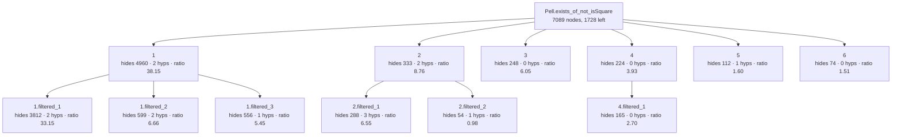

# Pell's equation has a nontrivial solution — recovered skeleton

Number theory. Source: `Mathlib/NumberTheory/Pell.lean`, lines 324–386: one tactic block of 63
lines with no helper lemma of its own. The classical argument: Dirichlet approximation gives
infinitely many rationals `q` with `|q.num² − d·q.den²| < M`; pigeonhole gives one value `m` taken
infinitely often; `m ≠ 0` because `d` is not a square; pigeonhole again modulo `m` gives two such
rationals congruent mod `m`; composing them (Brahmagupta) and dividing by `m` gives a solution.

Everything in fenced blocks and stat lines below is copied from `generated/`, which Lean wrote
(`Rosette/Demo.lean`). The tables and prose are my reading.

## Original statement

```lean
Pell.exists_of_not_isSquare {d : ℤ} (h₀ : 0 < d) (hd : ¬IsSquare d) :
  ∃ x y, x ^ 2 - d * y ^ 2 = 1 ∧ y ≠ 0
```

- proof term: **7089** nodes as a DAG (shared subterms once), **319530** as a tree
- candidate boundaries enumerated (Prop-typed subterms of DAG size ≥ 20): 833, of which 12 are typeclass-instance proofs and 9 are values of a `have`

Rating scale used in all tables:

- **meaningful** — a step of the mathematical argument that a number theorist would state.
- **technical** — technical-but-sensible: bookkeeping an author could plausibly name with a `have`
  (casts, side conditions, a trivial base case).
- **junk** — an artefact: tactic internals, an equation between propositions, a typeclass
  instance, a renamed copy of its parent, or a closed triviality.

## Skeleton A — `Rosette.Lift` as shipped (score = hidingRatio)

- config `lifted`: levels k = [6, 3], minProof 40, maxStmt 150, maxFraction 0.800000
- result: 18 lemmas in the tree (6 called directly by the main proof); main proof 7089 → **1724** nodes
- kernel check: `Pell.exists_of_not_isSquare.lifted` and all 18 lemmas were added with `addDecl` (synchronous kernel check) and are `theorem`s; `Pell.exists_of_not_isSquare.lifted` has the identical statement; axioms of the lifted version: [propext, Classical.choice, Quot.sound] (no new axiom)

```mermaid
graph TD
  T["Pell.exists_of_not_isSquare<br/>7089 nodes, 1724 left"]
  T --> L1["1<br/>hides 4960 · 2 hyps · ratio 38.15"]
  L1 --> L1_lifted_1["1.lifted_1<br/>hides 3812 · 2 hyps · ratio 33.15"]
  L1 --> L1_lifted_2["1.lifted_2<br/>hides 599 · 2 hyps · ratio 6.66"]
  L1 --> L1_lifted_3["1.lifted_3<br/>hides 562 · 1 hyps · ratio 5.51"]
  T --> L2["2<br/>hides 333 · 2 hyps · ratio 8.76"]
  L2 --> L2_lifted_1["2.lifted_1<br/>hides 288 · 3 hyps · ratio 6.55"]
  L2 --> L2_lifted_2["2.lifted_2<br/>hides 54 · 1 hyps · ratio 0.98"]
  T --> L3["3<br/>hides 248 · 0 hyps · ratio 6.05"]
  L3 --> L3_lifted_1["3.lifted_1<br/>hides 156 · 0 hyps · ratio 2.79"]
  L3 --> L3_lifted_2["3.lifted_2<br/>hides 112 · 0 hyps · ratio 2.07"]
  T --> L4["4<br/>hides 224 · 0 hyps · ratio 3.93"]
  L4 --> L4_lifted_1["4.lifted_1<br/>hides 165 · 0 hyps · ratio 2.70"]
  L4 --> L4_lifted_2["4.lifted_2<br/>hides 134 · 0 hyps · ratio 1.34"]
  T --> L5["5<br/>hides 72 · 0 hyps · ratio 2.32"]
  L5 --> L5_lifted_1["5.lifted_1<br/>hides 46 · 0 hyps · ratio 2.00"]
  L5 --> L5_lifted_2["5.lifted_2<br/>hides 48 · 0 hyps · ratio 0.86"]
  T --> L6["6<br/>hides 144 · 1 hyps · ratio 2.06"]
  L6 --> L6_lifted_1["6.lifted_1<br/>hides 112 · 1 hyps · ratio 1.60"]
```



- **`1`** — hides 4960 proof nodes (tree 265979) · statement 130 nodes · hidingRatio 38.15 · binders: 2 hypotheses, 0 instances (4 supplied from the caller's context) · was `haveBody` in its parent proof, head `Exists.casesOn` · own proof 5166 → 194 nodes after lifting its children

  ```lean
  Pell.exists_of_not_isSquare.lifted_1 {d : ℤ} (hd : ¬IsSquare d) (M : ℤ)
    (hM : {q | |q.num ^ 2 - d * ↑q.den ^ 2| < M}.Infinite) : ∃ x y, x ^ 2 - d * y ^ 2 = 1 ∧ y ≠ 0
  ```
  - **`1.lifted_1`** — hides 3812 proof nodes (tree 238150) · statement 115 nodes · hidingRatio 33.15 · binders: 2 hypotheses, 0 instances (4 supplied from the caller's context) · was `haveBody` in its parent proof, head `«(none)»`

    ```lean
    Pell.exists_of_not_isSquare.lifted_1.lifted_1 {d : ℤ} (m : ℤ)
      (hm : {q | q.num ^ 2 - d * ↑q.den ^ 2 = m}.Infinite) (hm₀ : m ≠ 0) :
      ∃ x y, x ^ 2 - d * y ^ 2 = 1 ∧ y ≠ 0
    ```
  - **`1.lifted_2`** — hides 599 proof nodes (tree 8201) · statement 90 nodes · hidingRatio 6.66 · binders: 2 hypotheses, 0 instances (2 supplied from the caller's context) · was `arg` in its parent proof, head `«(none)»`

    ```lean
    Pell.exists_of_not_isSquare.lifted_1.lifted_2 {d : ℤ} (hd : ¬IsSquare d)
      (hm : {q | q.num ^ 2 - d * ↑q.den ^ 2 = 0}.Infinite) : False
    ```
  - **`1.lifted_3`** — hides 562 proof nodes (tree 18883) · statement 102 nodes · hidingRatio 5.51 · binders: 1 hypotheses, 0 instances (3 supplied from the caller's context) · was `arg` in its parent proof, head `Mathlib.Tactic.Contrapose.contrapose₁`

    ```lean
    Pell.exists_of_not_isSquare.lifted_1.lifted_3 {d : ℤ} (M : ℤ)
      (hM : {q | |q.num ^ 2 - d * ↑q.den ^ 2| < M}.Infinite) :
      ∃ m, {q | q.num ^ 2 - d * ↑q.den ^ 2 = m}.Infinite
    ```
- **`2`** — hides 333 proof nodes (tree 3193) · statement 38 nodes · hidingRatio 8.76 · binders: 2 hypotheses, 0 instances (3 supplied from the caller's context) · was `haveValue` in its parent proof, head `irrational_nrt_of_notint_nrt` · own proof 367 → 104 nodes after lifting its children

  ```lean
  Pell.exists_of_not_isSquare.lifted_2 {d : ℤ} (h₀ : 0 < d) (hd : ¬IsSquare d) :
    let ξ := √↑d;
    Irrational ξ
  ```
  - **`2.lifted_1`** — hides 288 proof nodes (tree 3017) · statement 44 nodes · hidingRatio 6.55 · binders: 3 hypotheses, 0 instances (3 supplied from the caller's context) · was `arg` in its parent proof, head `«(none)»`

    ```lean
    Pell.exists_of_not_isSquare.lifted_2.lifted_1 {d : ℤ} (h₀ : 0 < d) (hd : ¬IsSquare d) :
      let ξ := √↑d;
      ∀ (x : ℤ), ξ = ↑x → False
    ```
  - **`2.lifted_2`** — hides 54 proof nodes (tree 63) · statement 55 nodes · hidingRatio 0.98 · binders: 1 hypotheses, 0 instances (2 supplied from the caller's context) · was `arg` in its parent proof, head `Real.sq_sqrt`

    ```lean
    Pell.exists_of_not_isSquare.lifted_2.lifted_2 {d : ℤ} (h₀ : 0 < d) : √↑d ^ 2 = ↑d
    ```
- **`3`** — hides 248 proof nodes (tree 1407) · statement 41 nodes · hidingRatio 6.05 · binders: 0 hypotheses, 0 instances (1 supplied from the caller's context) · was `haveValue` in its parent proof, head `cast` · own proof 249 → 97 nodes after lifting its children

  ```lean
  Pell.exists_of_not_isSquare.lifted_3 (q : ℚ) : ↑q.num / ↑q.den = ↑q
  ```
  - **`3.lifted_1`** — hides 156 proof nodes (tree 723) · statement 56 nodes · hidingRatio 2.79 · binders: 0 hypotheses, 0 instances (1 supplied from the caller's context) · was `arg` in its parent proof, head `Eq.symm`

    ```lean
    Pell.exists_of_not_isSquare.lifted_3.lifted_1 (q : ℚ) :
      (Rat.divInt q.num ↑q.den = q) = (↑q.num / ↑q.den = ↑q)
    ```
  - **`3.lifted_2`** — hides 112 proof nodes (tree 461) · statement 54 nodes · hidingRatio 2.07 · binders: 0 hypotheses, 0 instances (1 supplied from the caller's context) · was `arg` in its parent proof, head `congrFun'`

    ```lean
    Pell.exists_of_not_isSquare.lifted_3.lifted_2 (q : ℚ) :
      (↑q.num / ↑q.den = q) = (↑(Rat.divInt q.num ↑q.den) = q)
    ```
- **`4`** — hides 224 proof nodes (tree 1663) · statement 57 nodes · hidingRatio 3.93 · binders: 0 hypotheses, 0 instances (1 supplied from the caller's context) · was `arg` in its parent proof, head `Eq.mpr` · own proof 225 → 104 nodes after lifting its children

  ```lean
  Pell.exists_of_not_isSquare.lifted_4 (q : ℚ) : 1 ≤ ↑q.den ^ 2
  ```
  - **`4.lifted_1`** — hides 165 proof nodes (tree 919) · statement 61 nodes · hidingRatio 2.70 · binders: 0 hypotheses, 0 instances (1 supplied from the caller's context) · was `arg` in its parent proof, head `Eq.mpr`

    ```lean
    Pell.exists_of_not_isSquare.lifted_4.lifted_1 (q : ℚ) : 1 ≤ |↑q.den|
    ```
  - **`4.lifted_2`** — hides 134 proof nodes (tree 583) · statement 100 nodes · hidingRatio 1.34 · binders: 0 hypotheses, 0 instances (1 supplied from the caller's context) · was `arg` in its parent proof, head `id`

    ```lean
    Pell.exists_of_not_isSquare.lifted_4.lifted_2 (q : ℚ) : (1 ≤ ↑q.den ^ 2) = (1 ≤ |↑q.den|)
    ```
- **`5`** — hides 72 proof nodes (tree 151) · statement 31 nodes · hidingRatio 2.32 · binders: 0 hypotheses, 0 instances (0 supplied from the caller's context) · was `arg` in its parent proof, head `IsLeftCancelAdd.addLeftReflectLE_of_addLeftReflectLT` · statement is a typeclass · own proof 72 → 29 nodes after lifting its children

  ```lean
  Pell.exists_of_not_isSquare.lifted_5 : AddLeftReflectLE ℝ
  ```
  - **`5.lifted_1`** — hides 46 proof nodes (tree 57) · statement 23 nodes · hidingRatio 2.00 · binders: 0 hypotheses, 0 instances (0 supplied from the caller's context) · was `arg` in its parent proof, head `instIsLeftCancelAddOfAddLeftReflectLE` · statement is a typeclass

    ```lean
    Pell.exists_of_not_isSquare.lifted_5.lifted_1 : IsLeftCancelAdd ℝ
    ```
  - **`5.lifted_2`** — hides 48 proof nodes (tree 61) · statement 56 nodes · hidingRatio 0.86 · binders: 0 hypotheses, 0 instances (0 supplied from the caller's context) · was `arg` in its parent proof, head `contravariant_lt_of_covariant_le` · statement is a typeclass

    ```lean
    Pell.exists_of_not_isSquare.lifted_5.lifted_2 :
      ContravariantClass ℝ ℝ (fun x1 x2 ↦ x1 + x2) fun x1 x2 ↦ x1 < x2
    ```
- **`6`** — hides 144 proof nodes (tree 369) · statement 70 nodes · hidingRatio 2.06 · binders: 1 hypotheses, 0 instances (2 supplied from the caller's context) · was `arg` in its parent proof, head `Eq.symm` · own proof 147 → 74 nodes after lifting its children

  ```lean
  Pell.exists_of_not_isSquare.lifted_6 {d : ℤ} (h₀ : 0 < d) : ↑d = √↑d ^ 2
  ```
  - **`6.lifted_1`** — hides 112 proof nodes (tree 273) · statement 70 nodes · hidingRatio 1.60 · binders: 1 hypotheses, 0 instances (2 supplied from the caller's context) · was `arg` in its parent proof, head `Real.sq_sqrt`

    ```lean
    Pell.exists_of_not_isSquare.lifted_6.lifted_1 {d : ℤ} (h₀ : 0 < d) : √↑d ^ 2 = ↑d
    ```

| lemma | what it says | rating | note |
|---|---|---|---|
| `1` | infinitely many `q` with `\|N(q)\| < M` ⟹ a solution exists | **meaningful** | Not a `have`: it is the *rest of the proof* after `hM`. As a lemma it is exactly the "pigeonhole half" of the theorem. |
| `1.1` | infinitely many `q` with `N(q) = m`, `m ≠ 0` ⟹ a solution exists | **meaningful** | Again a continuation. The cleanest statement in the file. |
| `1.2` | infinitely many `q` with `N(q) = 0` contradicts `d` non-square | **meaningful** | The author's `hm₀ : m ≠ 0` with `m` specialised to 0. Hypothesis is stronger than needed (`Infinite`, the proof only uses `Nonempty`). |
| `1.3` | pigeonhole: bounded norm infinitely often ⟹ some norm value infinitely often | **meaningful** | Matches the author's `obtain ⟨m, hm⟩ : ∃ m, … .Infinite`. |
| `2` | `√d` is irrational | **meaningful** | Verbatim the author's `have hξ`. |
| `2.1` | `√d` is not an integer | technical | |
| `2.2` | `√d ^ 2 = d` | technical | |
| `3` | `q.num / q.den = q` in `ℝ` | technical | Verbatim the author's `have h1`. |
| `3.1`, `3.2` | `(Rat.divInt … = q) = (… = ↑q)` | junk | Equations between propositions produced by `mod_cast`. |
| `4` | `1 ≤ q.den ^ 2` | technical | Last step of the estimate. |
| `4.1` | `1 ≤ \|q.den\|` | technical | |
| `4.2` | `(1 ≤ q.den ^ 2) = (1 ≤ \|q.den\|)` | junk | A `rw` step as a proposition equality. |
| `5`, `5.1`, `5.2` | `AddLeftReflectLE ℝ`, `IsLeftCancelAdd ℝ`, `ContravariantClass ℝ ℝ …` | junk | Instance-synthesis output. |
| `6`, `6.1` | `d = √d ^ 2`, `√d ^ 2 = d` | technical | The same fact as `2.2`, lifted three times under three names. |

**Tally: 5 meaningful, 7 technical, 6 junk (of 18).** The main proof shrinks from 7089 to 1724
nodes, and lemma `1` from 5166 to 194, so the top of this tree really is a readable outline:
*irrational → (infinitely many small norms, left inline) → pigeonhole → nonzero → solution*.

## Skeleton B — `filtered` (same score; instances, rewriting plumbing and tactic vocabulary excluded)

- config `filtered`: levels k = [6, 3], minProof 40, maxStmt 150, maxFraction 0.800000
- result: 12 lemmas in the tree (6 called directly by the main proof); main proof 7089 → **1728** nodes
- kernel check: `Pell.exists_of_not_isSquare.filtered` and all 12 lemmas were added with `addDecl` (synchronous kernel check) and are `theorem`s; `Pell.exists_of_not_isSquare.filtered` has the identical statement; axioms of the lifted version: [propext, Classical.choice, Quot.sound] (no new axiom)



- **`1`** — hides 4960 proof nodes (tree 265979) · statement 130 nodes · hidingRatio 38.15 · binders: 2 hypotheses, 0 instances (4 supplied from the caller's context) · was `haveBody` in its parent proof, head `Exists.casesOn` · own proof 5166 → 208 nodes after lifting its children

  ```lean
  Pell.exists_of_not_isSquare.filtered_1 {d : ℤ} (hd : ¬IsSquare d) (M : ℤ)
    (hM : {q | |q.num ^ 2 - d * ↑q.den ^ 2| < M}.Infinite) : ∃ x y, x ^ 2 - d * y ^ 2 = 1 ∧ y ≠ 0
  ```
  - **`1.filtered_1`** — hides 3812 proof nodes (tree 238150) · statement 115 nodes · hidingRatio 33.15 · binders: 2 hypotheses, 0 instances (4 supplied from the caller's context) · was `haveBody` in its parent proof, head `«(none)»`

    ```lean
    Pell.exists_of_not_isSquare.filtered_1.filtered_1 {d : ℤ} (m : ℤ)
      (hm : {q | q.num ^ 2 - d * ↑q.den ^ 2 = m}.Infinite) (hm₀ : m ≠ 0) :
      ∃ x y, x ^ 2 - d * y ^ 2 = 1 ∧ y ≠ 0
    ```
  - **`1.filtered_2`** — hides 599 proof nodes (tree 8201) · statement 90 nodes · hidingRatio 6.66 · binders: 2 hypotheses, 0 instances (2 supplied from the caller's context) · was `arg` in its parent proof, head `«(none)»`

    ```lean
    Pell.exists_of_not_isSquare.filtered_1.filtered_2 {d : ℤ} (hd : ¬IsSquare d)
      (hm : {q | q.num ^ 2 - d * ↑q.den ^ 2 = 0}.Infinite) : False
    ```
  - **`1.filtered_3`** — hides 556 proof nodes (tree 18607) · statement 102 nodes · hidingRatio 5.45 · binders: 1 hypotheses, 0 instances (2 supplied from the caller's context) · was `arg` in its parent proof, head `Eq.mpr`

    ```lean
    Pell.exists_of_not_isSquare.filtered_1.filtered_3 {d : ℤ} (M : ℤ) :
      (¬∃ m, {q | q.num ^ 2 - d * ↑q.den ^ 2 = m}.Infinite) →
        ¬{q | |q.num ^ 2 - d * ↑q.den ^ 2| < M}.Infinite
    ```
- **`2`** — hides 333 proof nodes (tree 3193) · statement 38 nodes · hidingRatio 8.76 · binders: 2 hypotheses, 0 instances (3 supplied from the caller's context) · was `haveValue` in its parent proof, head `irrational_nrt_of_notint_nrt` · own proof 367 → 104 nodes after lifting its children

  ```lean
  Pell.exists_of_not_isSquare.filtered_2 {d : ℤ} (h₀ : 0 < d) (hd : ¬IsSquare d) :
    let ξ := √↑d;
    Irrational ξ
  ```
  - **`2.filtered_1`** — hides 288 proof nodes (tree 3017) · statement 44 nodes · hidingRatio 6.55 · binders: 3 hypotheses, 0 instances (3 supplied from the caller's context) · was `arg` in its parent proof, head `«(none)»`

    ```lean
    Pell.exists_of_not_isSquare.filtered_2.filtered_1 {d : ℤ} (h₀ : 0 < d) (hd : ¬IsSquare d) :
      let ξ := √↑d;
      ∀ (x : ℤ), ξ = ↑x → False
    ```
  - **`2.filtered_2`** — hides 54 proof nodes (tree 63) · statement 55 nodes · hidingRatio 0.98 · binders: 1 hypotheses, 0 instances (2 supplied from the caller's context) · was `arg` in its parent proof, head `Real.sq_sqrt`

    ```lean
    Pell.exists_of_not_isSquare.filtered_2.filtered_2 {d : ℤ} (h₀ : 0 < d) : √↑d ^ 2 = ↑d
    ```
- **`3`** — hides 248 proof nodes (tree 1407) · statement 41 nodes · hidingRatio 6.05 · binders: 0 hypotheses, 0 instances (1 supplied from the caller's context) · was `haveValue` in its parent proof, head `cast`

  ```lean
  Pell.exists_of_not_isSquare.filtered_3 (q : ℚ) : ↑q.num / ↑q.den = ↑q
  ```
- **`4`** — hides 224 proof nodes (tree 1663) · statement 57 nodes · hidingRatio 3.93 · binders: 0 hypotheses, 0 instances (1 supplied from the caller's context) · was `arg` in its parent proof, head `Eq.mpr` · own proof 225 → 142 nodes after lifting its children

  ```lean
  Pell.exists_of_not_isSquare.filtered_4 (q : ℚ) : 1 ≤ ↑q.den ^ 2
  ```
  - **`4.filtered_1`** — hides 165 proof nodes (tree 919) · statement 61 nodes · hidingRatio 2.70 · binders: 0 hypotheses, 0 instances (1 supplied from the caller's context) · was `arg` in its parent proof, head `Eq.mpr`

    ```lean
    Pell.exists_of_not_isSquare.filtered_4.filtered_1 (q : ℚ) : 1 ≤ |↑q.den|
    ```
- **`5`** — hides 112 proof nodes (tree 273) · statement 70 nodes · hidingRatio 1.60 · binders: 1 hypotheses, 0 instances (2 supplied from the caller's context) · was `arg` in its parent proof, head `Real.sq_sqrt`

  ```lean
  Pell.exists_of_not_isSquare.filtered_5 {d : ℤ} (h₀ : 0 < d) : √↑d ^ 2 = ↑d
  ```
- **`6`** — hides 74 proof nodes (tree 101) · statement 49 nodes · hidingRatio 1.51 · binders: 0 hypotheses, 0 instances (1 supplied from the caller's context) · was `arg` in its parent proof, head `Iff.mpr`

  ```lean
  Pell.exists_of_not_isSquare.filtered_6 (q : ℚ) : 0 < ↑q.den
  ```

| lemma | rating | note |
|---|---|---|
| `1`, `1.1`, `1.2`, `2` | **meaningful** | as in A |
| `1.3` | technical | Now the *contrapositive* of the pigeonhole step, `(¬∃ m, …Infinite) → ¬ …Infinite`: this is what `contrapose! hM` left in the term. True and readable, but inside-out compared with what the author wrote. |
| `2.1`, `2.2`, `3`, `4`, `4.1`, `5`, `6` | technical | `5` is `√d ^ 2 = d` again, `6` is `0 < q.den`. |

**Tally: 4 meaningful, 8 technical, 0 junk (of 12).** The filter removes all six junk lemmas and
costs nothing here.

## Skeleton C — `wide` (filtered; statements up to 500 nodes; each pick at most half its parent)

- config `wide`: levels k = [6, 3], minProof 40, maxStmt 500, maxFraction 0.500000
- result: 21 lemmas in the tree (6 called directly by the main proof); main proof 7089 → **673** nodes
- kernel check: `Pell.exists_of_not_isSquare.wide` and all 21 lemmas were added with `addDecl` (synchronous kernel check) and are `theorem`s; `Pell.exists_of_not_isSquare.wide` has the identical statement; axioms of the lifted version: [propext, Classical.choice, Quot.sound] (no new axiom)

```mermaid
graph TD
  T["Pell.exists_of_not_isSquare<br/>7089 nodes, 673 left"]
  T --> L1["1<br/>hides 3514 · 4 hyps · ratio 18.40"]
  L1 --> L1_wide_1["1.wide_1<br/>hides 1893 · 3 hyps · ratio 7.28"]
  L1 --> L1_wide_2["1.wide_2<br/>hides 664 · 3 hyps · ratio 6.32"]
  L1 --> L1_wide_3["1.wide_3<br/>hides 873 · 3 hyps · ratio 4.93"]
  T --> L2["2<br/>hides 1922 · 3 hyps · ratio 10.56"]
  L2 --> L2_wide_1["2.wide_1<br/>hides 248 · 0 hyps · ratio 6.05"]
  L2 --> L2_wide_2["2.wide_2<br/>hides 224 · 0 hyps · ratio 3.93"]
  L2 --> L2_wide_3["2.wide_3<br/>hides 112 · 1 hyps · ratio 1.60"]
  T --> L3["3<br/>hides 333 · 2 hyps · ratio 8.76"]
  L3 --> L3_wide_1["3.wide_1<br/>hides 152 · 1 hyps · ratio 1.69"]
  L3 --> L3_wide_2["3.wide_2<br/>hides 54 · 1 hyps · ratio 0.98"]
  L3 --> L3_wide_3["3.wide_3<br/>hides 59 · 1 hyps · ratio 0.84"]
  T --> L4["4<br/>hides 599 · 2 hyps · ratio 6.66"]
  L4 --> L4_wide_1["4.wide_1<br/>hides 266 · 1 hyps · ratio 2.66"]
  L4 --> L4_wide_2["4.wide_2<br/>hides 282 · 2 hyps · ratio 1.84"]
  L4 --> L4_wide_3["4.wide_3<br/>hides 42 · 0 hyps · ratio 1.75"]
  T --> L5["5<br/>hides 556 · 1 hyps · ratio 5.45"]
  L5 --> L5_wide_1["5.wide_1<br/>hides 180 · 0 hyps · ratio 1.37"]
  L5 --> L5_wide_2["5.wide_2<br/>hides 47 · 0 hyps · ratio 1.12"]
  L5 --> L5_wide_3["5.wide_3<br/>hides 98 · 1 hyps · ratio 0.97"]
  T --> L6["6<br/>hides 75 · 0 hyps · ratio 0.75"]
```



- **`1`** — hides 3514 proof nodes (tree 234144) · statement 191 nodes · hidingRatio 18.40 · binders: 4 hypotheses, 0 instances (6 supplied from the caller's context) · was `arg` in its parent proof, head `«(none)»` · own proof 3890 → 1173 nodes after lifting its children

  ```lean
  Pell.exists_of_not_isSquare.wide_1 {d : ℤ} (m : ℤ) (hm₀ : m ≠ 0) :
    let f := fun q ↦ (↑q.num, ↑q.den);
    ∀ q₁ ∈ {q | q.num ^ 2 - d * ↑q.den ^ 2 = m},
      ∀ q₂ ∈ {q | q.num ^ 2 - d * ↑q.den ^ 2 = m},
        q₁ ≠ q₂ ∧ f q₁ = f q₂ → ∃ x y, x ^ 2 - d * y ^ 2 = 1 ∧ y ≠ 0
  ```
  - **`1.wide_1`** — hides 1893 proof nodes (tree 140777) · statement 260 nodes · hidingRatio 7.28 · binders: 3 hypotheses, 0 instances (7 supplied from the caller's context) · was `arg` in its parent proof, head `Eq.mpr`

    ```lean
    Pell.exists_of_not_isSquare.wide_1.wide_1 {d : ℤ} (m : ℤ) (q₁ : ℚ)
      (h₁ : q₁ ∈ {q | q.num ^ 2 - d * ↑q.den ^ 2 = m}) (q₂ : ℚ)
      (h₂ : q₂ ∈ {q | q.num ^ 2 - d * ↑q.den ^ 2 = m}) (hm₀ : ↑m ≠ 0) :
      ((↑q₁.num * ↑q₂.num - ↑d * (↑q₁.den * ↑q₂.den)) / ↑m) ^ 2 -
          ↑d * ((↑q₁.num * ↑q₂.den - ↑q₂.num * ↑q₁.den) / ↑m) ^ 2 =
        1
    ```
  - **`1.wide_2`** — hides 664 proof nodes (tree 15775) · statement 105 nodes · hidingRatio 6.32 · binders: 3 hypotheses, 0 instances (6 supplied from the caller's context) · was `arg` in its parent proof, head `Eq.mpr`

    ```lean
    Pell.exists_of_not_isSquare.wide_1.wide_2 (m : ℤ) (q₁ q₂ : ℚ) (hne : q₁ ≠ q₂)
      (hd₂ : m ∣ q₁.num * ↑q₂.den - q₂.num * ↑q₁.den) (hm₀ : ↑m ≠ 0) :
      (q₁.num * ↑q₂.den - q₂.num * ↑q₁.den) / m ≠ 0
    ```
  - **`1.wide_3`** — hides 873 proof nodes (tree 43729) · statement 177 nodes · hidingRatio 4.93 · binders: 3 hypotheses, 0 instances (7 supplied from the caller's context) · was `haveValue` in its parent proof, head `Eq.mpr`

    ```lean
    Pell.exists_of_not_isSquare.wide_1.wide_3 {d : ℤ} (m : ℤ) :
      let f := fun q ↦ (↑q.num, ↑q.den);
      ∀ (q₁ q₂ : ℚ),
        q₂ ∈ {q | q.num ^ 2 - d * ↑q.den ^ 2 = m} →
          (f q₁).1 = (f q₂).1 → (f q₁).2 = (f q₂).2 → m ∣ q₁.num * q₂.num - d * (↑q₁.den * ↑q₂.den)
    ```
- **`2`** — hides 1922 proof nodes (tree 49561) · statement 182 nodes · hidingRatio 10.56 · binders: 3 hypotheses, 0 instances (5 supplied from the caller's context) · was `haveValue` in its parent proof, head `Set.Infinite.mono` · own proof 1975 → 1683 nodes after lifting its children

  ```lean
  Pell.exists_of_not_isSquare.wide_2 {d : ℤ} (h₀ : 0 < d) :
    let ξ := √↑d;
    Irrational ξ → ∀ (M : ℤ), 2 * |ξ| + 1 < ↑M → {q | |q.num ^ 2 - d * ↑q.den ^ 2| < M}.Infinite
  ```
  - **`2.wide_1`** — hides 248 proof nodes (tree 1407) · statement 41 nodes · hidingRatio 6.05 · binders: 0 hypotheses, 0 instances (1 supplied from the caller's context) · was `haveValue` in its parent proof, head `cast`

    ```lean
    Pell.exists_of_not_isSquare.wide_2.wide_1 (q : ℚ) : ↑q.num / ↑q.den = ↑q
    ```
  - **`2.wide_2`** — hides 224 proof nodes (tree 1663) · statement 57 nodes · hidingRatio 3.93 · binders: 0 hypotheses, 0 instances (1 supplied from the caller's context) · was `arg` in its parent proof, head `Eq.mpr`

    ```lean
    Pell.exists_of_not_isSquare.wide_2.wide_2 (q : ℚ) : 1 ≤ ↑q.den ^ 2
    ```
  - **`2.wide_3`** — hides 112 proof nodes (tree 273) · statement 70 nodes · hidingRatio 1.60 · binders: 1 hypotheses, 0 instances (2 supplied from the caller's context) · was `arg` in its parent proof, head `Real.sq_sqrt`

    ```lean
    Pell.exists_of_not_isSquare.wide_2.wide_3 {d : ℤ} (h₀ : 0 < d) : √↑d ^ 2 = ↑d
    ```
- **`3`** — hides 333 proof nodes (tree 3193) · statement 38 nodes · hidingRatio 8.76 · binders: 2 hypotheses, 0 instances (3 supplied from the caller's context) · was `haveValue` in its parent proof, head `irrational_nrt_of_notint_nrt` · own proof 367 → 283 nodes after lifting its children

  ```lean
  Pell.exists_of_not_isSquare.wide_3 {d : ℤ} (h₀ : 0 < d) (hd : ¬IsSquare d) :
    let ξ := √↑d;
    Irrational ξ
  ```
  - **`3.wide_1`** — hides 152 proof nodes (tree 1519) · statement 90 nodes · hidingRatio 1.69 · binders: 1 hypotheses, 0 instances (3 supplied from the caller's context) · was `arg` in its parent proof, head `Eq.mpr`

    ```lean
    Pell.exists_of_not_isSquare.wide_3.wide_1 {d : ℤ} :
      let ξ := √↑d;
      ∀ (x : ℤ), ξ = ↑x → √↑d ^ 2 = ↑x * ↑x
    ```
  - **`3.wide_2`** — hides 54 proof nodes (tree 63) · statement 55 nodes · hidingRatio 0.98 · binders: 1 hypotheses, 0 instances (2 supplied from the caller's context) · was `arg` in its parent proof, head `Real.sq_sqrt`

    ```lean
    Pell.exists_of_not_isSquare.wide_3.wide_2 {d : ℤ} (h₀ : 0 < d) : √↑d ^ 2 = ↑d
    ```
  - **`3.wide_3`** — hides 59 proof nodes (tree 83) · statement 70 nodes · hidingRatio 0.84 · binders: 1 hypotheses, 0 instances (2 supplied from the caller's context) · was `arg` in its parent proof, head `Real.sq_sqrt`

    ```lean
    Pell.exists_of_not_isSquare.wide_3.wide_3 {d : ℤ} (h₀ : 0 < d) : √↑d ^ 2 = ↑d
    ```
- **`4`** — hides 599 proof nodes (tree 8201) · statement 90 nodes · hidingRatio 6.66 · binders: 2 hypotheses, 0 instances (2 supplied from the caller's context) · was `arg` in its parent proof, head `«(none)»` · own proof 643 → 327 nodes after lifting its children

  ```lean
  Pell.exists_of_not_isSquare.wide_4 {d : ℤ} (hd : ¬IsSquare d)
    (hm : {q | q.num ^ 2 - d * ↑q.den ^ 2 = 0}.Infinite) : False
  ```
  - **`4.wide_1`** — hides 266 proof nodes (tree 2675) · statement 100 nodes · hidingRatio 2.66 · binders: 1 hypotheses, 0 instances (3 supplied from the caller's context) · was `arg` in its parent proof, head `Iff.mp`

    ```lean
    Pell.exists_of_not_isSquare.wide_4.wide_1 {d : ℤ} (q : ℚ)
      (hq : q ∈ {q | q.num ^ 2 - d * ↑q.den ^ 2 = 0}) : ↑q.den ∣ q.num
    ```
  - **`4.wide_2`** — hides 282 proof nodes (tree 3487) · statement 153 nodes · hidingRatio 1.84 · binders: 2 hypotheses, 0 instances (5 supplied from the caller's context) · was `arg` in its parent proof, head `Eq.mp`

    ```lean
    Pell.exists_of_not_isSquare.wide_4.wide_2 {d : ℤ} (q : ℚ)
      (hq : q ∈ {q | q.num ^ 2 - d * ↑q.den ^ 2 = 0}) (a : ℤ) (ha : q.num = ↑q.den * a) :
      ↑q.den ^ 2 * a ^ 2 = ↑q.den ^ 2 * d
    ```
  - **`4.wide_3`** — hides 42 proof nodes (tree 57) · statement 24 nodes · hidingRatio 1.75 · binders: 0 hypotheses, 0 instances (1 supplied from the caller's context) · was `arg` in its parent proof, head `Iff.mpr`

    ```lean
    Pell.exists_of_not_isSquare.wide_4.wide_3 (q : ℚ) : 0 < ↑q.den
    ```
- **`5`** — hides 556 proof nodes (tree 18607) · statement 102 nodes · hidingRatio 5.45 · binders: 1 hypotheses, 0 instances (2 supplied from the caller's context) · was `arg` in its parent proof, head `Eq.mpr` · own proof 617 → 553 nodes after lifting its children

  ```lean
  Pell.exists_of_not_isSquare.wide_5 {d : ℤ} (M : ℤ) :
    (¬∃ m, {q | q.num ^ 2 - d * ↑q.den ^ 2 = m}.Infinite) →
      ¬{q | |q.num ^ 2 - d * ↑q.den ^ 2| < M}.Infinite
  ```
  - **`5.wide_1`** — hides 180 proof nodes (tree 2851) · statement 131 nodes · hidingRatio 1.37 · binders: 0 hypotheses, 0 instances (3 supplied from the caller's context) · was `arg` in its parent proof, head `«(none)»`

    ```lean
    Pell.exists_of_not_isSquare.wide_5.wide_1 {d : ℤ} (M : ℤ) (x : ℚ) (i : ℤ) :
      (x ∈ ⋃ (_ : -M < i ∧ i < M), {q | q.num ^ 2 - d * ↑q.den ^ 2 = i}) =
        ((-M < i ∧ i < M) ∧ x.num ^ 2 - d * ↑x.den ^ 2 = i)
    ```
  - **`5.wide_2`** — hides 47 proof nodes (tree 85) · statement 42 nodes · hidingRatio 1.12 · binders: 0 hypotheses, 0 instances (2 supplied from the caller's context) · was `arg` in its parent proof, head `Iff.of_eq`

    ```lean
    Pell.exists_of_not_isSquare.wide_5.wide_2 (M i : ℤ) : i ∈ Set.Ioo (-M) M ↔ -M < i ∧ i < M
    ```
  - **`5.wide_3`** — hides 98 proof nodes (tree 165) · statement 101 nodes · hidingRatio 0.97 · binders: 1 hypotheses, 0 instances (3 supplied from the caller's context) · was `arg` in its parent proof, head `«(none)»`

    ```lean
    Pell.exists_of_not_isSquare.wide_5.wide_3 {d : ℤ} (M i : ℤ) (x : -M < i ∧ i < M) :
      {q | q.num ^ 2 - d * ↑q.den ^ 2 = i} = {q | q.num ^ 2 - d * ↑q.den ^ 2 = i}
    ```
- **`6`** — hides 75 proof nodes (tree 99) · statement 100 nodes · hidingRatio 0.75 · binders: 0 hypotheses, 0 instances (1 supplied from the caller's context) · was `arg` in its parent proof, head `exists_int_gt`

  ```lean
  Pell.exists_of_not_isSquare.wide_6 {d : ℤ} :
    let ξ := √↑d;
    ∃ n, 2 * |ξ| + 1 < ↑n
  ```

| lemma | what it says | rating | note |
|---|---|---|---|
| `1` | two distinct `q₁, q₂` of norm `m ≠ 0` with the same image under `f` ⟹ a solution | **meaningful** | The composition step. But `f` prints as `fun q => (↑q.num, ↑q.den)`: the target `ZMod m.natAbs × ZMod m.natAbs` is invisible, and without it the statement reads as false (it looks like `q₁ = q₂`). |
| `1.1` | Brahmagupta: `((x₁x₂ − d y₁y₂)/m)² − d((x₁y₂ − x₂y₁)/m)² = 1` | **meaningful** | The first bullet of the final `refine`. |
| `1.2` | the `y`-component is nonzero | technical | The second bullet. |
| `1.3` | `m ∣ x₁x₂ − d y₁y₂` | **meaningful** | Verbatim the author's `have hd₁`, again with the invisible `ZMod` cast. |
| `2` | `√d` irrational ⟹ infinitely many `q` with `\|N(q)\| < M` | **meaningful** | Verbatim the author's `have hM`. |
| `2.1`, `2.2`, `2.3` | `q.num/q.den = q`, `1 ≤ q.den²`, `√d² = d` | technical | |
| `3` | `√d` is irrational | **meaningful** | `have hξ`. |
| `3.1` | `ξ = x → √d² = x·x` | technical | |
| `3.2`, `3.3` | `√d ^ 2 = d` twice | technical | Two lemmas with identical printed statements (55 and 70 nodes): different elaborated casts, so they were not merged. |
| `4` | norm 0 infinitely often is impossible | **meaningful** | `hm₀`. |
| `4.1`, `4.2`, `4.3` | `q.den ∣ q.num`; `den²·a² = den²·d`; `0 < q.den` | technical | |
| `5` | contrapositive pigeonhole | technical | as B `1.3` |
| `5.1` | `(x ∈ ⋃ …) = ((−M < i ∧ i < M) ∧ …)` | junk | Proposition equality from `simp only`; its proof has no head constant, so the head filter missed it. |
| `5.2` | `i ∈ Set.Ioo (−M) M ↔ −M < i ∧ i < M` | junk | Unfolding of a definition (head `Iff.of_eq`, not on the filter list). |
| `5.3` | `{q \| N(q) = i} = {q \| N(q) = i}` | junk | A reflexive equation with an unused hypothesis. |
| `6` | `∃ n : ℤ, 2\|ξ\| + 1 < n` | junk | One instance of `exists_int_gt`; ratio 0.75, picked only because `k = 6` slots had to be filled. |

**Tally: 6 meaningful, 11 technical, 4 junk (of 21).** Main proof 7089 → 673 nodes. This is the
best outline of the three: every step of the informal proof above is a top-level lemma.

## Comparison with the `have` statements the author wrote

The elaborated term contains 9 `have` values of at least 20 nodes: `hξ`, `hM`, `h0`, `h1`, `hm₀`,
the `NeZero` instance, `hd₁`, `hd₂`, and the cast `(m : ℚ) ≠ 0`.

- Recovered with an identical statement: `hξ`, `h1` (A, B, C); `hM`, `hd₁` (C only, their closed
  statements are 182 and 177 nodes, above the default bound of 150).
- Recovered in an equivalent form: `hm₀` (as "norm 0 infinitely often ⟹ False").
- Never recovered: `h0`, `hd₂`, the `NeZero` instance, the cast. All four are small.
- Recovered although they are *not* `have`s: the pigeonhole step (an `obtain … : ∃ m, …`), and
  the two continuation lemmas `1` and `1.1`. The continuations are the most useful output: they
  are the statements a human would write if asked to split this proof into three lemmas, and no
  `have` in the source corresponds to them.
- Under hidingRatio the five substantive `have`s rank 31st–64th of 833 candidates (top 4–8 %);
  the median `have` is at 7.7 %. What outranks them is the chain of "rest of the proof" bodies.

Every value of a `have` (non-dependent `let`) in the elaborated term with proof DAG size ≥ 20, in source order (a value that occurs at several positions is listed once). `rank` is the position among all 833 distinct candidates sorted by hidingRatio (1 = best). The statement shown is the *closed* one: all hypotheses the proof of the `have` actually uses are quantified.

- rank 32/833 · ratio 8.76 · proof 333 · statement 38 · 2 hyps

  ```lean
  ∀ {d : ℤ}, 0 < d → ¬IsSquare d → let ξ := √↑d; Irrational ξ
  ```
- rank 31/833 · ratio 10.56 · proof 1922 · statement 182 · 3 hyps

  ```lean
  ∀ {d : ℤ}, 0 < d → let ξ := √↑d; Irrational ξ → ∀ (M : ℤ), 2 * |ξ| + 1 < ↑M → {q | |q.num ^ 2 - d * ↑q.den ^ 2| < M}.Infinite
  ```
- rank 302/833 · ratio 1.44 · proof 98 · statement 68 · 0 hyps

  ```lean
  ∀ (q : ℚ), 0 < ↑q.den ^ 2
  ```
- rank 50/833 · ratio 6.05 · proof 248 · statement 41 · 0 hyps

  ```lean
  ∀ (q : ℚ), ↑q.num / ↑q.den = ↑q
  ```
- rank 40/833 · ratio 6.54 · proof 621 · statement 95 · 2 hyps

  ```lean
  ∀ {d : ℤ}, ¬IsSquare d → ∀ (m : ℤ), {q | q.num ^ 2 - d * ↑q.den ^ 2 = m}.Infinite → m = 0 → False
  ```
- rank 182/833 · ratio 1.96 · proof 53 · statement 27 · 1 hyps · typeclass

  ```lean
  ∀ (m : ℤ), m ≠ 0 → NeZero m.natAbs
  ```
- rank 64/833 · ratio 4.93 · proof 873 · statement 177 · 3 hyps

  ```lean
  ∀ {d : ℤ} (m : ℤ), let f := fun q ↦ (↑q.num, ↑q.den); ∀ (q₁ q₂ : ℚ), q₂ ∈ {q | q.num ^ 2 - d * ↑q.den ^ 2 = m} → (f q₁).1 = (f q₂).1 → (f q₁).2 = (f q₂).2 → m ∣ q₁.num * q₂.num - d * (↑q₁.den * ↑q₂.den)
  ```
- rank 142/833 · ratio 2.37 · proof 287 · statement 121 · 2 hyps

  ```lean
  ∀ (m : ℤ), let f := fun q ↦ (↑q.num, ↑q.den); ∀ (q₁ q₂ : ℚ), (f q₁).1 = (f q₂).1 → (f q₁).2 = (f q₂).2 → m ∣ q₁.num * ↑q₂.den - q₂.num * ↑q₁.den
  ```
- rank 437/833 · ratio 1.16 · proof 64 · statement 55 · 1 hyps

  ```lean
  ∀ (m : ℤ), m ≠ 0 → ↑m ≠ 0
  ```

## Verdict for this proof

Term-level statements are readable enough here. The objects are integers and rationals, there is
one implicit variable and no instance argument, and Lean prints the lifted statements essentially
as a human would write them. Two presentation defects remain and both need information the term
does not print: the invisible `ZMod` coercion target in `f`, and the contrapositive left by
`contrapose!`.
