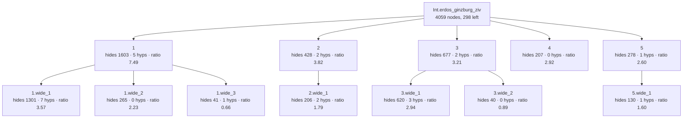

<!-- GENERATED by Rosette/Demo.lean (config `wide`); do not edit. -->

### Original statement

```lean
Int.erdos_ginzburg_ziv.{u_1} {ι : Type u_1} {n : ℕ} {s : Finset ι} (a : ι → ℤ)
  (hs : 2 * n - 1 ≤ s.card) : ∃ t ⊆ s, t.card = n ∧ ↑n ∣ ∑ i ∈ t, a i
```

- proof term: **4059** nodes as a DAG (shared subterms once), **39563** as a tree
- candidate boundaries enumerated (Prop-typed subterms of DAG size ≥ 20): 252, of which 2 are typeclass-instance proofs and 3 are values of a `have`
- config `wide`: levels k = [6, 3], minProof 40, maxStmt 500, maxFraction 0.500000
- result: 12 lemmas in the tree (5 called directly by the main proof); main proof 4059 → **298** nodes
- kernel check: `Int.erdos_ginzburg_ziv.wide` and all 12 lemmas were added with `addDecl` (synchronous kernel check) and are `theorem`s; `Int.erdos_ginzburg_ziv.wide` has the identical statement; axioms of the lifted version: [propext, Classical.choice, Quot.sound] (no new axiom)

### Recovered skeleton



- **`1`** — hides 1603 proof nodes (tree 24887) · statement 214 nodes · hidingRatio 7.49 · binders: 5 hypotheses, 0 instances (9 supplied from the caller's context) · was `haveValue` in its parent proof, head `«(none)»` · own proof 2746 → 421 nodes after lifting its children

  ```lean
  Int.erdos_ginzburg_ziv.wide_1.{u_1} (m : ℕ) (hm : 2 ≤ m) (n : ℕ) (hn : 2 ≤ n)
    (ihn :
      ∀ {ι : Type u_1} {s : Finset ι} (a : ι → ℤ),
        2 * n - 1 ≤ s.card → ∃ t ⊆ s, t.card = n ∧ ↑n ∣ ∑ i ∈ t, a i)
    {ι : Type u_1} {s : Finset ι} (a : ι → ℤ) (hs : 2 * (m * n) - 1 ≤ s.card) (k : ℕ)
    (hk : k ≤ 2 * m - 1) :
    ∃ 𝒜,
      𝒜.card = k ∧
        (↑𝒜).Pairwise Disjoint ∧ ∀ ⦃t : Finset ι⦄, t ∈ 𝒜 → t ⊆ s ∧ t.card = n ∧ ↑n ∣ ∑ i ∈ t, a i
  ```
  - **`1.wide_1`** — hides 1301 proof nodes (tree 20903) · statement 364 nodes · hidingRatio 3.57 · binders: 7 hypotheses, 0 instances (14 supplied from the caller's context) · was `lamBody` in its parent proof, head `And.casesOn`

    ```lean
    Int.erdos_ginzburg_ziv.wide_1.wide_1.{u_1} (m : ℕ) (hm : 2 ≤ m) (n : ℕ) (hn : 2 ≤ n)
      (ihn :
        ∀ {ι : Type u_1} {s : Finset ι} (a : ι → ℤ),
          2 * n - 1 ≤ s.card → ∃ t ⊆ s, t.card = n ∧ ↑n ∣ ∑ i ∈ t, a i)
      {ι : Type u_1} {s : Finset ι} (a : ι → ℤ) (hs : 2 * (m * n) - 1 ≤ s.card) (k : ℕ)
      (ih :
        k ≤ 2 * m - 1 →
          ∃ 𝒜,
            𝒜.card = k ∧
              (↑𝒜).Pairwise Disjoint ∧ ∀ ⦃t : Finset ι⦄, t ∈ 𝒜 → t ⊆ s ∧ t.card = n ∧ ↑n ∣ ∑ i ∈ t, a i)
      (hk : k + 1 ≤ 2 * m - 1) (𝒜 : Finset (Finset ι)) :
      (𝒜.card = k ∧
          (↑𝒜).Pairwise Disjoint ∧ ∀ ⦃t : Finset ι⦄, t ∈ 𝒜 → t ⊆ s ∧ t.card = n ∧ ↑n ∣ ∑ i ∈ t, a i) →
        ∃ 𝒜,
          𝒜.card = k + 1 ∧
            (↑𝒜).Pairwise Disjoint ∧ ∀ ⦃t : Finset ι⦄, t ∈ 𝒜 → t ⊆ s ∧ t.card = n ∧ ↑n ∣ ∑ i ∈ t, a i
    ```
  - **`1.wide_2`** — hides 265 proof nodes (tree 2483) · statement 119 nodes · hidingRatio 2.23 · binders: 0 hypotheses, 0 instances (4 supplied from the caller's context) · was `lamBody` in its parent proof, head `Exists.intro`

    ```lean
    Int.erdos_ginzburg_ziv.wide_1.wide_2.{u_1} (n : ℕ) {ι : Type u_1} {s : Finset ι} (a : ι → ℤ) :
      ∃ 𝒜,
        𝒜.card = 0 ∧
          (↑𝒜).Pairwise Disjoint ∧ ∀ ⦃t : Finset ι⦄, t ∈ 𝒜 → t ⊆ s ∧ t.card = n ∧ ↑n ∣ ∑ i ∈ t, a i
    ```
  - **`1.wide_3`** — hides 41 proof nodes (tree 55) · statement 62 nodes · hidingRatio 0.66 · binders: 1 hypotheses, 0 instances (3 supplied from the caller's context) · was `arg` in its parent proof, head `Nat.le_of_succ_le`

    ```lean
    Int.erdos_ginzburg_ziv.wide_1.wide_3 (m k : ℕ) (hk : k + 1 ≤ 2 * m - 1) : k ≤ 2 * m - 1
    ```
- **`2`** — hides 428 proof nodes (tree 1682) · statement 112 nodes · hidingRatio 3.82 · binders: 2 hypotheses, 0 instances (0 supplied from the caller's context) · was `arg` in its parent proof, head `«(none)»` · own proof 428 → 77 nodes after lifting its children

  ```lean
  Int.erdos_ginzburg_ziv.wide_2.{u_1} (p : ℕ) (hp : Nat.Prime p) {ι : Type u_1} {s : Finset ι}
    (a : ι → ℤ) (hs : 2 * p - 1 ≤ s.card) : ∃ t ⊆ s, t.card = p ∧ ↑p ∣ ∑ i ∈ t, a i
  ```
  - **`2.wide_1`** — hides 206 proof nodes (tree 1591) · statement 115 nodes · hidingRatio 1.79 · binders: 2 hypotheses, 0 instances (6 supplied from the caller's context) · was `haveBody` in its parent proof, head `Exists.casesOn`

    ```lean
    Int.erdos_ginzburg_ziv.wide_2.wide_1.{u_1} (p : ℕ) {ι : Type u_1} {s : Finset ι} (a : ι → ℤ)
      (hs : 2 * p - 1 ≤ s.card) (this : Fact (Nat.Prime p)) : ∃ t ⊆ s, t.card = p ∧ ↑p ∣ ∑ i ∈ t, a i
    ```
- **`3`** — hides 677 proof nodes (tree 8569) · statement 211 nodes · hidingRatio 3.21 · binders: 2 hypotheses, 0 instances (7 supplied from the caller's context) · was `haveBody` in its parent proof, head `Exists.casesOn` · own proof 1254 → 360 nodes after lifting its children

  ```lean
  Int.erdos_ginzburg_ziv.wide_3.{u_1} (m : ℕ)
    (ihm :
      ∀ {ι : Type u_1} {s : Finset ι} (a : ι → ℤ),
        2 * m - 1 ≤ s.card → ∃ t ⊆ s, t.card = m ∧ ↑m ∣ ∑ i ∈ t, a i)
    (n : ℕ) {ι : Type u_1} {s : Finset ι} (a : ι → ℤ)
    (this :
      ∀ k ≤ 2 * m - 1,
        ∃ 𝒜,
          𝒜.card = k ∧
            (↑𝒜).Pairwise Disjoint ∧
              ∀ ⦃t : Finset ι⦄, t ∈ 𝒜 → t ⊆ s ∧ t.card = n ∧ ↑n ∣ ∑ i ∈ t, a i) :
    ∃ t ⊆ s, t.card = m * n ∧ ↑(m * n) ∣ ∑ i ∈ t, a i
  ```
  - **`3.wide_1`** — hides 620 proof nodes (tree 7117) · statement 211 nodes · hidingRatio 2.94 · binders: 3 hypotheses, 0 instances (7 supplied from the caller's context) · was `arg` in its parent proof, head `«(none)»`

    ```lean
    Int.erdos_ginzburg_ziv.wide_3.wide_1.{u_1} (m : ℕ)
      (ihm :
        ∀ {ι : Type u_1} {s : Finset ι} (a : ι → ℤ),
          2 * m - 1 ≤ s.card → ∃ t ⊆ s, t.card = m ∧ ↑m ∣ ∑ i ∈ t, a i)
      (n : ℕ) {ι : Type u_1} {s : Finset ι} (a : ι → ℤ) (𝒜 : Finset (Finset ι))
      (h𝒜card : 𝒜.card = 2 * m - 1) :
      ((↑𝒜).Pairwise Disjoint ∧ ∀ ⦃t : Finset ι⦄, t ∈ 𝒜 → t ⊆ s ∧ t.card = n ∧ ↑n ∣ ∑ i ∈ t, a i) →
        ∃ t ⊆ s, t.card = m * n ∧ ↑(m * n) ∣ ∑ i ∈ t, a i
    ```
  - **`3.wide_2`** — hides 40 proof nodes (tree 55) · statement 45 nodes · hidingRatio 0.89 · binders: 0 hypotheses, 0 instances (1 supplied from the caller's context) · was `arg` in its parent proof, head `le_rfl`

    ```lean
    Int.erdos_ginzburg_ziv.wide_3.wide_2 (m : ℕ) : 2 * m - 1 ≤ 2 * m - 1
    ```
- **`4`** — hides 207 proof nodes (tree 1131) · statement 71 nodes · hidingRatio 2.92 · binders: 0 hypotheses, 0 instances (3 supplied from the caller's context) · was `lamBody` in its parent proof, head `Exists.intro`

  ```lean
  Int.erdos_ginzburg_ziv.wide_4.{u_1} {ι : Type u_1} {s : Finset ι} (a : ι → ℤ) :
    ∃ t ⊆ s, t.card = 0 ∧ ↑0 ∣ ∑ i ∈ t, a i
  ```
- **`5`** — hides 278 proof nodes (tree 2291) · statement 107 nodes · hidingRatio 2.60 · binders: 1 hypotheses, 0 instances (0 supplied from the caller's context) · was `arg` in its parent proof, head `«(none)»` · own proof 278 → 232 nodes after lifting its children

  ```lean
  Int.erdos_ginzburg_ziv.wide_5.{u_1} {ι : Type u_1} {s : Finset ι} (a : ι → ℤ)
    (hs : 2 * 1 - 1 ≤ s.card) : ∃ t ⊆ s, t.card = 1 ∧ ↑1 ∣ ∑ i ∈ t, a i
  ```
  - **`5.wide_1`** — hides 130 proof nodes (tree 943) · statement 81 nodes · hidingRatio 1.60 · binders: 1 hypotheses, 0 instances (3 supplied from the caller's context) · was `arg` in its parent proof, head `Eq.mp`

    ```lean
    Int.erdos_ginzburg_ziv.wide_5.wide_1.{u_1} {ι : Type u_1} {s : Finset ι} (hs : 2 * 1 - 1 ≤ s.card) :
      ∃ t ⊆ s, t.card = 1
    ```
