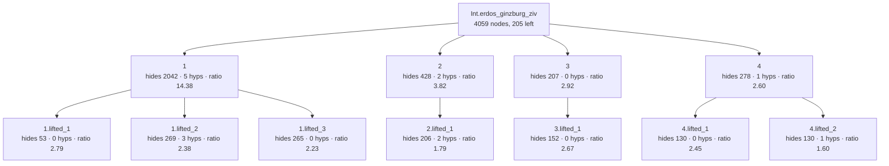

<!-- GENERATED by Rosette/Demo.lean (config `lifted`); do not edit. -->

### Original statement

```lean
Int.erdos_ginzburg_ziv.{u_1} {ι : Type u_1} {n : ℕ} {s : Finset ι} (a : ι → ℤ)
  (hs : 2 * n - 1 ≤ s.card) : ∃ t ⊆ s, t.card = n ∧ ↑n ∣ ∑ i ∈ t, a i
```

- proof term: **4059** nodes as a DAG (shared subterms once), **39563** as a tree
- candidate boundaries enumerated (Prop-typed subterms of DAG size ≥ 20): 258, of which 2 are typeclass-instance proofs and 3 are values of a `have`
- config `lifted`: levels k = [6, 3], minProof 40, maxStmt 150, maxFraction 0.800000
- result: 11 lemmas in the tree (4 called directly by the main proof); main proof 4059 → **205** nodes
- kernel check: `Int.erdos_ginzburg_ziv.lifted` and all 11 lemmas were added with `addDecl` (synchronous kernel check) and are `theorem`s; `Int.erdos_ginzburg_ziv.lifted` has the identical statement; axioms of the lifted version: [propext, Classical.choice, Quot.sound] (no new axiom)

### Recovered skeleton



- **`1`** — hides 2042 proof nodes (tree 33698) · statement 142 nodes · hidingRatio 14.38 · binders: 5 hypotheses, 0 instances (10 supplied from the caller's context) · was `lamBody` in its parent proof, head `«(none)»` · own proof 3525 → 3142 nodes after lifting its children

  ```lean
  Int.erdos_ginzburg_ziv.lifted_1.{u_1} (m : ℕ) (hm : 2 ≤ m)
    (ihm :
      ∀ {ι : Type u_1} {s : Finset ι} (a : ι → ℤ),
        2 * m - 1 ≤ s.card → ∃ t ⊆ s, t.card = m ∧ ↑m ∣ ∑ i ∈ t, a i)
    (n : ℕ) (hn : 2 ≤ n)
    (ihn :
      ∀ {ι : Type u_1} {s : Finset ι} (a : ι → ℤ),
        2 * n - 1 ≤ s.card → ∃ t ⊆ s, t.card = n ∧ ↑n ∣ ∑ i ∈ t, a i)
    {ι : Type u_1} {s : Finset ι} (a : ι → ℤ) (hs : 2 * (m * n) - 1 ≤ s.card) :
    ∃ t ⊆ s, t.card = m * n ∧ ↑(m * n) ∣ ∑ i ∈ t, a i
  ```
  - **`1.lifted_1`** — hides 53 proof nodes (tree 75) · statement 19 nodes · hidingRatio 2.79 · binders: 0 hypotheses, 0 instances (0 supplied from the caller's context) · was `arg` in its parent proof, head `IsLeftCancelAdd.addLeftReflectLE_of_addLeftReflectLT` · statement is a typeclass

    ```lean
    Int.erdos_ginzburg_ziv.lifted_1.lifted_1 : AddLeftReflectLE ℕ
    ```
  - **`1.lifted_2`** — hides 269 proof nodes (tree 2293) · statement 113 nodes · hidingRatio 2.38 · binders: 3 hypotheses, 0 instances (7 supplied from the caller's context) · was `arg` in its parent proof, head `Eq.mpr`

    ```lean
    Int.erdos_ginzburg_ziv.lifted_1.lifted_2.{u_1} {ι : Type u_1} {s : Finset ι} (𝒜 : Finset (Finset ι))
      (h𝒜disj : (↑𝒜).Pairwise Disjoint) (t₀ : Finset ι) (ht₀ : t₀ ⊆ s \ 𝒜.biUnion id) (this : t₀ ∉ 𝒜) :
      (↑(Finset.cons t₀ 𝒜 this)).Pairwise Disjoint
    ```
  - **`1.lifted_3`** — hides 265 proof nodes (tree 2483) · statement 119 nodes · hidingRatio 2.23 · binders: 0 hypotheses, 0 instances (4 supplied from the caller's context) · was `lamBody` in its parent proof, head `Exists.intro`

    ```lean
    Int.erdos_ginzburg_ziv.lifted_1.lifted_3.{u_1} (n : ℕ) {ι : Type u_1} {s : Finset ι} (a : ι → ℤ) :
      ∃ 𝒜,
        𝒜.card = 0 ∧
          (↑𝒜).Pairwise Disjoint ∧ ∀ ⦃t : Finset ι⦄, t ∈ 𝒜 → t ⊆ s ∧ t.card = n ∧ ↑n ∣ ∑ i ∈ t, a i
    ```
- **`2`** — hides 428 proof nodes (tree 1682) · statement 112 nodes · hidingRatio 3.82 · binders: 2 hypotheses, 0 instances (0 supplied from the caller's context) · was `arg` in its parent proof, head `«(none)»` · own proof 428 → 77 nodes after lifting its children

  ```lean
  Int.erdos_ginzburg_ziv.lifted_2.{u_1} (p : ℕ) (hp : Nat.Prime p) {ι : Type u_1} {s : Finset ι}
    (a : ι → ℤ) (hs : 2 * p - 1 ≤ s.card) : ∃ t ⊆ s, t.card = p ∧ ↑p ∣ ∑ i ∈ t, a i
  ```
  - **`2.lifted_1`** — hides 206 proof nodes (tree 1591) · statement 115 nodes · hidingRatio 1.79 · binders: 2 hypotheses, 0 instances (6 supplied from the caller's context) · was `haveBody` in its parent proof, head `Exists.casesOn`

    ```lean
    Int.erdos_ginzburg_ziv.lifted_2.lifted_1.{u_1} (p : ℕ) {ι : Type u_1} {s : Finset ι} (a : ι → ℤ)
      (hs : 2 * p - 1 ≤ s.card) (this : Fact (Nat.Prime p)) : ∃ t ⊆ s, t.card = p ∧ ↑p ∣ ∑ i ∈ t, a i
    ```
- **`3`** — hides 207 proof nodes (tree 1131) · statement 71 nodes · hidingRatio 2.92 · binders: 0 hypotheses, 0 instances (3 supplied from the caller's context) · was `lamBody` in its parent proof, head `Exists.intro` · own proof 227 → 142 nodes after lifting its children

  ```lean
  Int.erdos_ginzburg_ziv.lifted_3.{u_1} {ι : Type u_1} {s : Finset ι} (a : ι → ℤ) :
    ∃ t ⊆ s, t.card = 0 ∧ ↑0 ∣ ∑ i ∈ t, a i
  ```
  - **`3.lifted_1`** — hides 152 proof nodes (tree 605) · statement 57 nodes · hidingRatio 2.67 · binders: 0 hypotheses, 0 instances (2 supplied from the caller's context) · was `arg` in its parent proof, head `Eq.trans`

    ```lean
    Int.erdos_ginzburg_ziv.lifted_3.lifted_1.{u_1} {ι : Type u_1} (a : ι → ℤ) :
      (∅.card = 0 ∧ ↑0 ∣ ∑ i ∈ ∅, a i) = True
    ```
- **`4`** — hides 278 proof nodes (tree 2291) · statement 107 nodes · hidingRatio 2.60 · binders: 1 hypotheses, 0 instances (0 supplied from the caller's context) · was `arg` in its parent proof, head `«(none)»` · own proof 278 → 153 nodes after lifting its children

  ```lean
  Int.erdos_ginzburg_ziv.lifted_4.{u_1} {ι : Type u_1} {s : Finset ι} (a : ι → ℤ)
    (hs : 2 * 1 - 1 ≤ s.card) : ∃ t ⊆ s, t.card = 1 ∧ ↑1 ∣ ∑ i ∈ t, a i
  ```
  - **`4.lifted_1`** — hides 130 proof nodes (tree 513) · statement 53 nodes · hidingRatio 2.45 · binders: 0 hypotheses, 0 instances (3 supplied from the caller's context) · was `arg` in its parent proof, head `Eq.trans`

    ```lean
    Int.erdos_ginzburg_ziv.lifted_4.lifted_1.{u_1} {ι : Type u_1} (a : ι → ℤ) (t : Finset ι) :
      (t.card = 1 ∧ ↑1 ∣ ∑ i ∈ t, a i) = (t.card = 1)
    ```
  - **`4.lifted_2`** — hides 130 proof nodes (tree 943) · statement 81 nodes · hidingRatio 1.60 · binders: 1 hypotheses, 0 instances (3 supplied from the caller's context) · was `arg` in its parent proof, head `Eq.mp`

    ```lean
    Int.erdos_ginzburg_ziv.lifted_4.lifted_2.{u_1} {ι : Type u_1} {s : Finset ι}
      (hs : 2 * 1 - 1 ≤ s.card) : ∃ t ⊆ s, t.card = 1
    ```

### The `have` boundaries in the original proof term

Every value of a `have` (non-dependent `let`) in the elaborated term with proof DAG size ≥ 20, in source order. `rank` is the position among all 258 candidates sorted by hidingRatio (1 = best). The statement shown is the *closed* one: all hypotheses the proof of the `have` actually uses are quantified.

- rank 6/258 · ratio 7.49 · proof 1603 · statement 214 · 4 hyps

  ```lean
  ∀ (m : ℕ), 2 ≤ m → ∀ (n : ℕ), 2 ≤ n → (∀ {ι : Type u_1} {s : Finset ι} (a : ι → ℤ), 2 * n - 1 ≤ s.card → ∃ t ⊆ s, t.card = n ∧ ↑n ∣ ∑ i ∈ t, a i) → ∀ {ι : Type u_1} {s : Finset ι} (a : ι → ℤ), 2 * (m * n) - 1 ≤ s.card → ∀ k ≤ 2 * m - 1, ∃ 𝒜, 𝒜.card = k ∧ (↑𝒜).Pairwise Disjoint ∧ ∀ ⦃t : Finset ι⦄, t ∈ 𝒜 → t ⊆ s ∧ t.card = n ∧ ↑n ∣ ∑ i ∈ t, a i
  ```
- rank 28/258 · ratio 2.65 · proof 503 · statement 190 · 5 hyps

  ```lean
  ∀ (m : ℕ), 2 ≤ m → ∀ (n : ℕ) {ι : Type u_1} {s : Finset ι} (a : ι → ℤ), 2 * (m * n) - 1 ≤ s.card → ∀ (k : ℕ), k + 1 ≤ 2 * m - 1 → ∀ (𝒜 : Finset (Finset ι)), 𝒜.card = k → (∀ ⦃t : Finset ι⦄, t ∈ 𝒜 → t ⊆ s ∧ t.card = n ∧ ↑n ∣ ∑ i ∈ t, a i) → 2 * n - 1 ≤ (s \ 𝒜.biUnion id).card
  ```
- rank 108/258 · ratio 1.39 · proof 432 · statement 311 · 9 hyps

  ```lean
  ∀ (m n : ℕ), 2 ≤ n → (∀ {ι : Type u_1} {s : Finset ι} (a : ι → ℤ), 2 * n - 1 ≤ s.card → ∃ t ⊆ s, t.card = n ∧ ↑n ∣ ∑ i ∈ t, a i) → ∀ {ι : Type u_1} {s : Finset ι} (a : ι → ℤ), 2 * (m * n) - 1 ≤ s.card → ∀ (k : ℕ), (k ≤ 2 * m - 1 → ∃ 𝒜, 𝒜.card = k ∧ (↑𝒜).Pairwise Disjoint ∧ ∀ ⦃t : Finset ι⦄, t ∈ 𝒜 → t ⊆ s ∧ t.card = n ∧ ↑n ∣ ∑ i ∈ t, a i) → ∀ (𝒜 : Finset (Finset ι)), (∀ ⦃t : Finset ι⦄, t ∈ 𝒜 → t ⊆ s ∧ t.card = n ∧ ↑n ∣ ∑ i ∈ t, a i) → 2 * n - 1 ≤ (s \ 𝒜.biUnion id).card → ∀ t₀ ⊆ s \ 𝒜.biUnion id, t₀.card = n → ↑n ∣ ∑ i ∈ t₀, a i → t₀ ∈ 𝒜 → False
  ```
