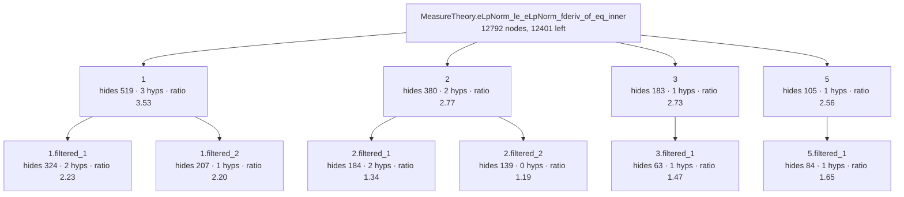

<!-- GENERATED by Rosette/Demo.lean (config `filtered`); do not edit. -->

### Original statement

```lean
MeasureTheory.eLpNorm_le_eLpNorm_fderiv_of_eq_inner.{u_4, u_5} {E : Type u_4} [NormedAddCommGroup E]
  [NormedSpace ℝ E] [MeasurableSpace E] [BorelSpace E] [FiniteDimensional ℝ E]
  (μ : MeasureTheory.Measure E) [μ.IsAddHaarMeasure] {F' : Type u_5} [NormedAddCommGroup F']
  [InnerProductSpace ℝ F'] {u : E → F'} (hu : ContDiff ℝ 1 u) (h2u : HasCompactSupport u)
  {p p' : NNReal} (hp : 1 ≤ p) (hn : 0 < Module.finrank ℝ E)
  (hp' : (↑p')⁻¹ = ↑p⁻¹ - (↑(Module.finrank ℝ E))⁻¹) :
  MeasureTheory.eLpNorm u (↑p') μ ≤
    ↑(MeasureTheory.eLpNormLESNormFDerivOfEqInnerConst μ ↑p) *
      MeasureTheory.eLpNorm (fderiv ℝ u) (↑p) μ
```

- proof term: **12792** nodes as a DAG (shared subterms once), **1189531** as a tree
- candidate boundaries enumerated (Prop-typed subterms of DAG size ≥ 20): 2174, of which 184 are typeclass-instance proofs and 41 are values of a `have`
- config `filtered`: levels k = [6, 3], minProof 40, maxStmt 150, maxFraction 0.800000
- result: 10 lemmas in the tree (4 called directly by the main proof); main proof 12792 → **12401** nodes
- kernel check: `MeasureTheory.eLpNorm_le_eLpNorm_fderiv_of_eq_inner.filtered` and all 10 lemmas were added with `addDecl` (synchronous kernel check) and are `theorem`s; `MeasureTheory.eLpNorm_le_eLpNorm_fderiv_of_eq_inner.filtered` has the identical statement; axioms of the lifted version: [propext, Classical.choice, Quot.sound] (no new axiom)

### Recovered skeleton



- **`1`** — hides 519 proof nodes (tree 2258) · statement 147 nodes · hidingRatio 3.53 · binders: 3 hypotheses, 2 instances (7 supplied from the caller's context) · was `haveBody` in its parent proof, head `Eq.mp` · own proof 574 → 207 nodes after lifting its children

  ```lean
  MeasureTheory.eLpNorm_le_eLpNorm_fderiv_of_eq_inner.filtered_1.{u_4} {E : Type u_4}
    [NormedAddCommGroup E] [NormedSpace ℝ E] {p : NNReal} (hp : 1 ≤ p) (hn : 0 < Module.finrank ℝ E) :
    let n := Module.finrank ℝ E;
    0 < ↑p⁻¹ - (↑n)⁻¹ → ↑p < ↑n
  ```
  - **`1.filtered_1`** — hides 324 proof nodes (tree 1162) · statement 145 nodes · hidingRatio 2.23 · binders: 2 hypotheses, 2 instances (6 supplied from the caller's context) · was `arg` in its parent proof, head `inv_lt_inv₀`

    ```lean
    MeasureTheory.eLpNorm_le_eLpNorm_fderiv_of_eq_inner.filtered_1.filtered_1.{u_4} {E : Type u_4}
      [NormedAddCommGroup E] [NormedSpace ℝ E] {p : NNReal} (hp : 1 ≤ p) (hn : 0 < Module.finrank ℝ E) :
      let n := Module.finrank ℝ E;
      (↑n)⁻¹ < (↑p)⁻¹ ↔ ↑p < ↑n
    ```
  - **`1.filtered_2`** — hides 207 proof nodes (tree 721) · statement 94 nodes · hidingRatio 2.20 · binders: 1 hypotheses, 2 instances (5 supplied from the caller's context) · was `arg` in its parent proof, head `Eq.mp`

    ```lean
    MeasureTheory.eLpNorm_le_eLpNorm_fderiv_of_eq_inner.filtered_1.filtered_2.{u_4} {E : Type u_4}
      [NormedAddCommGroup E] [NormedSpace ℝ E] {p : NNReal} :
      let n := Module.finrank ℝ E;
      0 < ↑p⁻¹ - (↑n)⁻¹ → (↑n)⁻¹ < (↑p)⁻¹
    ```
- **`2`** — hides 380 proof nodes (tree 3455) · statement 137 nodes · hidingRatio 2.77 · binders: 2 hypotheses, 2 instances (6 supplied from the caller's context) · was `arg` in its parent proof, head `Eq.mpr` · own proof 450 → 306 nodes after lifting its children

  ```lean
  MeasureTheory.eLpNorm_le_eLpNorm_fderiv_of_eq_inner.filtered_2.{u_4} {E : Type u_4}
    [NormedAddCommGroup E] [NormedSpace ℝ E] {p : NNReal} :
    let n := Module.finrank ℝ E;
    let n' := (↑n).conjExponent;
    (↑n).HolderConjugate n' → 1 < p → ↑n - ↑p < ↑p * (↑n - 1)
  ```
  - **`2.filtered_1`** — hides 184 proof nodes (tree 615) · statement 137 nodes · hidingRatio 1.34 · binders: 2 hypotheses, 2 instances (6 supplied from the caller's context) · was `arg` in its parent proof, head `Eq.mpr`

    ```lean
    MeasureTheory.eLpNorm_le_eLpNorm_fderiv_of_eq_inner.filtered_2.filtered_1.{u_4} {E : Type u_4}
      [NormedAddCommGroup E] [NormedSpace ℝ E] {p : NNReal} :
      let n := Module.finrank ℝ E;
      let n' := (↑n).conjExponent;
      (↑n).HolderConjugate n' → 1 < p → ↑n < ↑p * ↑n
    ```
  - **`2.filtered_2`** — hides 139 proof nodes (tree 227) · statement 117 nodes · hidingRatio 1.19 · binders: 0 hypotheses, 2 instances (4 supplied from the caller's context) · was `arg` in its parent proof, head `sub_lt_sub_iff_right`

    ```lean
    MeasureTheory.eLpNorm_le_eLpNorm_fderiv_of_eq_inner.filtered_2.filtered_2.{u_4} {E : Type u_4}
      [NormedAddCommGroup E] [NormedSpace ℝ E] {p : NNReal} :
      let n := Module.finrank ℝ E;
      ↑n - ↑p < ↑p * ↑n - ↑p ↔ ↑n < ↑p * ↑n
    ```
- **`3`** — hides 183 proof nodes (tree 317) · statement 67 nodes · hidingRatio 2.73 · binders: 1 hypotheses, 0 instances (2 supplied from the caller's context) · was `arg` in its parent proof, head `ENNReal.zero_rpow_of_pos` · own proof 193 → 143 nodes after lifting its children

  ```lean
  MeasureTheory.eLpNorm_le_eLpNorm_fderiv_of_eq_inner.filtered_3 {p' : NNReal} (hp'0 : ¬p' = 0) :
    0 ^ (1 / ↑p') = 0
  ```
  - **`3.filtered_1`** — hides 63 proof nodes (tree 107) · statement 43 nodes · hidingRatio 1.47 · binders: 1 hypotheses, 0 instances (2 supplied from the caller's context) · was `arg` in its parent proof, head `lt_of_le_of_ne'`

    ```lean
    MeasureTheory.eLpNorm_le_eLpNorm_fderiv_of_eq_inner.filtered_3.filtered_1 {p' : NNReal}
      (hp'0 : ¬p' = 0) : 0 < p'
    ```
- **`5`** — hides 105 proof nodes (tree 179) · statement 41 nodes · hidingRatio 2.56 · binders: 1 hypotheses, 0 instances (2 supplied from the caller's context) · was `arg` in its parent proof, head `ne_of_gt` · REUSED at 3 call sites · own proof 116 → 52 nodes after lifting its children

  ```lean
  MeasureTheory.eLpNorm_le_eLpNorm_fderiv_of_eq_inner.filtered_5 {p : NNReal} (hp : 1 ≤ p) : ↑p ≠ 0
  ```
  - **`5.filtered_1`** — hides 84 proof nodes (tree 149) · statement 51 nodes · hidingRatio 1.65 · binders: 1 hypotheses, 0 instances (2 supplied from the caller's context) · was `arg` in its parent proof, head `lt_of_lt_of_le`

    ```lean
    MeasureTheory.eLpNorm_le_eLpNorm_fderiv_of_eq_inner.filtered_5.filtered_1 {p : NNReal}
      (hp : 1 ≤ p) : 0 < p
    ```
