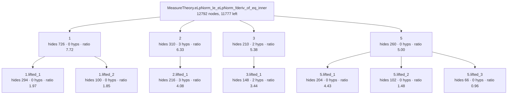

<!-- GENERATED by Rosette/Demo.lean (config `lifted`); do not edit. -->

### Original statement

```lean
MeasureTheory.eLpNorm_le_eLpNorm_fderiv_of_eq_inner.{u_4, u_5} {E : Type u_4} [NormedAddCommGroup E]
  [NormedSpace ℝ E] [MeasurableSpace E] [BorelSpace E] [FiniteDimensional ℝ E]
  (μ : MeasureTheory.Measure E) [μ.IsAddHaarMeasure] {F' : Type u_5} [NormedAddCommGroup F']
  [InnerProductSpace ℝ F'] {u : E → F'} (hu : ContDiff ℝ 1 u) (h2u : HasCompactSupport u)
  {p p' : NNReal} (hp : 1 ≤ p) (hn : 0 < Module.finrank ℝ E)
  (hp' : (↑p')⁻¹ = ↑p⁻¹ - (↑(Module.finrank ℝ E))⁻¹) :
  MeasureTheory.eLpNorm u (↑p') μ ≤
    ↑(MeasureTheory.eLpNormLESNormFDerivOfEqInnerConst μ ↑p) *
      MeasureTheory.eLpNorm (fderiv ℝ u) (↑p) μ
```

- proof term: **12792** nodes as a DAG (shared subterms once), **1189531** as a tree
- candidate boundaries enumerated (Prop-typed subterms of DAG size ≥ 20): 2174, of which 184 are typeclass-instance proofs and 41 are values of a `have`
- config `lifted`: levels k = [6, 3], minProof 40, maxStmt 150, maxFraction 0.800000
- result: 11 lemmas in the tree (4 called directly by the main proof); main proof 12792 → **11777** nodes
- kernel check: `MeasureTheory.eLpNorm_le_eLpNorm_fderiv_of_eq_inner.lifted` and all 11 lemmas were added with `addDecl` (synchronous kernel check) and are `theorem`s; `MeasureTheory.eLpNorm_le_eLpNorm_fderiv_of_eq_inner.lifted` has the identical statement; axioms of the lifted version: [propext, Classical.choice, Quot.sound] (no new axiom)

### Recovered skeleton



- **`1`** — hides 726 proof nodes (tree 35955) · statement 94 nodes · hidingRatio 7.72 · binders: 0 hypotheses, 2 instances (4 supplied from the caller's context) · was `haveValue` in its parent proof, head `Mathlib.Tactic.Ring.of_eq` · own proof 778 → 735 nodes after lifting its children

  ```lean
  MeasureTheory.eLpNorm_le_eLpNorm_fderiv_of_eq_inner.lifted_1.{u_4} {E : Type u_4}
    [NormedAddCommGroup E] [NormedSpace ℝ E] {p : NNReal} :
    let n := Module.finrank ℝ E;
    ↑p * (↑n - 1) - (↑n - ↑p) = ↑n * (↑p - 1)
  ```
  - **`1.lifted_1`** — hides 294 proof nodes (tree 3499) · statement 149 nodes · hidingRatio 1.97 · binders: 0 hypotheses, 0 instances (1 supplied from the caller's context) · was `arg` in its parent proof, head `Mathlib.Tactic.Ring.Common.sub_congr`

    ```lean
    MeasureTheory.eLpNorm_le_eLpNorm_fderiv_of_eq_inner.lifted_1.lifted_1 {p : NNReal} :
      ↑p - 1 = (Int.negOfNat 1).rawCast + (↑p ^ Nat.rawCast 1 * Nat.rawCast 1 + 0)
    ```
  - **`1.lifted_2`** — hides 100 proof nodes (tree 335) · statement 54 nodes · hidingRatio 1.85 · binders: 0 hypotheses, 0 instances (0 supplied from the caller's context) · was `arg` in its parent proof, head `Mathlib.Meta.NormNum.IsInt.to_raw_eq` · REUSED at 2 call sites

    ```lean
    MeasureTheory.eLpNorm_le_eLpNorm_fderiv_of_eq_inner.lifted_1.lifted_2 :
      Nat.rawCast 1 * (Int.negOfNat 1).rawCast = (Int.negOfNat 1).rawCast
    ```
- **`2`** — hides 310 proof nodes (tree 751) · statement 49 nodes · hidingRatio 6.33 · binders: 3 hypotheses, 2 instances (0 supplied from the caller's context) · was `fn` in its parent proof, head `«(none)»` · own proof 310 → 50 nodes after lifting its children

  ```lean
  MeasureTheory.eLpNorm_le_eLpNorm_fderiv_of_eq_inner.lifted_2 (α : Type) (self self' : LE α)
    (e'_2 : self = self') (a✝ a'✝ : α) (e'_3 : a✝ = a'✝) (a✝¹ a'✝¹ : α) (e'_4 : a✝¹ = a'✝¹) :
    (a✝ ≤ a✝¹) ≍ (a'✝ ≤ a'✝¹)
  ```
  - **`2.lifted_1`** — hides 216 proof nodes (tree 707) · statement 53 nodes · hidingRatio 4.08 · binders: 3 hypotheses, 2 instances (14 supplied from the caller's context) · was `lamBody` in its parent proof, head `Eq.casesOn`

    ```lean
    MeasureTheory.eLpNorm_le_eLpNorm_fderiv_of_eq_inner.lifted_2.lifted_1 (α : Type) :
      ∀ (α✝ α✝¹ α✝² α✝³ : Type) (self self' : LE α✝³) (e'_2 : self = self') (a a' : α✝³) (e'_3 : a = a')
        (a✝ a'✝ : α✝³) (e'_4 : a✝ = a'✝), (a ≤ a✝) ≍ (a' ≤ a'✝)
    ```
- **`3`** — hides 210 proof nodes (tree 479) · statement 39 nodes · hidingRatio 5.38 · binders: 2 hypotheses, 1 instances (0 supplied from the caller's context) · was `fn` in its parent proof, head `«(none)»` · own proof 210 → 39 nodes after lifting its children

  ```lean
  MeasureTheory.eLpNorm_le_eLpNorm_fderiv_of_eq_inner.lifted_3 (α : Type) (self : LE α) (a✝ a'✝ : α)
    (e'_3 : a✝ = a'✝) (a✝¹ a'✝¹ : α) (e'_4 : a✝¹ = a'✝¹) : (a✝ ≤ a✝¹) ≍ (a'✝ ≤ a'✝¹)
  ```
  - **`3.lifted_1`** — hides 148 proof nodes (tree 449) · statement 43 nodes · hidingRatio 3.44 · binders: 2 hypotheses, 1 instances (12 supplied from the caller's context) · was `lamBody` in its parent proof, head `Eq.casesOn`

    ```lean
    MeasureTheory.eLpNorm_le_eLpNorm_fderiv_of_eq_inner.lifted_3.lifted_1 (α : Type) :
      ∀ (α✝ α✝¹ α✝² α✝³ : Type) (self : LE α✝³) (a a' : α✝³) (e'_3 : a = a') (a✝ a'✝ : α✝³)
        (e'_4 : a✝ = a'✝), (a ≤ a✝) ≍ (a' ≤ a'✝)
    ```
- **`5`** — hides 260 proof nodes (tree 2409) · statement 52 nodes · hidingRatio 5.00 · binders: 0 hypotheses, 0 instances (1 supplied from the caller's context) · was `arg` in its parent proof, head `Mathlib.Tactic.FieldSimp.eq_mul_of_eq_eq_eq_mul` · REUSED at 3 call sites · own proof 263 → 87 nodes after lifting its children

  ```lean
  MeasureTheory.eLpNorm_le_eLpNorm_fderiv_of_eq_inner.lifted_5 {p : NNReal} :
    ↑p = Mathlib.Tactic.FieldSimp.NF.eval [] * ↑p
  ```
  - **`5.lifted_1`** — hides 204 proof nodes (tree 1491) · statement 46 nodes · hidingRatio 4.43 · binders: 0 hypotheses, 0 instances (1 supplied from the caller's context) · was `arg` in its parent proof, head `Mathlib.Tactic.FieldSimp.eq_div_of_eq_one_of_subst`

    ```lean
    MeasureTheory.eLpNorm_le_eLpNorm_fderiv_of_eq_inner.lifted_5.lifted_1 {p : NNReal} :
      ((1, ↑p) ::ᵣ []).eval = ↑p
    ```
  - **`5.lifted_2`** — hides 102 proof nodes (tree 547) · statement 69 nodes · hidingRatio 1.48 · binders: 0 hypotheses, 0 instances (1 supplied from the caller's context) · was `arg` in its parent proof, head `Eq.trans`

    ```lean
    MeasureTheory.eLpNorm_le_eLpNorm_fderiv_of_eq_inner.lifted_5.lifted_2 {p : NNReal} :
      ↑p = Mathlib.Tactic.FieldSimp.NF.eval [] * ((1, ↑p) ::ᵣ []).eval
    ```
  - **`5.lifted_3`** — hides 66 proof nodes (tree 121) · statement 69 nodes · hidingRatio 0.96 · binders: 0 hypotheses, 0 instances (1 supplied from the caller's context) · was `arg` in its parent proof, head `rfl`

    ```lean
    MeasureTheory.eLpNorm_le_eLpNorm_fderiv_of_eq_inner.lifted_5.lifted_3 {p : NNReal} :
      Mathlib.Tactic.FieldSimp.NF.eval [] * ((1, ↑p) ::ᵣ []).eval =
        Mathlib.Tactic.FieldSimp.NF.eval [] * ((1, ↑p) ::ᵣ []).eval
    ```

### The `have` boundaries in the original proof term

Every value of a `have` (non-dependent `let`) in the elaborated term with proof DAG size ≥ 20, in source order. `rank` is the position among all 2174 candidates sorted by hidingRatio (1 = best). The statement shown is the *closed* one: all hypotheses the proof of the `have` actually uses are quantified.

- rank 118/2174 · ratio 3.59 · proof 618 · statement 172 · 4 hyps

  ```lean
  ∀ {E : Type u_4} [inst : NormedAddCommGroup E] [inst_1 : NormedSpace ℝ E] {p p' : NNReal}, 1 ≤ p → 0 < Module.finrank ℝ E → (↑p')⁻¹ = ↑p⁻¹ - (↑(Module.finrank ℝ E))⁻¹ → ¬p' = 0 → let n := Module.finrank ℝ E; ↑p < ↑n
  ```
- rank 668/2174 · ratio 1.32 · proof 193 · statement 146 · 2 hyps

  ```lean
  ∀ {E : Type u_4} [inst : NormedAddCommGroup E] [inst_1 : NormedSpace ℝ E] {p p' : NNReal}, (↑p')⁻¹ = ↑p⁻¹ - (↑(Module.finrank ℝ E))⁻¹ → ¬p' = 0 → let n := Module.finrank ℝ E; ↑0 < ↑p⁻¹ - (↑n)⁻¹
  ```
- rank 1512/2174 · ratio 0.69 · proof 31 · statement 45 · 0 hyps

  ```lean
  ∀ {E : Type u_4} [inst : NormedAddCommGroup E] [inst_1 : NormedSpace ℝ E], Module.finrank ℝ E = Module.finrank ℝ E
  ```
- rank 1524/2174 · ratio 0.69 · proof 31 · statement 45 · 0 hyps

  ```lean
  ∀ {E : Type u_4} [inst : NormedAddCommGroup E] [inst_1 : NormedSpace ℝ E], Module.finrank ℝ E = Module.finrank ℝ E
  ```
- rank 947/2174 · ratio 1.02 · proof 96 · statement 94 · 2 hyps

  ```lean
  ∀ {E : Type u_4} [inst : NormedAddCommGroup E] [inst_1 : NormedSpace ℝ E] {p : NNReal}, 1 ≤ p → let n := Module.finrank ℝ E; ↑p < ↑n → Nat.succ 1 ≤ n
  ```
- rank 494/2174 · ratio 1.61 · proof 127 · statement 79 · 1 hyps

  ```lean
  ∀ {E : Type u_4} [inst : NormedAddCommGroup E] [inst_1 : NormedSpace ℝ E], let n := Module.finrank ℝ E; 2 ≤ n → (↑n).HolderConjugate (↑n).conjExponent
  ```
- rank 1881/2174 · ratio 0.50 · proof 45 · statement 90 · 1 hyps

  ```lean
  ∀ {E : Type u_4} [inst : NormedAddCommGroup E] [inst_1 : NormedSpace ℝ E], let n := Module.finrank ℝ E; let n' := (↑n).conjExponent; (↑n).HolderConjugate n' → 1 ≤ ↑n
  ```
- rank 411/2174 · ratio 1.73 · proof 182 · statement 105 · 1 hyps

  ```lean
  ∀ {E : Type u_4} [inst : NormedAddCommGroup E] [inst_1 : NormedSpace ℝ E], let n := Module.finrank ℝ E; let n' := (↑n).conjExponent; (↑n).HolderConjugate n' → 0 < ↑n - 1
  ```
- rank 404/2174 · ratio 1.78 · proof 148 · statement 83 · 1 hyps

  ```lean
  ∀ {E : Type u_4} [inst : NormedAddCommGroup E] [inst_1 : NormedSpace ℝ E] {p : NNReal}, let n := Module.finrank ℝ E; ↑p < ↑n → 0 < ↑n - ↑p
  ```
- rank 37/2174 · ratio 5.77 · proof 1016 · statement 176 · 4 hyps

  ```lean
  ∀ {E : Type u_4} [inst : NormedAddCommGroup E] [inst_1 : NormedSpace ℝ E] {p' : NNReal}, 0 < Module.finrank ℝ E → let n := Module.finrank ℝ E; let n' := (↑n).conjExponent; 1 ≤ ↑n → 0 < ↑n - 1 → (↑p')⁻¹ = ↑1⁻¹ - (↑n)⁻¹ → ↑p' = ↑n'
  ```
- rank 1518/2174 · ratio 0.69 · proof 31 · statement 45 · 0 hyps

  ```lean
  ∀ {E : Type u_4} [inst : NormedAddCommGroup E] [inst_1 : NormedSpace ℝ E], Module.finrank ℝ E = Module.finrank ℝ E
  ```
- rank 1521/2174 · ratio 0.69 · proof 31 · statement 45 · 0 hyps

  ```lean
  ∀ {E : Type u_4} [inst : NormedAddCommGroup E] [inst_1 : NormedSpace ℝ E], Module.finrank ℝ E = Module.finrank ℝ E
  ```
- rank 1519/2174 · ratio 0.69 · proof 31 · statement 45 · 0 hyps

  ```lean
  ∀ {E : Type u_4} [inst : NormedAddCommGroup E] [inst_1 : NormedSpace ℝ E], Module.finrank ℝ E = Module.finrank ℝ E
  ```
- rank 375/2174 · ratio 1.86 · proof 69 · statement 37 · 1 hyps

  ```lean
  ∀ {p : NNReal}, 1 < p → p ≠ 0
  ```
- rank 1149/2174 · ratio 0.90 · proof 27 · statement 30 · 1 hyps

  ```lean
  ∀ {p : NNReal}, let q := (↑p).conjExponent; (↑p).HolderConjugate q → ↑p ≠ 1
  ```
- rank 1993/2174 · ratio 0.42 · proof 27 · statement 65 · 1 hyps

  ```lean
  ∀ {p : NNReal}, ↑p ≠ 1 → ↑p - 1 ≠ 0
  ```
- rank 290/2174 · ratio 2.31 · proof 369 · statement 160 · 3 hyps

  ```lean
  ∀ {E : Type u_4} [inst : NormedAddCommGroup E] [inst_1 : NormedSpace ℝ E] {p p' : NNReal}, (↑p')⁻¹ = ↑p⁻¹ - (↑(Module.finrank ℝ E))⁻¹ → let n := Module.finrank ℝ E; let n' := (↑n).conjExponent; (↑n).HolderConjugate n' → let q := (↑p).conjExponent; (↑p).HolderConjugate q → 1 / ↑n' - 1 / q = 1 / ↑p'
  ```
- rank 1514/2174 · ratio 0.69 · proof 31 · statement 45 · 0 hyps

  ```lean
  ∀ {E : Type u_4} [inst : NormedAddCommGroup E] [inst_1 : NormedSpace ℝ E], Module.finrank ℝ E = Module.finrank ℝ E
  ```
- rank 731/2174 · ratio 1.19 · proof 493 · statement 413 · 7 hyps

  ```lean
  ∀ {E : Type u_4} [inst : NormedAddCommGroup E] [inst_1 : NormedSpace ℝ E] {p : NNReal} (hp : 1 ≤ p), let n := Module.finrank ℝ E; let n' := (↑n).conjExponent; ∀ (h2p : ↑p < ↑n), (↑n).HolderConjugate n' → ∀ (h2n : 0 < ↑n - 1), 0 < ↑n - ↑p → 1 < p → let γ := NNReal.mk (↑p * (↑n - 1) / (↑n - ↑p)) ⋯; ↑γ = ↑p * (↑n - 1) / (↑n - ↑p) → 1 < ↑γ
  ```
- rank 143/2174 · ratio 3.39 · proof 1592 · statement 470 · 7 hyps

  ```lean
  ∀ {E : Type u_4} [inst : NormedAddCommGroup E] [inst_1 : NormedSpace ℝ E] {p p' : NNReal} (hp : 1 ≤ p), 0 < Module.finrank ℝ E → (↑p')⁻¹ = ↑p⁻¹ - (↑(Module.finrank ℝ E))⁻¹ → let n := Module.finrank ℝ E; let n' := (↑n).conjExponent; ∀ (h2p : ↑p < ↑n), (↑n).HolderConjugate n' → ∀ (h2n : 0 < ↑n - 1), let γ := NNReal.mk (↑p * (↑n - 1) / (↑n - ↑p)) ⋯; ↑γ = ↑p * (↑n - 1) / (↑n - ↑p) → γ * n' = p'
  ```
- rank 1510/2174 · ratio 0.69 · proof 31 · statement 45 · 0 hyps

  ```lean
  ∀ {E : Type u_4} [inst : NormedAddCommGroup E] [inst_1 : NormedSpace ℝ E], Module.finrank ℝ E = Module.finrank ℝ E
  ```
- rank 1522/2174 · ratio 0.69 · proof 31 · statement 45 · 0 hyps

  ```lean
  ∀ {E : Type u_4} [inst : NormedAddCommGroup E] [inst_1 : NormedSpace ℝ E], Module.finrank ℝ E = Module.finrank ℝ E
  ```
- rank 1513/2174 · ratio 0.69 · proof 31 · statement 45 · 0 hyps

  ```lean
  ∀ {E : Type u_4} [inst : NormedAddCommGroup E] [inst_1 : NormedSpace ℝ E], Module.finrank ℝ E = Module.finrank ℝ E
  ```
- rank 38/2174 · ratio 5.63 · proof 2619 · statement 465 · 8 hyps

  ```lean
  ∀ {E : Type u_4} [inst : NormedAddCommGroup E] [inst_1 : NormedSpace ℝ E] {p p' : NNReal} (hp : 1 ≤ p), 0 < Module.finrank ℝ E → (↑p')⁻¹ = ↑p⁻¹ - (↑(Module.finrank ℝ E))⁻¹ → let n := Module.finrank ℝ E; ∀ (h2p : ↑p < ↑n) (h2n : 0 < ↑n - 1), let q := (↑p).conjExponent; (↑p).HolderConjugate q → ↑p - 1 ≠ 0 → let γ := NNReal.mk (↑p * (↑n - 1) / (↑n - ↑p)) ⋯; ↑γ = ↑p * (↑n - 1) / (↑n - ↑p) → (↑γ - 1) * q = ↑p'
  ```
- rank 1520/2174 · ratio 0.69 · proof 31 · statement 45 · 0 hyps

  ```lean
  ∀ {E : Type u_4} [inst : NormedAddCommGroup E] [inst_1 : NormedSpace ℝ E], Module.finrank ℝ E = Module.finrank ℝ E
  ```
- rank 28/2174 · ratio 7.72 · proof 726 · statement 94 · 0 hyps

  ```lean
  ∀ {E : Type u_4} [inst : NormedAddCommGroup E] [inst_1 : NormedSpace ℝ E] {p : NNReal}, let n := Module.finrank ℝ E; ↑p * (↑n - 1) - (↑n - ↑p) = ↑n * (↑p - 1)
  ```
- rank 1515/2174 · ratio 0.69 · proof 31 · statement 45 · 0 hyps

  ```lean
  ∀ {E : Type u_4} [inst : NormedAddCommGroup E] [inst_1 : NormedSpace ℝ E], Module.finrank ℝ E = Module.finrank ℝ E
  ```
- rank 1516/2174 · ratio 0.69 · proof 31 · statement 45 · 0 hyps

  ```lean
  ∀ {E : Type u_4} [inst : NormedAddCommGroup E] [inst_1 : NormedSpace ℝ E], Module.finrank ℝ E = Module.finrank ℝ E
  ```
- rank 1525/2174 · ratio 0.69 · proof 31 · statement 45 · 0 hyps

  ```lean
  ∀ {E : Type u_4} [inst : NormedAddCommGroup E] [inst_1 : NormedSpace ℝ E], Module.finrank ℝ E = Module.finrank ℝ E
  ```
- rank 1523/2174 · ratio 0.69 · proof 31 · statement 45 · 0 hyps

  ```lean
  ∀ {E : Type u_4} [inst : NormedAddCommGroup E] [inst_1 : NormedSpace ℝ E], Module.finrank ℝ E = Module.finrank ℝ E
  ```
- rank 1511/2174 · ratio 0.69 · proof 31 · statement 45 · 0 hyps

  ```lean
  ∀ {E : Type u_4} [inst : NormedAddCommGroup E] [inst_1 : NormedSpace ℝ E], Module.finrank ℝ E = Module.finrank ℝ E
  ```
- rank 1517/2174 · ratio 0.69 · proof 31 · statement 45 · 0 hyps

  ```lean
  ∀ {E : Type u_4} [inst : NormedAddCommGroup E] [inst_1 : NormedSpace ℝ E], Module.finrank ℝ E = Module.finrank ℝ E
  ```
- rank 2134/2174 · ratio 0.20 · proof 74 · statement 372 · 4 hyps

  ```lean
  ∀ {E : Type u_4} [inst : NormedAddCommGroup E] [inst_1 : NormedSpace ℝ E] {p : NNReal} (hp : 1 ≤ p), let n := Module.finrank ℝ E; ∀ (h2p : ↑p < ↑n) (h2n : 0 < ↑n - 1), let γ := NNReal.mk (↑p * (↑n - 1) / (↑n - ↑p)) ⋯; 1 < ↑γ → ↑γ ≠ 0
  ```
- rank 639/2174 · ratio 1.39 · proof 356 · statement 257 · 6 hyps

  ```lean
  ∀ {E : Type u_4} [inst : NormedAddCommGroup E] [inst_1 : NormedSpace ℝ E] [inst_2 : MeasurableSpace E] [BorelSpace E] [FiniteDimensional ℝ E] (μ : MeasureTheory.Measure E) [μ.IsAddHaarMeasure] {F' : Type u_5} [inst_6 : NormedAddCommGroup F'] [inst_7 : InnerProductSpace ℝ F'] {u : E → F'}, ContDiff ℝ 1 u → HasCompactSupport u → ∀ {p' : NNReal}, ¬p' = 0 → ∫⁻ (a : E), ‖u a‖ₑ ^ ↑p' ∂μ ≠ ⊤
  ```
- rank 1391/2174 · ratio 0.78 · proof 154 · statement 198 · 2 hyps

  ```lean
  ∀ {E : Type u_4} [inst : MeasurableSpace E] (μ : MeasureTheory.Measure E) {F' : Type u_5} [inst_1 : NormedAddCommGroup F'] {u : E → F'} {p p' : NNReal}, let q := (↑p).conjExponent; ¬∫⁻ (x : E), ‖u x‖ₑ ^ ↑p' ∂μ = 0 → ∫⁻ (x : E), ‖u x‖ₑ ^ ↑p' ∂μ ≠ ⊤ → (∫⁻ (x : E), ‖u x‖ₑ ^ ↑p' ∂μ) ^ (1 / q) ≠ 0
  ```
- rank 1529/2174 · ratio 0.69 · proof 136 · statement 198 · 2 hyps

  ```lean
  ∀ {E : Type u_4} [inst : MeasurableSpace E] (μ : MeasureTheory.Measure E) {F' : Type u_5} [inst_1 : NormedAddCommGroup F'] {u : E → F'} {p p' : NNReal}, let q := (↑p).conjExponent; ¬∫⁻ (x : E), ‖u x‖ₑ ^ ↑p' ∂μ = 0 → ∫⁻ (x : E), ‖u x‖ₑ ^ ↑p' ∂μ ≠ ⊤ → (∫⁻ (x : E), ‖u x‖ₑ ^ ↑p' ∂μ) ^ (1 / q) ≠ ⊤
  ```
- rank 1931/2174 · ratio 0.46 · proof 50 · statement 108 · 1 hyps

  ```lean
  ∀ {E : Type u_4} [inst : NormedAddCommGroup E] [inst_1 : NormedSpace ℝ E] {F' : Type u_5} [inst_2 : NormedAddCommGroup F'] [inst_3 : InnerProductSpace ℝ F'] {u : E → F'}, ContDiff ℝ 1 u → Continuous u
  ```
- rank 2174/2174 · ratio 0.05 · proof 23 · statement 474 · 5 hyps

  ```lean
  ∀ {E : Type u_4} [inst : NormedAddCommGroup E] [inst_1 : NormedSpace ℝ E] {F' : Type u_5} [inst_2 : NormedAddCommGroup F'] [inst_3 : InnerProductSpace ℝ F'] {u : E → F'}, ContDiff ℝ 1 u → ∀ {p : NNReal} (hp : 1 ≤ p), let n := Module.finrank ℝ E; ∀ (h2p : ↑p < ↑n) (h2n : 0 < ↑n - 1), let γ := NNReal.mk (↑p * (↑n - 1) / (↑n - ↑p)) ⋯; 1 < ↑γ → ContDiff ℝ 1 fun x => ‖u x‖ ^ ↑γ
  ```
- rank 2162/2174 · ratio 0.11 · proof 49 · statement 459 · 5 hyps

  ```lean
  ∀ {E : Type u_4} [inst : NormedAddCommGroup E] [inst_1 : NormedSpace ℝ E] {F' : Type u_5} [inst_2 : NormedAddCommGroup F'] {u : E → F'}, HasCompactSupport u → ∀ {p : NNReal} (hp : 1 ≤ p), let n := Module.finrank ℝ E; ∀ (h2p : ↑p < ↑n) (h2n : 0 < ↑n - 1), let γ := NNReal.mk (↑p * (↑n - 1) / (↑n - ↑p)) ⋯; ↑γ ≠ 0 → HasCompactSupport fun x => ‖u x‖ ^ ↑γ
  ```
- rank 141/2174 · ratio 3.44 · proof 3048 · statement 886 · 15 hyps

  ```lean
  ∀ {E : Type u_4} [inst : NormedAddCommGroup E] [inst_1 : NormedSpace ℝ E] [inst_2 : MeasurableSpace E] [inst_3 : BorelSpace E] [inst_4 : FiniteDimensional ℝ E] (μ : MeasureTheory.Measure E) [inst_5 : μ.IsAddHaarMeasure] {F' : Type u_5} [inst_6 : NormedAddCommGroup F'] [inst_7 : InnerProductSpace ℝ F'] {u : E → F'}, ContDiff ℝ 1 u → ∀ {p p' : NNReal} (hp : 1 ≤ p), let n := Module.finrank ℝ E; let n' := (↑n).conjExponent; ∀ (h2p : ↑p < ↑n), (↑n).HolderConjugate n' → ∀ (h2n : 0 < ↑n - 1), 1 < p → let q := (↑p).conjExponent; let γ := NNReal.mk (↑p * (↑n - 1) / (↑n - ↑p)) ⋯; 1 < ↑γ → γ * n' = p' → (↑γ - 1) * q = ↑p' → Continuous u → let v := fun x => ‖u x‖ ^ ↑γ; ContDiff ℝ 1 v → HasCompactSupport …
  ```
- rank 676/2174 · ratio 1.31 · proof 618 · statement 473 · 6 hyps

  ```lean
  ∀ {E : Type u_4} [inst : NormedAddCommGroup E] [inst_1 : NormedSpace ℝ E] [inst_2 : MeasurableSpace E] [inst_3 : BorelSpace E] [inst_4 : FiniteDimensional ℝ E] (μ : MeasureTheory.Measure E) [inst_5 : μ.IsAddHaarMeasure] {p : NNReal} (hp : 1 ≤ p), let n := Module.finrank ℝ E; let n' := (↑n).conjExponent; ∀ (h2p : ↑p < ↑n) (h2n : 0 < ↑n - 1), let γ := NNReal.mk (↑p * (↑n - 1) / (↑n - ↑p)) ⋯; let C := MeasureTheory.eLpNormLESNormFDerivOneConst μ ↑n'; ↑C * ↑γ = ↑(MeasureTheory.eLpNormLESNormFDerivOfEqInnerConst μ ↑p)
  ```
