<!-- GENERATED by Rosette/Demo.lean (config `wide`); do not edit. -->

### Original statement

```lean
MeasureTheory.eLpNorm_le_eLpNorm_fderiv_of_eq_inner.{u_4, u_5} {E : Type u_4} [NormedAddCommGroup E]
  [NormedSpace ℝ E] [MeasurableSpace E] [BorelSpace E] [FiniteDimensional ℝ E]
  (μ : MeasureTheory.Measure E) [μ.IsAddHaarMeasure] {F' : Type u_5} [NormedAddCommGroup F']
  [InnerProductSpace ℝ F'] {u : E → F'} (hu : ContDiff ℝ 1 u) (h2u : HasCompactSupport u)
  {p p' : NNReal} (hp : 1 ≤ p) (hn : 0 < Module.finrank ℝ E)
  (hp' : (↑p')⁻¹ = ↑p⁻¹ - (↑(Module.finrank ℝ E))⁻¹) :
  MeasureTheory.eLpNorm u (↑p') μ ≤
    ↑(MeasureTheory.eLpNormLESNormFDerivOfEqInnerConst μ ↑p) *
      MeasureTheory.eLpNorm (fderiv ℝ u) (↑p) μ
```

- proof term: **12792** nodes as a DAG (shared subterms once), **1189531** as a tree
- candidate boundaries enumerated (Prop-typed subterms of DAG size ≥ 20): 2174, of which 184 are typeclass-instance proofs and 41 are values of a `have`
- config `wide`: levels k = [6, 3], minProof 40, maxStmt 500, maxFraction 0.500000
- result: 21 lemmas in the tree (6 called directly by the main proof); main proof 12792 → **8383** nodes
- kernel check: `MeasureTheory.eLpNorm_le_eLpNorm_fderiv_of_eq_inner.wide` and all 21 lemmas were added with `addDecl` (synchronous kernel check) and are `theorem`s; `MeasureTheory.eLpNorm_le_eLpNorm_fderiv_of_eq_inner.wide` has the identical statement; axioms of the lifted version: [propext, Classical.choice, Quot.sound] (no new axiom)

### Recovered skeleton

```mermaid
graph TD
  T["MeasureTheory.eLpNorm_le_eLpNorm_fderiv_of_eq_inner<br/>12792 nodes, 8383 left"]
  T --> L1["1<br/>hides 2489 · 4 hyps · ratio 11.91"]
  L1 --> L1_wide_1["1.wide_1<br/>hides 105 · 1 hyps · ratio 2.56"]
  L1 --> L1_wide_3["1.wide_3<br/>hides 164 · 1 hyps · ratio 1.89"]
  T --> L2["2<br/>hides 1398 · 4 hyps · ratio 6.30"]
  L2 --> L2_wide_1["2.wide_1<br/>hides 105 · 1 hyps · ratio 2.56"]
  L2 --> L2_wide_3["2.wide_3<br/>hides 164 · 1 hyps · ratio 1.89"]
  T --> L3["3<br/>hides 1045 · 4 hyps · ratio 5.84"]
  L3 --> L3_wide_2["3.wide_2<br/>hides 164 · 1 hyps · ratio 1.89"]
  L3 --> L3_wide_3["3.wide_3<br/>hides 50 · 0 hyps · ratio 0.89"]
  T --> L4["4<br/>hides 1120 · 4 hyps · ratio 5.60"]
  L4 --> L4_wide_1["4.wide_1<br/>hides 198 · 3 hyps · ratio 0.95"]
  L4 --> L4_wide_2["4.wide_2<br/>hides 47 · 0 hyps · ratio 0.89"]
  L4 --> L4_wide_3["4.wide_3<br/>hides 96 · 1 hyps · ratio 0.69"]
  T --> L5["5<br/>hides 618 · 4 hyps · ratio 3.59"]
  L5 --> L5_wide_1["5.wide_1<br/>hides 324 · 2 hyps · ratio 2.23"]
  L5 --> L5_wide_2["5.wide_2<br/>hides 207 · 1 hyps · ratio 2.20"]
  L5 --> L5_wide_3["5.wide_3<br/>hides 95 · 1 hyps · ratio 1.56"]
  T --> L6["6<br/>hides 475 · 3 hyps · ratio 2.93"]
  L6 --> L6_wide_1["6.wide_1<br/>hides 184 · 2 hyps · ratio 1.34"]
  L6 --> L6_wide_2["6.wide_2<br/>hides 139 · 0 hyps · ratio 1.19"]
  L6 --> L6_wide_3["6.wide_3<br/>hides 84 · 1 hyps · ratio 0.52"]
```



- **`1`** — hides 2489 proof nodes (tree 126132) · statement 209 nodes · hidingRatio 11.91 · binders: 4 hypotheses, 2 instances (8 supplied from the caller's context) · was `arg` in its parent proof, head `«(none)»` · own proof 2586 → 2533 nodes after lifting its children

  ```lean
  MeasureTheory.eLpNorm_le_eLpNorm_fderiv_of_eq_inner.wide_1.{u_4} {E : Type u_4}
    [NormedAddCommGroup E] [NormedSpace ℝ E] {p : NNReal} (hp : 1 ≤ p) (hn : 0 < Module.finrank ℝ E) :
    let n := Module.finrank ℝ E;
    ↑p < ↑n → ↑p - 1 ≠ 0 → ((↑p * (↑n - 1) / (↑n - ↑p) - 1) * (↑p / (↑p - 1)))⁻¹ = (↑p)⁻¹ - (↑n)⁻¹
  ```
  - **`1.wide_1`** — hides 105 proof nodes (tree 179) · statement 41 nodes · hidingRatio 2.56 · binders: 1 hypotheses, 0 instances (2 supplied from the caller's context) · was `arg` in its parent proof, head `ne_of_gt` · REUSED at 2 call sites

    ```lean
    MeasureTheory.eLpNorm_le_eLpNorm_fderiv_of_eq_inner.wide_1.wide_1 {p : NNReal} (hp : 1 ≤ p) : ↑p ≠ 0
    ```
  - **`1.wide_3`** — hides 164 proof nodes (tree 398) · statement 87 nodes · hidingRatio 1.89 · binders: 1 hypotheses, 2 instances (4 supplied from the caller's context) · was `arg` in its parent proof, head `ne_of_gt`

    ```lean
    MeasureTheory.eLpNorm_le_eLpNorm_fderiv_of_eq_inner.wide_1.wide_3.{u_4} {E : Type u_4}
      [NormedAddCommGroup E] [NormedSpace ℝ E] (hn : 0 < Module.finrank ℝ E) :
      let n := Module.finrank ℝ E;
      ↑n ≠ 0
    ```
- **`2`** — hides 1398 proof nodes (tree 42951) · statement 222 nodes · hidingRatio 6.30 · binders: 4 hypotheses, 2 instances (8 supplied from the caller's context) · was `arg` in its parent proof, head `of_eq_true` · own proof 1464 → 1416 nodes after lifting its children

  ```lean
  MeasureTheory.eLpNorm_le_eLpNorm_fderiv_of_eq_inner.wide_2.{u_4} {E : Type u_4}
    [NormedAddCommGroup E] [NormedSpace ℝ E] {p : NNReal} (hp : 1 ≤ p) (hn : 0 < Module.finrank ℝ E) :
    let n := Module.finrank ℝ E;
    ↑p < ↑n → 0 < ↑n - 1 → (↑p * (↑n - 1) / (↑n - ↑p) * (↑↑n / (↑↑n - 1)))⁻¹ = (↑p)⁻¹ - (↑n)⁻¹
  ```
  - **`2.wide_1`** — hides 105 proof nodes (tree 179) · statement 41 nodes · hidingRatio 2.56 · binders: 1 hypotheses, 0 instances (2 supplied from the caller's context) · was `arg` in its parent proof, head `ne_of_gt` · REUSED at 2 call sites

    ```lean
    MeasureTheory.eLpNorm_le_eLpNorm_fderiv_of_eq_inner.wide_2.wide_1 {p : NNReal} (hp : 1 ≤ p) : ↑p ≠ 0
    ```
  - **`2.wide_3`** — hides 164 proof nodes (tree 398) · statement 87 nodes · hidingRatio 1.89 · binders: 1 hypotheses, 2 instances (4 supplied from the caller's context) · was `arg` in its parent proof, head `ne_of_gt`

    ```lean
    MeasureTheory.eLpNorm_le_eLpNorm_fderiv_of_eq_inner.wide_2.wide_3.{u_4} {E : Type u_4}
      [NormedAddCommGroup E] [NormedSpace ℝ E] (hn : 0 < Module.finrank ℝ E) :
      let n := Module.finrank ℝ E;
      ↑n ≠ 0
    ```
- **`3`** — hides 1045 proof nodes (tree 20146) · statement 179 nodes · hidingRatio 5.84 · binders: 4 hypotheses, 2 instances (8 supplied from the caller's context) · was `arg` in its parent proof, head `«(none)»` · own proof 1128 → 1013 nodes after lifting its children

  ```lean
  MeasureTheory.eLpNorm_le_eLpNorm_fderiv_of_eq_inner.wide_3.{u_4} {E : Type u_4}
    [NormedAddCommGroup E] [NormedSpace ℝ E] {p' : NNReal} (hn : 0 < Module.finrank ℝ E) :
    let n := Module.finrank ℝ E;
    let n' := (↑n).conjExponent;
    1 ≤ ↑n → 0 < ↑n - 1 → (↑p')⁻¹ = ↑1⁻¹ - (↑n)⁻¹ → ↑p' = ↑n'
  ```
  - **`3.wide_2`** — hides 164 proof nodes (tree 398) · statement 87 nodes · hidingRatio 1.89 · binders: 1 hypotheses, 2 instances (4 supplied from the caller's context) · was `arg` in its parent proof, head `ne_of_gt` · REUSED at 2 call sites

    ```lean
    MeasureTheory.eLpNorm_le_eLpNorm_fderiv_of_eq_inner.wide_3.wide_2.{u_4} {E : Type u_4}
      [NormedAddCommGroup E] [NormedSpace ℝ E] (hn : 0 < Module.finrank ℝ E) :
      let n := Module.finrank ℝ E;
      ↑n ≠ 0
    ```
  - **`3.wide_3`** — hides 50 proof nodes (tree 107) · statement 56 nodes · hidingRatio 0.89 · binders: 0 hypotheses, 0 instances (0 supplied from the caller's context) · was `arg` in its parent proof, head `one_ne_zero`

    ```lean
    MeasureTheory.eLpNorm_le_eLpNorm_fderiv_of_eq_inner.wide_3.wide_3 : 1 ≠ 0
    ```
- **`4`** — hides 1120 proof nodes (tree 41413) · statement 200 nodes · hidingRatio 5.60 · binders: 4 hypotheses, 3 instances (9 supplied from the caller's context) · was `arg` in its parent proof, head `Eq.mpr` · own proof 1246 → 1199 nodes after lifting its children

  ```lean
  MeasureTheory.eLpNorm_le_eLpNorm_fderiv_of_eq_inner.wide_4.{u_4} {E : Type u_4}
    [NormedAddCommGroup E] [NormedSpace ℝ E] [MeasurableSpace E] [BorelSpace E]
    [FiniteDimensional ℝ E] (μ : MeasureTheory.Measure E) [μ.IsAddHaarMeasure] :
    let n := Module.finrank ℝ E;
    let n' := (↑n).conjExponent;
    0 < ↑n - ↑1 →
      ↑(MeasureTheory.eLpNormLESNormFDerivOfEqInnerConst μ ↑1) =
        ↑(MeasureTheory.eLpNormLESNormFDerivOneConst μ ↑n')
  ```
  - **`4.wide_1`** — hides 198 proof nodes (tree 2021) · statement 209 nodes · hidingRatio 0.95 · binders: 3 hypotheses, 3 instances (8 supplied from the caller's context) · was `arg` in its parent proof, head `of_eq_true`

    ```lean
    MeasureTheory.eLpNorm_le_eLpNorm_fderiv_of_eq_inner.wide_4.wide_1.{u_4} {E : Type u_4}
      [NormedAddCommGroup E] [NormedSpace ℝ E] [MeasurableSpace E] [BorelSpace E]
      [FiniteDimensional ℝ E] (μ : MeasureTheory.Measure E) [μ.IsAddHaarMeasure] :
      MeasureTheory.eLpNormLESNormFDerivOneConst μ ↑(↑(Module.finrank ℝ E)).conjExponent *
          Real.toNNReal 1 =
        MeasureTheory.eLpNormLESNormFDerivOneConst μ ↑(↑(Module.finrank ℝ E)).conjExponent
    ```
  - **`4.wide_2`** — hides 47 proof nodes (tree 91) · statement 53 nodes · hidingRatio 0.89 · binders: 0 hypotheses, 0 instances (0 supplied from the caller's context) · was `arg` in its parent proof, head `one_ne_zero`

    ```lean
    MeasureTheory.eLpNorm_le_eLpNorm_fderiv_of_eq_inner.wide_4.wide_2 : 1 ≠ 0
    ```
  - **`4.wide_3`** — hides 96 proof nodes (tree 123) · statement 139 nodes · hidingRatio 0.69 · binders: 1 hypotheses, 2 instances (4 supplied from the caller's context) · was `arg` in its parent proof, head `ne_of_gt`

    ```lean
    MeasureTheory.eLpNorm_le_eLpNorm_fderiv_of_eq_inner.wide_4.wide_3.{u_4} {E : Type u_4}
      [NormedAddCommGroup E] [NormedSpace ℝ E] :
      let n := Module.finrank ℝ E;
      0 < ↑n - ↑1 → ↑(Module.finrank ℝ E) - 1 ≠ 0
    ```
- **`5`** — hides 618 proof nodes (tree 3168) · statement 172 nodes · hidingRatio 3.59 · binders: 4 hypotheses, 2 instances (9 supplied from the caller's context) · was `haveValue` in its parent proof, head `«(none)»` · own proof 729 → 337 nodes after lifting its children

  ```lean
  MeasureTheory.eLpNorm_le_eLpNorm_fderiv_of_eq_inner.wide_5.{u_4} {E : Type u_4}
    [NormedAddCommGroup E] [NormedSpace ℝ E] {p p' : NNReal} (hp : 1 ≤ p)
    (hn : 0 < Module.finrank ℝ E) (hp' : (↑p')⁻¹ = ↑p⁻¹ - (↑(Module.finrank ℝ E))⁻¹)
    (hp'0 : ¬p' = 0) :
    let n := Module.finrank ℝ E;
    ↑p < ↑n
  ```
  - **`5.wide_1`** — hides 324 proof nodes (tree 1162) · statement 145 nodes · hidingRatio 2.23 · binders: 2 hypotheses, 2 instances (6 supplied from the caller's context) · was `arg` in its parent proof, head `inv_lt_inv₀`

    ```lean
    MeasureTheory.eLpNorm_le_eLpNorm_fderiv_of_eq_inner.wide_5.wide_1.{u_4} {E : Type u_4}
      [NormedAddCommGroup E] [NormedSpace ℝ E] {p : NNReal} (hp : 1 ≤ p) (hn : 0 < Module.finrank ℝ E) :
      let n := Module.finrank ℝ E;
      (↑n)⁻¹ < (↑p)⁻¹ ↔ ↑p < ↑n
    ```
  - **`5.wide_2`** — hides 207 proof nodes (tree 721) · statement 94 nodes · hidingRatio 2.20 · binders: 1 hypotheses, 2 instances (5 supplied from the caller's context) · was `arg` in its parent proof, head `Eq.mp`

    ```lean
    MeasureTheory.eLpNorm_le_eLpNorm_fderiv_of_eq_inner.wide_5.wide_2.{u_4} {E : Type u_4}
      [NormedAddCommGroup E] [NormedSpace ℝ E] {p : NNReal} :
      let n := Module.finrank ℝ E;
      0 < ↑p⁻¹ - (↑n)⁻¹ → (↑n)⁻¹ < (↑p)⁻¹
    ```
  - **`5.wide_3`** — hides 95 proof nodes (tree 431) · statement 61 nodes · hidingRatio 1.56 · binders: 1 hypotheses, 0 instances (2 supplied from the caller's context) · was `arg` in its parent proof, head `Iff.mpr`

    ```lean
    MeasureTheory.eLpNorm_le_eLpNorm_fderiv_of_eq_inner.wide_5.wide_3 {p' : NNReal} (hp'0 : ¬p' = 0) :
      ↑0 < ↑p'⁻¹
    ```
- **`6`** — hides 475 proof nodes (tree 4543) · statement 162 nodes · hidingRatio 2.93 · binders: 3 hypotheses, 2 instances (7 supplied from the caller's context) · was `arg` in its parent proof, head `Eq.mpr` · own proof 557 → 397 nodes after lifting its children

  ```lean
  MeasureTheory.eLpNorm_le_eLpNorm_fderiv_of_eq_inner.wide_6.{u_4} {E : Type u_4}
    [NormedAddCommGroup E] [NormedSpace ℝ E] {p : NNReal} :
    let n := Module.finrank ℝ E;
    let n' := (↑n).conjExponent;
    (↑n).HolderConjugate n' → 0 < ↑n - ↑p → 1 < p → 1 < ↑p * (↑n - 1) / (↑n - ↑p)
  ```
  - **`6.wide_1`** — hides 184 proof nodes (tree 615) · statement 137 nodes · hidingRatio 1.34 · binders: 2 hypotheses, 2 instances (6 supplied from the caller's context) · was `arg` in its parent proof, head `Eq.mpr`

    ```lean
    MeasureTheory.eLpNorm_le_eLpNorm_fderiv_of_eq_inner.wide_6.wide_1.{u_4} {E : Type u_4}
      [NormedAddCommGroup E] [NormedSpace ℝ E] {p : NNReal} :
      let n := Module.finrank ℝ E;
      let n' := (↑n).conjExponent;
      (↑n).HolderConjugate n' → 1 < p → ↑n < ↑p * ↑n
    ```
  - **`6.wide_2`** — hides 139 proof nodes (tree 227) · statement 117 nodes · hidingRatio 1.19 · binders: 0 hypotheses, 2 instances (4 supplied from the caller's context) · was `arg` in its parent proof, head `sub_lt_sub_iff_right`

    ```lean
    MeasureTheory.eLpNorm_le_eLpNorm_fderiv_of_eq_inner.wide_6.wide_2.{u_4} {E : Type u_4}
      [NormedAddCommGroup E] [NormedSpace ℝ E] {p : NNReal} :
      let n := Module.finrank ℝ E;
      ↑n - ↑p < ↑p * ↑n - ↑p ↔ ↑n < ↑p * ↑n
    ```
  - **`6.wide_3`** — hides 84 proof nodes (tree 139) · statement 163 nodes · hidingRatio 0.52 · binders: 1 hypotheses, 2 instances (5 supplied from the caller's context) · was `arg` in its parent proof, head `one_lt_div`

    ```lean
    MeasureTheory.eLpNorm_le_eLpNorm_fderiv_of_eq_inner.wide_6.wide_3.{u_4} {E : Type u_4}
      [NormedAddCommGroup E] [NormedSpace ℝ E] {p : NNReal} :
      let n := Module.finrank ℝ E;
      0 < ↑n - ↑p → (1 < ↑p * (↑n - 1) / (↑n - ↑p) ↔ ↑n - ↑p < ↑p * (↑n - 1))
    ```
