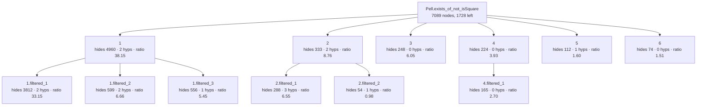

<!-- GENERATED by Rosette/Demo.lean (config `filtered`); do not edit. -->

### Original statement

```lean
Pell.exists_of_not_isSquare {d : ℤ} (h₀ : 0 < d) (hd : ¬IsSquare d) :
  ∃ x y, x ^ 2 - d * y ^ 2 = 1 ∧ y ≠ 0
```

- proof term: **7089** nodes as a DAG (shared subterms once), **319530** as a tree
- candidate boundaries enumerated (Prop-typed subterms of DAG size ≥ 20): 948, of which 13 are typeclass-instance proofs and 9 are values of a `have`
- config `filtered`: levels k = [6, 3], minProof 40, maxStmt 150, maxFraction 0.800000
- result: 12 lemmas in the tree (6 called directly by the main proof); main proof 7089 → **1728** nodes
- kernel check: `Pell.exists_of_not_isSquare.filtered` and all 12 lemmas were added with `addDecl` (synchronous kernel check) and are `theorem`s; `Pell.exists_of_not_isSquare.filtered` has the identical statement; axioms of the lifted version: [propext, Classical.choice, Quot.sound] (no new axiom)

### Recovered skeleton



- **`1`** — hides 4960 proof nodes (tree 265979) · statement 130 nodes · hidingRatio 38.15 · binders: 2 hypotheses, 0 instances (4 supplied from the caller's context) · was `haveBody` in its parent proof, head `Exists.casesOn` · own proof 5166 → 208 nodes after lifting its children

  ```lean
  Pell.exists_of_not_isSquare.filtered_1 {d : ℤ} (hd : ¬IsSquare d) (M : ℤ)
    (hM : {q | |q.num ^ 2 - d * ↑q.den ^ 2| < M}.Infinite) : ∃ x y, x ^ 2 - d * y ^ 2 = 1 ∧ y ≠ 0
  ```
  - **`1.filtered_1`** — hides 3812 proof nodes (tree 238150) · statement 115 nodes · hidingRatio 33.15 · binders: 2 hypotheses, 0 instances (4 supplied from the caller's context) · was `haveBody` in its parent proof, head `«(none)»`

    ```lean
    Pell.exists_of_not_isSquare.filtered_1.filtered_1 {d : ℤ} (m : ℤ)
      (hm : {q | q.num ^ 2 - d * ↑q.den ^ 2 = m}.Infinite) (hm₀ : m ≠ 0) :
      ∃ x y, x ^ 2 - d * y ^ 2 = 1 ∧ y ≠ 0
    ```
  - **`1.filtered_2`** — hides 599 proof nodes (tree 8201) · statement 90 nodes · hidingRatio 6.66 · binders: 2 hypotheses, 0 instances (2 supplied from the caller's context) · was `arg` in its parent proof, head `«(none)»`

    ```lean
    Pell.exists_of_not_isSquare.filtered_1.filtered_2 {d : ℤ} (hd : ¬IsSquare d)
      (hm : {q | q.num ^ 2 - d * ↑q.den ^ 2 = 0}.Infinite) : False
    ```
  - **`1.filtered_3`** — hides 556 proof nodes (tree 18607) · statement 102 nodes · hidingRatio 5.45 · binders: 1 hypotheses, 0 instances (2 supplied from the caller's context) · was `arg` in its parent proof, head `Eq.mpr`

    ```lean
    Pell.exists_of_not_isSquare.filtered_1.filtered_3 {d : ℤ} (M : ℤ) :
      (¬∃ m, {q | q.num ^ 2 - d * ↑q.den ^ 2 = m}.Infinite) →
        ¬{q | |q.num ^ 2 - d * ↑q.den ^ 2| < M}.Infinite
    ```
- **`2`** — hides 333 proof nodes (tree 3193) · statement 38 nodes · hidingRatio 8.76 · binders: 2 hypotheses, 0 instances (3 supplied from the caller's context) · was `haveValue` in its parent proof, head `irrational_nrt_of_notint_nrt` · own proof 367 → 104 nodes after lifting its children

  ```lean
  Pell.exists_of_not_isSquare.filtered_2 {d : ℤ} (h₀ : 0 < d) (hd : ¬IsSquare d) :
    let ξ := √↑d;
    Irrational ξ
  ```
  - **`2.filtered_1`** — hides 288 proof nodes (tree 3017) · statement 44 nodes · hidingRatio 6.55 · binders: 3 hypotheses, 0 instances (3 supplied from the caller's context) · was `arg` in its parent proof, head `«(none)»`

    ```lean
    Pell.exists_of_not_isSquare.filtered_2.filtered_1 {d : ℤ} (h₀ : 0 < d) (hd : ¬IsSquare d) :
      let ξ := √↑d;
      ∀ (x : ℤ), ξ = ↑x → False
    ```
  - **`2.filtered_2`** — hides 54 proof nodes (tree 63) · statement 55 nodes · hidingRatio 0.98 · binders: 1 hypotheses, 0 instances (2 supplied from the caller's context) · was `arg` in its parent proof, head `Real.sq_sqrt`

    ```lean
    Pell.exists_of_not_isSquare.filtered_2.filtered_2 {d : ℤ} (h₀ : 0 < d) : √↑d ^ 2 = ↑d
    ```
- **`3`** — hides 248 proof nodes (tree 1407) · statement 41 nodes · hidingRatio 6.05 · binders: 0 hypotheses, 0 instances (1 supplied from the caller's context) · was `haveValue` in its parent proof, head `cast`

  ```lean
  Pell.exists_of_not_isSquare.filtered_3 (q : ℚ) : ↑q.num / ↑q.den = ↑q
  ```
- **`4`** — hides 224 proof nodes (tree 1663) · statement 57 nodes · hidingRatio 3.93 · binders: 0 hypotheses, 0 instances (1 supplied from the caller's context) · was `arg` in its parent proof, head `Eq.mpr` · own proof 225 → 142 nodes after lifting its children

  ```lean
  Pell.exists_of_not_isSquare.filtered_4 (q : ℚ) : 1 ≤ ↑q.den ^ 2
  ```
  - **`4.filtered_1`** — hides 165 proof nodes (tree 919) · statement 61 nodes · hidingRatio 2.70 · binders: 0 hypotheses, 0 instances (1 supplied from the caller's context) · was `arg` in its parent proof, head `Eq.mpr`

    ```lean
    Pell.exists_of_not_isSquare.filtered_4.filtered_1 (q : ℚ) : 1 ≤ |↑q.den|
    ```
- **`5`** — hides 112 proof nodes (tree 273) · statement 70 nodes · hidingRatio 1.60 · binders: 1 hypotheses, 0 instances (2 supplied from the caller's context) · was `arg` in its parent proof, head `Real.sq_sqrt`

  ```lean
  Pell.exists_of_not_isSquare.filtered_5 {d : ℤ} (h₀ : 0 < d) : √↑d ^ 2 = ↑d
  ```
- **`6`** — hides 74 proof nodes (tree 101) · statement 49 nodes · hidingRatio 1.51 · binders: 0 hypotheses, 0 instances (1 supplied from the caller's context) · was `arg` in its parent proof, head `Iff.mpr`

  ```lean
  Pell.exists_of_not_isSquare.filtered_6 (q : ℚ) : 0 < ↑q.den
  ```
