<!-- GENERATED by Rosette/Demo.lean (config `lifted`); do not edit. -->

### Original statement

```lean
Pell.exists_of_not_isSquare {d : ℤ} (h₀ : 0 < d) (hd : ¬IsSquare d) :
  ∃ x y, x ^ 2 - d * y ^ 2 = 1 ∧ y ≠ 0
```

- proof term: **7089** nodes as a DAG (shared subterms once), **319530** as a tree
- candidate boundaries enumerated (Prop-typed subterms of DAG size ≥ 20): 948, of which 13 are typeclass-instance proofs and 9 are values of a `have`
- config `lifted`: levels k = [6, 3], minProof 40, maxStmt 150, maxFraction 0.800000
- result: 18 lemmas in the tree (6 called directly by the main proof); main proof 7089 → **1724** nodes
- kernel check: `Pell.exists_of_not_isSquare.lifted` and all 18 lemmas were added with `addDecl` (synchronous kernel check) and are `theorem`s; `Pell.exists_of_not_isSquare.lifted` has the identical statement; axioms of the lifted version: [propext, Classical.choice, Quot.sound] (no new axiom)

### Recovered skeleton

```mermaid
graph TD
  T["Pell.exists_of_not_isSquare<br/>7089 nodes, 1724 left"]
  T --> L1["1<br/>hides 4960 · 2 hyps · ratio 38.15"]
  L1 --> L1_lifted_1["1.lifted_1<br/>hides 3812 · 2 hyps · ratio 33.15"]
  L1 --> L1_lifted_2["1.lifted_2<br/>hides 599 · 2 hyps · ratio 6.66"]
  L1 --> L1_lifted_3["1.lifted_3<br/>hides 562 · 1 hyps · ratio 5.51"]
  T --> L2["2<br/>hides 333 · 2 hyps · ratio 8.76"]
  L2 --> L2_lifted_1["2.lifted_1<br/>hides 288 · 3 hyps · ratio 6.55"]
  L2 --> L2_lifted_2["2.lifted_2<br/>hides 54 · 1 hyps · ratio 0.98"]
  T --> L3["3<br/>hides 248 · 0 hyps · ratio 6.05"]
  L3 --> L3_lifted_1["3.lifted_1<br/>hides 156 · 0 hyps · ratio 2.79"]
  L3 --> L3_lifted_2["3.lifted_2<br/>hides 112 · 0 hyps · ratio 2.07"]
  T --> L4["4<br/>hides 224 · 0 hyps · ratio 3.93"]
  L4 --> L4_lifted_1["4.lifted_1<br/>hides 165 · 0 hyps · ratio 2.70"]
  L4 --> L4_lifted_2["4.lifted_2<br/>hides 134 · 0 hyps · ratio 1.34"]
  T --> L5["5<br/>hides 72 · 0 hyps · ratio 2.32"]
  L5 --> L5_lifted_1["5.lifted_1<br/>hides 46 · 0 hyps · ratio 2.00"]
  L5 --> L5_lifted_2["5.lifted_2<br/>hides 48 · 0 hyps · ratio 0.86"]
  T --> L6["6<br/>hides 144 · 1 hyps · ratio 2.06"]
  L6 --> L6_lifted_1["6.lifted_1<br/>hides 112 · 1 hyps · ratio 1.60"]
```



- **`1`** — hides 4960 proof nodes (tree 265979) · statement 130 nodes · hidingRatio 38.15 · binders: 2 hypotheses, 0 instances (4 supplied from the caller's context) · was `haveBody` in its parent proof, head `Exists.casesOn` · own proof 5166 → 194 nodes after lifting its children

  ```lean
  Pell.exists_of_not_isSquare.lifted_1 {d : ℤ} (hd : ¬IsSquare d) (M : ℤ)
    (hM : {q | |q.num ^ 2 - d * ↑q.den ^ 2| < M}.Infinite) : ∃ x y, x ^ 2 - d * y ^ 2 = 1 ∧ y ≠ 0
  ```
  - **`1.lifted_1`** — hides 3812 proof nodes (tree 238150) · statement 115 nodes · hidingRatio 33.15 · binders: 2 hypotheses, 0 instances (4 supplied from the caller's context) · was `haveBody` in its parent proof, head `«(none)»`

    ```lean
    Pell.exists_of_not_isSquare.lifted_1.lifted_1 {d : ℤ} (m : ℤ)
      (hm : {q | q.num ^ 2 - d * ↑q.den ^ 2 = m}.Infinite) (hm₀ : m ≠ 0) :
      ∃ x y, x ^ 2 - d * y ^ 2 = 1 ∧ y ≠ 0
    ```
  - **`1.lifted_2`** — hides 599 proof nodes (tree 8201) · statement 90 nodes · hidingRatio 6.66 · binders: 2 hypotheses, 0 instances (2 supplied from the caller's context) · was `arg` in its parent proof, head `«(none)»`

    ```lean
    Pell.exists_of_not_isSquare.lifted_1.lifted_2 {d : ℤ} (hd : ¬IsSquare d)
      (hm : {q | q.num ^ 2 - d * ↑q.den ^ 2 = 0}.Infinite) : False
    ```
  - **`1.lifted_3`** — hides 562 proof nodes (tree 18883) · statement 102 nodes · hidingRatio 5.51 · binders: 1 hypotheses, 0 instances (3 supplied from the caller's context) · was `arg` in its parent proof, head `Mathlib.Tactic.Contrapose.contrapose₁`

    ```lean
    Pell.exists_of_not_isSquare.lifted_1.lifted_3 {d : ℤ} (M : ℤ)
      (hM : {q | |q.num ^ 2 - d * ↑q.den ^ 2| < M}.Infinite) :
      ∃ m, {q | q.num ^ 2 - d * ↑q.den ^ 2 = m}.Infinite
    ```
- **`2`** — hides 333 proof nodes (tree 3193) · statement 38 nodes · hidingRatio 8.76 · binders: 2 hypotheses, 0 instances (3 supplied from the caller's context) · was `haveValue` in its parent proof, head `irrational_nrt_of_notint_nrt` · own proof 367 → 104 nodes after lifting its children

  ```lean
  Pell.exists_of_not_isSquare.lifted_2 {d : ℤ} (h₀ : 0 < d) (hd : ¬IsSquare d) :
    let ξ := √↑d;
    Irrational ξ
  ```
  - **`2.lifted_1`** — hides 288 proof nodes (tree 3017) · statement 44 nodes · hidingRatio 6.55 · binders: 3 hypotheses, 0 instances (3 supplied from the caller's context) · was `arg` in its parent proof, head `«(none)»`

    ```lean
    Pell.exists_of_not_isSquare.lifted_2.lifted_1 {d : ℤ} (h₀ : 0 < d) (hd : ¬IsSquare d) :
      let ξ := √↑d;
      ∀ (x : ℤ), ξ = ↑x → False
    ```
  - **`2.lifted_2`** — hides 54 proof nodes (tree 63) · statement 55 nodes · hidingRatio 0.98 · binders: 1 hypotheses, 0 instances (2 supplied from the caller's context) · was `arg` in its parent proof, head `Real.sq_sqrt`

    ```lean
    Pell.exists_of_not_isSquare.lifted_2.lifted_2 {d : ℤ} (h₀ : 0 < d) : √↑d ^ 2 = ↑d
    ```
- **`3`** — hides 248 proof nodes (tree 1407) · statement 41 nodes · hidingRatio 6.05 · binders: 0 hypotheses, 0 instances (1 supplied from the caller's context) · was `haveValue` in its parent proof, head `cast` · own proof 249 → 97 nodes after lifting its children

  ```lean
  Pell.exists_of_not_isSquare.lifted_3 (q : ℚ) : ↑q.num / ↑q.den = ↑q
  ```
  - **`3.lifted_1`** — hides 156 proof nodes (tree 723) · statement 56 nodes · hidingRatio 2.79 · binders: 0 hypotheses, 0 instances (1 supplied from the caller's context) · was `arg` in its parent proof, head `Eq.symm`

    ```lean
    Pell.exists_of_not_isSquare.lifted_3.lifted_1 (q : ℚ) :
      (Rat.divInt q.num ↑q.den = q) = (↑q.num / ↑q.den = ↑q)
    ```
  - **`3.lifted_2`** — hides 112 proof nodes (tree 461) · statement 54 nodes · hidingRatio 2.07 · binders: 0 hypotheses, 0 instances (1 supplied from the caller's context) · was `arg` in its parent proof, head `congrFun'`

    ```lean
    Pell.exists_of_not_isSquare.lifted_3.lifted_2 (q : ℚ) :
      (↑q.num / ↑q.den = q) = (↑(Rat.divInt q.num ↑q.den) = q)
    ```
- **`4`** — hides 224 proof nodes (tree 1663) · statement 57 nodes · hidingRatio 3.93 · binders: 0 hypotheses, 0 instances (1 supplied from the caller's context) · was `arg` in its parent proof, head `Eq.mpr` · own proof 225 → 104 nodes after lifting its children

  ```lean
  Pell.exists_of_not_isSquare.lifted_4 (q : ℚ) : 1 ≤ ↑q.den ^ 2
  ```
  - **`4.lifted_1`** — hides 165 proof nodes (tree 919) · statement 61 nodes · hidingRatio 2.70 · binders: 0 hypotheses, 0 instances (1 supplied from the caller's context) · was `arg` in its parent proof, head `Eq.mpr`

    ```lean
    Pell.exists_of_not_isSquare.lifted_4.lifted_1 (q : ℚ) : 1 ≤ |↑q.den|
    ```
  - **`4.lifted_2`** — hides 134 proof nodes (tree 583) · statement 100 nodes · hidingRatio 1.34 · binders: 0 hypotheses, 0 instances (1 supplied from the caller's context) · was `arg` in its parent proof, head `id`

    ```lean
    Pell.exists_of_not_isSquare.lifted_4.lifted_2 (q : ℚ) : (1 ≤ ↑q.den ^ 2) = (1 ≤ |↑q.den|)
    ```
- **`5`** — hides 72 proof nodes (tree 151) · statement 31 nodes · hidingRatio 2.32 · binders: 0 hypotheses, 0 instances (0 supplied from the caller's context) · was `arg` in its parent proof, head `IsLeftCancelAdd.addLeftReflectLE_of_addLeftReflectLT` · statement is a typeclass · own proof 72 → 29 nodes after lifting its children

  ```lean
  Pell.exists_of_not_isSquare.lifted_5 : AddLeftReflectLE ℝ
  ```
  - **`5.lifted_1`** — hides 46 proof nodes (tree 57) · statement 23 nodes · hidingRatio 2.00 · binders: 0 hypotheses, 0 instances (0 supplied from the caller's context) · was `arg` in its parent proof, head `instIsLeftCancelAddOfAddLeftReflectLE` · statement is a typeclass

    ```lean
    Pell.exists_of_not_isSquare.lifted_5.lifted_1 : IsLeftCancelAdd ℝ
    ```
  - **`5.lifted_2`** — hides 48 proof nodes (tree 61) · statement 56 nodes · hidingRatio 0.86 · binders: 0 hypotheses, 0 instances (0 supplied from the caller's context) · was `arg` in its parent proof, head `contravariant_lt_of_covariant_le` · statement is a typeclass

    ```lean
    Pell.exists_of_not_isSquare.lifted_5.lifted_2 :
      ContravariantClass ℝ ℝ (fun x1 x2 => x1 + x2) fun x1 x2 => x1 < x2
    ```
- **`6`** — hides 144 proof nodes (tree 369) · statement 70 nodes · hidingRatio 2.06 · binders: 1 hypotheses, 0 instances (2 supplied from the caller's context) · was `arg` in its parent proof, head `Eq.symm` · own proof 147 → 74 nodes after lifting its children

  ```lean
  Pell.exists_of_not_isSquare.lifted_6 {d : ℤ} (h₀ : 0 < d) : ↑d = √↑d ^ 2
  ```
  - **`6.lifted_1`** — hides 112 proof nodes (tree 273) · statement 70 nodes · hidingRatio 1.60 · binders: 1 hypotheses, 0 instances (2 supplied from the caller's context) · was `arg` in its parent proof, head `Real.sq_sqrt`

    ```lean
    Pell.exists_of_not_isSquare.lifted_6.lifted_1 {d : ℤ} (h₀ : 0 < d) : √↑d ^ 2 = ↑d
    ```

### The `have` boundaries in the original proof term

Every value of a `have` (non-dependent `let`) in the elaborated term with proof DAG size ≥ 20, in source order. `rank` is the position among all 948 candidates sorted by hidingRatio (1 = best). The statement shown is the *closed* one: all hypotheses the proof of the `have` actually uses are quantified.

- rank 32/948 · ratio 8.76 · proof 333 · statement 38 · 2 hyps

  ```lean
  ∀ {d : ℤ}, 0 < d → ¬IsSquare d → let ξ := √↑d; Irrational ξ
  ```
- rank 31/948 · ratio 10.56 · proof 1922 · statement 182 · 3 hyps

  ```lean
  ∀ {d : ℤ}, 0 < d → let ξ := √↑d; Irrational ξ → ∀ (M : ℤ), 2 * |ξ| + 1 < ↑M → {q | |q.num ^ 2 - d * ↑q.den ^ 2| < M}.Infinite
  ```
- rank 321/948 · ratio 1.44 · proof 98 · statement 68 · 0 hyps

  ```lean
  ∀ (q : ℚ), 0 < ↑q.den ^ 2
  ```
- rank 50/948 · ratio 6.05 · proof 248 · statement 41 · 0 hyps

  ```lean
  ∀ (q : ℚ), ↑q.num / ↑q.den = ↑q
  ```
- rank 40/948 · ratio 6.54 · proof 621 · statement 95 · 2 hyps

  ```lean
  ∀ {d : ℤ}, ¬IsSquare d → ∀ (m : ℤ), {q | q.num ^ 2 - d * ↑q.den ^ 2 = m}.Infinite → m = 0 → False
  ```
- rank 188/948 · ratio 1.96 · proof 53 · statement 27 · 1 hyps · typeclass

  ```lean
  ∀ (m : ℤ), m ≠ 0 → NeZero m.natAbs
  ```
- rank 64/948 · ratio 4.93 · proof 873 · statement 177 · 3 hyps

  ```lean
  ∀ {d : ℤ} (m : ℤ), let f := fun q => (↑q.num, ↑q.den); ∀ (q₁ q₂ : ℚ), q₂ ∈ {q | q.num ^ 2 - d * ↑q.den ^ 2 = m} → (f q₁).1 = (f q₂).1 → (f q₁).2 = (f q₂).2 → m ∣ q₁.num * q₂.num - d * (↑q₁.den * ↑q₂.den)
  ```
- rank 147/948 · ratio 2.37 · proof 287 · statement 121 · 2 hyps

  ```lean
  ∀ (m : ℤ), let f := fun q => (↑q.num, ↑q.den); ∀ (q₁ q₂ : ℚ), (f q₁).1 = (f q₂).1 → (f q₁).2 = (f q₂).2 → m ∣ q₁.num * ↑q₂.den - q₂.num * ↑q₁.den
  ```
- rank 474/948 · ratio 1.16 · proof 64 · statement 55 · 1 hyps

  ```lean
  ∀ (m : ℤ), m ≠ 0 → ↑m ≠ 0
  ```
