<!-- GENERATED by Rosette/Demo.lean (config `wide`); do not edit. -->

### Original statement

```lean
Pell.exists_of_not_isSquare {d : ℤ} (h₀ : 0 < d) (hd : ¬IsSquare d) :
  ∃ x y, x ^ 2 - d * y ^ 2 = 1 ∧ y ≠ 0
```

- proof term: **7089** nodes as a DAG (shared subterms once), **319530** as a tree
- candidate boundaries enumerated (Prop-typed subterms of DAG size ≥ 20): 948, of which 13 are typeclass-instance proofs and 9 are values of a `have`
- config `wide`: levels k = [6, 3], minProof 40, maxStmt 500, maxFraction 0.500000
- result: 21 lemmas in the tree (6 called directly by the main proof); main proof 7089 → **673** nodes
- kernel check: `Pell.exists_of_not_isSquare.wide` and all 21 lemmas were added with `addDecl` (synchronous kernel check) and are `theorem`s; `Pell.exists_of_not_isSquare.wide` has the identical statement; axioms of the lifted version: [propext, Classical.choice, Quot.sound] (no new axiom)

### Recovered skeleton

```mermaid
graph TD
  T["Pell.exists_of_not_isSquare<br/>7089 nodes, 673 left"]
  T --> L1["1<br/>hides 3514 · 4 hyps · ratio 18.40"]
  L1 --> L1_wide_1["1.wide_1<br/>hides 1893 · 3 hyps · ratio 7.28"]
  L1 --> L1_wide_2["1.wide_2<br/>hides 664 · 3 hyps · ratio 6.32"]
  L1 --> L1_wide_3["1.wide_3<br/>hides 873 · 3 hyps · ratio 4.93"]
  T --> L2["2<br/>hides 1922 · 3 hyps · ratio 10.56"]
  L2 --> L2_wide_1["2.wide_1<br/>hides 248 · 0 hyps · ratio 6.05"]
  L2 --> L2_wide_2["2.wide_2<br/>hides 224 · 0 hyps · ratio 3.93"]
  L2 --> L2_wide_3["2.wide_3<br/>hides 112 · 1 hyps · ratio 1.60"]
  T --> L3["3<br/>hides 333 · 2 hyps · ratio 8.76"]
  L3 --> L3_wide_1["3.wide_1<br/>hides 152 · 1 hyps · ratio 1.69"]
  L3 --> L3_wide_2["3.wide_2<br/>hides 54 · 1 hyps · ratio 0.98"]
  L3 --> L3_wide_3["3.wide_3<br/>hides 59 · 1 hyps · ratio 0.84"]
  T --> L4["4<br/>hides 599 · 2 hyps · ratio 6.66"]
  L4 --> L4_wide_1["4.wide_1<br/>hides 266 · 1 hyps · ratio 2.66"]
  L4 --> L4_wide_2["4.wide_2<br/>hides 282 · 2 hyps · ratio 1.84"]
  L4 --> L4_wide_3["4.wide_3<br/>hides 42 · 0 hyps · ratio 1.75"]
  T --> L5["5<br/>hides 556 · 1 hyps · ratio 5.45"]
  L5 --> L5_wide_1["5.wide_1<br/>hides 180 · 0 hyps · ratio 1.37"]
  L5 --> L5_wide_2["5.wide_2<br/>hides 47 · 0 hyps · ratio 1.12"]
  L5 --> L5_wide_3["5.wide_3<br/>hides 98 · 1 hyps · ratio 0.97"]
  T --> L6["6<br/>hides 75 · 0 hyps · ratio 0.75"]
```



- **`1`** — hides 3514 proof nodes (tree 234144) · statement 191 nodes · hidingRatio 18.40 · binders: 4 hypotheses, 0 instances (6 supplied from the caller's context) · was `arg` in its parent proof, head `«(none)»` · own proof 3890 → 1173 nodes after lifting its children

  ```lean
  Pell.exists_of_not_isSquare.wide_1 {d : ℤ} (m : ℤ) (hm₀ : m ≠ 0) :
    let f := fun q => (↑q.num, ↑q.den);
    ∀ q₁ ∈ {q | q.num ^ 2 - d * ↑q.den ^ 2 = m},
      ∀ q₂ ∈ {q | q.num ^ 2 - d * ↑q.den ^ 2 = m},
        q₁ ≠ q₂ ∧ f q₁ = f q₂ → ∃ x y, x ^ 2 - d * y ^ 2 = 1 ∧ y ≠ 0
  ```
  - **`1.wide_1`** — hides 1893 proof nodes (tree 140777) · statement 260 nodes · hidingRatio 7.28 · binders: 3 hypotheses, 0 instances (7 supplied from the caller's context) · was `arg` in its parent proof, head `Eq.mpr`

    ```lean
    Pell.exists_of_not_isSquare.wide_1.wide_1 {d : ℤ} (m : ℤ) (q₁ : ℚ)
      (h₁ : q₁ ∈ {q | q.num ^ 2 - d * ↑q.den ^ 2 = m}) (q₂ : ℚ)
      (h₂ : q₂ ∈ {q | q.num ^ 2 - d * ↑q.den ^ 2 = m}) (hm₀ : ↑m ≠ 0) :
      ((↑q₁.num * ↑q₂.num - ↑d * (↑q₁.den * ↑q₂.den)) / ↑m) ^ 2 -
          ↑d * ((↑q₁.num * ↑q₂.den - ↑q₂.num * ↑q₁.den) / ↑m) ^ 2 =
        1
    ```
  - **`1.wide_2`** — hides 664 proof nodes (tree 15775) · statement 105 nodes · hidingRatio 6.32 · binders: 3 hypotheses, 0 instances (6 supplied from the caller's context) · was `arg` in its parent proof, head `Eq.mpr`

    ```lean
    Pell.exists_of_not_isSquare.wide_1.wide_2 (m : ℤ) (q₁ q₂ : ℚ) (hne : q₁ ≠ q₂)
      (hd₂ : m ∣ q₁.num * ↑q₂.den - q₂.num * ↑q₁.den) (hm₀ : ↑m ≠ 0) :
      (q₁.num * ↑q₂.den - q₂.num * ↑q₁.den) / m ≠ 0
    ```
  - **`1.wide_3`** — hides 873 proof nodes (tree 43729) · statement 177 nodes · hidingRatio 4.93 · binders: 3 hypotheses, 0 instances (7 supplied from the caller's context) · was `haveValue` in its parent proof, head `Eq.mpr`

    ```lean
    Pell.exists_of_not_isSquare.wide_1.wide_3 {d : ℤ} (m : ℤ) :
      let f := fun q => (↑q.num, ↑q.den);
      ∀ (q₁ q₂ : ℚ),
        q₂ ∈ {q | q.num ^ 2 - d * ↑q.den ^ 2 = m} →
          (f q₁).1 = (f q₂).1 → (f q₁).2 = (f q₂).2 → m ∣ q₁.num * q₂.num - d * (↑q₁.den * ↑q₂.den)
    ```
- **`2`** — hides 1922 proof nodes (tree 49561) · statement 182 nodes · hidingRatio 10.56 · binders: 3 hypotheses, 0 instances (5 supplied from the caller's context) · was `haveValue` in its parent proof, head `Set.Infinite.mono` · own proof 1975 → 1683 nodes after lifting its children

  ```lean
  Pell.exists_of_not_isSquare.wide_2 {d : ℤ} (h₀ : 0 < d) :
    let ξ := √↑d;
    Irrational ξ → ∀ (M : ℤ), 2 * |ξ| + 1 < ↑M → {q | |q.num ^ 2 - d * ↑q.den ^ 2| < M}.Infinite
  ```
  - **`2.wide_1`** — hides 248 proof nodes (tree 1407) · statement 41 nodes · hidingRatio 6.05 · binders: 0 hypotheses, 0 instances (1 supplied from the caller's context) · was `haveValue` in its parent proof, head `cast`

    ```lean
    Pell.exists_of_not_isSquare.wide_2.wide_1 (q : ℚ) : ↑q.num / ↑q.den = ↑q
    ```
  - **`2.wide_2`** — hides 224 proof nodes (tree 1663) · statement 57 nodes · hidingRatio 3.93 · binders: 0 hypotheses, 0 instances (1 supplied from the caller's context) · was `arg` in its parent proof, head `Eq.mpr`

    ```lean
    Pell.exists_of_not_isSquare.wide_2.wide_2 (q : ℚ) : 1 ≤ ↑q.den ^ 2
    ```
  - **`2.wide_3`** — hides 112 proof nodes (tree 273) · statement 70 nodes · hidingRatio 1.60 · binders: 1 hypotheses, 0 instances (2 supplied from the caller's context) · was `arg` in its parent proof, head `Real.sq_sqrt`

    ```lean
    Pell.exists_of_not_isSquare.wide_2.wide_3 {d : ℤ} (h₀ : 0 < d) : √↑d ^ 2 = ↑d
    ```
- **`3`** — hides 333 proof nodes (tree 3193) · statement 38 nodes · hidingRatio 8.76 · binders: 2 hypotheses, 0 instances (3 supplied from the caller's context) · was `haveValue` in its parent proof, head `irrational_nrt_of_notint_nrt` · own proof 367 → 283 nodes after lifting its children

  ```lean
  Pell.exists_of_not_isSquare.wide_3 {d : ℤ} (h₀ : 0 < d) (hd : ¬IsSquare d) :
    let ξ := √↑d;
    Irrational ξ
  ```
  - **`3.wide_1`** — hides 152 proof nodes (tree 1519) · statement 90 nodes · hidingRatio 1.69 · binders: 1 hypotheses, 0 instances (3 supplied from the caller's context) · was `arg` in its parent proof, head `Eq.mpr`

    ```lean
    Pell.exists_of_not_isSquare.wide_3.wide_1 {d : ℤ} :
      let ξ := √↑d;
      ∀ (x : ℤ), ξ = ↑x → √↑d ^ 2 = ↑x * ↑x
    ```
  - **`3.wide_2`** — hides 54 proof nodes (tree 63) · statement 55 nodes · hidingRatio 0.98 · binders: 1 hypotheses, 0 instances (2 supplied from the caller's context) · was `arg` in its parent proof, head `Real.sq_sqrt`

    ```lean
    Pell.exists_of_not_isSquare.wide_3.wide_2 {d : ℤ} (h₀ : 0 < d) : √↑d ^ 2 = ↑d
    ```
  - **`3.wide_3`** — hides 59 proof nodes (tree 83) · statement 70 nodes · hidingRatio 0.84 · binders: 1 hypotheses, 0 instances (2 supplied from the caller's context) · was `arg` in its parent proof, head `Real.sq_sqrt`

    ```lean
    Pell.exists_of_not_isSquare.wide_3.wide_3 {d : ℤ} (h₀ : 0 < d) : √↑d ^ 2 = ↑d
    ```
- **`4`** — hides 599 proof nodes (tree 8201) · statement 90 nodes · hidingRatio 6.66 · binders: 2 hypotheses, 0 instances (2 supplied from the caller's context) · was `arg` in its parent proof, head `«(none)»` · own proof 643 → 327 nodes after lifting its children

  ```lean
  Pell.exists_of_not_isSquare.wide_4 {d : ℤ} (hd : ¬IsSquare d)
    (hm : {q | q.num ^ 2 - d * ↑q.den ^ 2 = 0}.Infinite) : False
  ```
  - **`4.wide_1`** — hides 266 proof nodes (tree 2675) · statement 100 nodes · hidingRatio 2.66 · binders: 1 hypotheses, 0 instances (3 supplied from the caller's context) · was `arg` in its parent proof, head `Iff.mp`

    ```lean
    Pell.exists_of_not_isSquare.wide_4.wide_1 {d : ℤ} (q : ℚ)
      (hq : q ∈ {q | q.num ^ 2 - d * ↑q.den ^ 2 = 0}) : ↑q.den ∣ q.num
    ```
  - **`4.wide_2`** — hides 282 proof nodes (tree 3487) · statement 153 nodes · hidingRatio 1.84 · binders: 2 hypotheses, 0 instances (5 supplied from the caller's context) · was `arg` in its parent proof, head `Eq.mp`

    ```lean
    Pell.exists_of_not_isSquare.wide_4.wide_2 {d : ℤ} (q : ℚ)
      (hq : q ∈ {q | q.num ^ 2 - d * ↑q.den ^ 2 = 0}) (a : ℤ) (ha : q.num = ↑q.den * a) :
      ↑q.den ^ 2 * a ^ 2 = ↑q.den ^ 2 * d
    ```
  - **`4.wide_3`** — hides 42 proof nodes (tree 57) · statement 24 nodes · hidingRatio 1.75 · binders: 0 hypotheses, 0 instances (1 supplied from the caller's context) · was `arg` in its parent proof, head `Iff.mpr`

    ```lean
    Pell.exists_of_not_isSquare.wide_4.wide_3 (q : ℚ) : 0 < ↑q.den
    ```
- **`5`** — hides 556 proof nodes (tree 18607) · statement 102 nodes · hidingRatio 5.45 · binders: 1 hypotheses, 0 instances (2 supplied from the caller's context) · was `arg` in its parent proof, head `Eq.mpr` · own proof 617 → 553 nodes after lifting its children

  ```lean
  Pell.exists_of_not_isSquare.wide_5 {d : ℤ} (M : ℤ) :
    (¬∃ m, {q | q.num ^ 2 - d * ↑q.den ^ 2 = m}.Infinite) →
      ¬{q | |q.num ^ 2 - d * ↑q.den ^ 2| < M}.Infinite
  ```
  - **`5.wide_1`** — hides 180 proof nodes (tree 2851) · statement 131 nodes · hidingRatio 1.37 · binders: 0 hypotheses, 0 instances (3 supplied from the caller's context) · was `arg` in its parent proof, head `«(none)»`

    ```lean
    Pell.exists_of_not_isSquare.wide_5.wide_1 {d : ℤ} (M : ℤ) (x : ℚ) (i : ℤ) :
      (x ∈ ⋃ (_ : -M < i ∧ i < M), {q | q.num ^ 2 - d * ↑q.den ^ 2 = i}) =
        ((-M < i ∧ i < M) ∧ x.num ^ 2 - d * ↑x.den ^ 2 = i)
    ```
  - **`5.wide_2`** — hides 47 proof nodes (tree 85) · statement 42 nodes · hidingRatio 1.12 · binders: 0 hypotheses, 0 instances (2 supplied from the caller's context) · was `arg` in its parent proof, head `Iff.of_eq`

    ```lean
    Pell.exists_of_not_isSquare.wide_5.wide_2 (M i : ℤ) : i ∈ Set.Ioo (-M) M ↔ -M < i ∧ i < M
    ```
  - **`5.wide_3`** — hides 98 proof nodes (tree 165) · statement 101 nodes · hidingRatio 0.97 · binders: 1 hypotheses, 0 instances (3 supplied from the caller's context) · was `arg` in its parent proof, head `«(none)»`

    ```lean
    Pell.exists_of_not_isSquare.wide_5.wide_3 {d : ℤ} (M i : ℤ) (x : -M < i ∧ i < M) :
      {q | q.num ^ 2 - d * ↑q.den ^ 2 = i} = {q | q.num ^ 2 - d * ↑q.den ^ 2 = i}
    ```
- **`6`** — hides 75 proof nodes (tree 99) · statement 100 nodes · hidingRatio 0.75 · binders: 0 hypotheses, 0 instances (1 supplied from the caller's context) · was `arg` in its parent proof, head `exists_int_gt`

  ```lean
  Pell.exists_of_not_isSquare.wide_6 {d : ℤ} :
    let ξ := √↑d;
    ∃ n, 2 * |ξ| + 1 < ↑n
  ```
